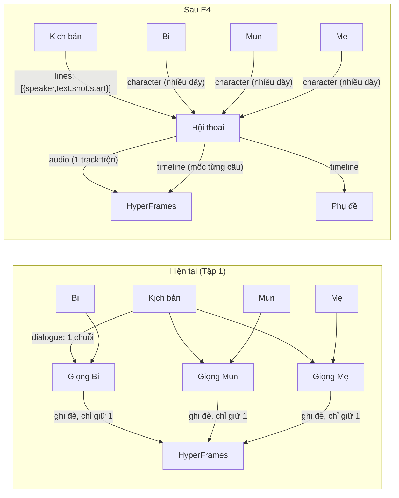

# E4 — Nhân vật tự nói theo kịch bản (node "Hội thoại" nhiều giọng)

> Trạng thái (2026-11-06): **Phần A "Lặp theo cảnh" + B2 "Cổng nhiều dây" ĐÃ LÀM** (xem mục 8). Phần Hội thoại (B1, B3–B6) **chưa làm**.
> **2026-11-06: B4 (node Hội thoại riêng) được đề xuất thay bằng `E5_character_actor_node.md`** (nhân vật tự có chức năng Nói và Ảnh). B1, B3, B5 vẫn dùng, E5 tham chiếu lại.
> Viết 2026-11-05 sau khi dựng flow Tập 1 (`ep01-nui-lua-trong-bung-bi`).
> Mục tiêu: nhân vật đã có voice thì chỉ cần nối nhân vật + kịch bản → ra giọng đúng người nói, không phải tạo 1 node giọng cho mỗi nhân vật và trích lời thoại bằng tay. Dùng chung cho hoạt hình (nhiều nhân vật) và KOC (1–2 người nói).

## 0. Hiện trạng (đã đọc code)

| # | Vấn đề | Vị trí | Hậu quả |
|---|---|---|---|
| H1 | Node `character` trả `defaultVoice: "soc-nho"` **gán cứng** cho mọi nhân vật, `name` cũng gán cứng | `core/engine/graph_runner.py` nhánh `character` (~dòng 570) | Nối Mun/Mẹ vào node giọng vẫn ra giọng Sóc Nhỏ; phải ghi đè `voiceId` tay |
| H2 | `voiceId` trong hồ sơ (`de_mun_v1`, `me_soc_v1`…) **không khớp** id kho giọng (`mun`, `soc-nho`) | `characters/studio_characters.json` ↔ `data/shared/voice_vault/` | Không tự tra được giọng từ nhân vật |
| H3 | Kho giọng thiếu: `mun` ở trạng thái `todo_clone` (chưa có mẫu), **Mẹ Sóc chưa có giọng** | `voice_vault/mun/voice.json` | Cần người dùng cấp mẫu giọng / chọn giọng có sẵn |
| H4 | Node `script` xuất `dialogue` là **1 chuỗi text**, không có người nói | nhánh `script` (~dòng 755) | Không định tuyến câu thoại theo nhân vật |
| H5 | Nhiều dây vào **cùng 1 cổng** thì dây sau **ghi đè** dây trước (`resolved[edge.target_port] = val`) | `_resolve_inputs` (~dòng 366–377) | `image_gen.references` chỉ nhận ảnh của nhân vật nối cuối; `hyperframes_render.voice` chỉ nhận 1 trong 3 giọng. **Flow Tập 1 hiện tại vì thế chỉ dựng được 1 giọng.** |
| H6 | `hyperframes_render` chỉ nhận 1 track giọng, không có mốc thời gian từng câu | nhánh render (~dòng 1018) | Không ghép được hội thoại nhiều người |

**Đã có sẵn, dùng lại được:**
- `core/engine/episode_script.py` → `parse_episode_markdown()` đã tách kịch bản tập thành từng shot có `speaker`, `dialogue`, `voiceDelivery`, `startSec/endSec`, `characters`.
- `core/engine/script_parser.py` (chế độ dán) đã giữ dạng `Tên: lời thoại`.
- `voice_tts` + `VoiceAdapter` (OmniVoice, mastering −14 LUFS) đọc được 1 đoạn text với 1 giọng.

## 1. Quyết định thiết kế

**Không gắn việc tạo giọng vào node Nhân vật.** Lý do: đổi lời thoại sẽ làm node nhân vật chạy lại → mọi keyframe nối từ `reference_images` bị đánh dấu lỗi thời; một node hai việc khó tính chi phí, khó ghim kết quả.

**Nâng cấp node giọng thành node "Hội thoại"** (giữ `voice_tts` cho trường hợp 1 đoạn đơn). Nhân vật chỉ là **nguồn dữ liệu** (DNA ảnh + voiceId); Hội thoại là **bộ phát**.



Flow KOC: `[KOC] → [Hội thoại] ← [Kịch bản]`, 1 node giọng cho cả 1 hay 2 người nói.

## 2. Hợp đồng dữ liệu mới

**Cổng `DIALOGUE`** (`PortType.DIALOGUE = "dialogue"`): danh sách câu thoại
```json
[{ "id": "S02-1", "speaker": "Dê Mun", "characterId": "de_mun",
   "text": "Anh Bi ơi! Mun mang quả bóng vải sang chơi…",
   "sceneIndex": 1, "shotId": "S02", "startSec": 20, "endSec": 40,
   "delivery": "Giọng em bé 3 tuổi líu lo" }]
```
**Cổng `TIMELINE`** (`PortType.TIMELINE = "timeline"`): mốc thời gian thật sau khi đọc
```json
[{ "lineId": "S02-1", "characterId": "de_mun", "audioStartSec": 20.0, "audioEndSec": 23.4, "text": "…" }]
```
Tương thích: `DIALOGUE → TEXT` được (nối thành chuỗi `Tên: câu`) để node cũ vẫn chạy.

**Cổng nhiều dây (multi):** `PortDefinition.multi: bool`. Cổng `multi` gom giá trị thành danh sách thay vì ghi đè. Áp cho: `dialogue.characters`, `image_gen.references`, `image_edit.references`, `video_gen.references`, `hyperframes_render.scenes`.

## 3. Các bước (làm đúng thứ tự, mỗi bước có test + commit riêng)

### B1 — Sửa node Nhân vật trả đúng dữ liệu (sửa lỗi, nhỏ)
- Nhánh `character` đọc hồ sơ thật từ `studio_characters.json` / `project.json`: `name`, `heightCm`, `promptLock`, `voiceId`, `defaultTempo`, `aliases` (tên gọi trong kịch bản: "Sóc Bi", "Bi", "Dê Mun", "Mun", "Mẹ Sóc"…).
- Hàm `resolve_voice_id(character)` → id kho giọng: thử `voiceId`, bỏ hậu tố `_v1`, đổi `_`↔`-`, tra `aliases` trong `voice_vault/*/voice.json`. Không thấy → trả `None` + cảnh báo rõ (không âm thầm dùng `soc-nho`).
- Bỏ giá trị gán cứng `"soc-nho"` trong nhánh `voice_tts` khi có `character` nối vào.
- Test: Bi → `soc-nho`; Mun → `mun` (cảnh báo `todo_clone`); Mẹ → `None` + cảnh báo.

### B2 — Cổng nhiều dây (sửa lỗi H5) — ✅ ĐÃ LÀM 2026-11-06 (cổng `image[]` và `scenes`; chưa có hiển thị `×N` trên UI)
- `PortDefinition.multi`, `_resolve_inputs` gom list cho cổng multi; validator cho phép nhiều dây vào cổng multi, cảnh báo khi nối nhiều dây vào cổng đơn.
- UI (`node-ports.ts`, `StudioCanvas`): cổng multi hiện số dây (`×3`), không xoá dây cũ khi nối thêm.
- Test: keyframe nối 3 nhân vật nhận đủ ảnh của cả 3.

### B3 — Kịch bản xuất lời thoại có cấu trúc
- Node `script` thêm cổng ra `lines` (DIALOGUE), giữ `dialogue` (TEXT) cũ.
- Nguồn dữ liệu theo chế độ: `mode=episode` (mới: `params.episodeId` → `parse_episode_markdown`, lấy thẳng `speaker/dialogue/startSec` từ file `KICH-BAN-TAP-xx.md`), `mode=paste` (`script_parser` tách `Tên: lời`), `mode=ai` (schema LLM thêm `speaker` cho từng câu).
- Ghép `speaker` → `characterId` qua `aliases` của nhân vật trong dự án; câu không ghép được → đánh dấu `unmatched`, hiện ngay trên card.
- Test: Tập 1 ra 30 câu (Bi 19, Mun 6, Mẹ 5), đúng shot và mốc thời gian.

### B4 — Node "Hội thoại" (`dialogue_voice`)
- Vào: `lines` (DIALOGUE, bắt buộc), `characters` (CHARACTER, **multi**), `text` (TEXT, tuỳ chọn cho 1 người nói).
- Ra: `audio` (AUDIO, 1 track trộn, master −14 LUFS), `timeline` (TIMELINE), `tracks` (AUDIO theo từng nhân vật, tuỳ chọn).
- Params: `voiceOverrides: {characterId: voiceId}`, `gapSec: 0.35`, `alignToShot: true` (đặt câu vào `startSec` của shot, dư thì kéo dài shot / thiếu thì chèn lặng), `tempoByCharacter`, `cache: true`.
- Chạy: đọc **từng câu** bằng `VoiceAdapter` (song song tối đa 2), cache theo hash `(voiceId, text, tempo)` → sửa 1 câu chỉ đọc lại 1 câu. Trộn bằng ffmpeg (chuỗi TikTok Mastering chuẩn trong `CLAUDE.md`).
- Tiến độ SSE theo câu: "Đọc 7/30 · Dê Mun".
- Card UI: danh sách câu theo người nói (avatar + màu), nghe thử từng câu, sửa text từng câu ngay trên card (dùng chung component với `NodeTab`).
- `voice_tts` giữ nguyên cho đoạn đơn; preset mới dùng `dialogue_voice`.

### B5 — Dựng phim & phụ đề dùng timeline
- `hyperframes_render`: nhận `timeline`; đặt giọng đúng mốc, BGM ducking theo khoảng có thoại; khi có timeline thì bỏ qua cổng `voice` đơn.
- `captions`: nhận `timeline` → phụ đề đúng người nói, không cần Whisper (vẫn dùng Whisper khi chỉ có audio).

### B6 — Cập nhật flow Tập 1 và preset
- Flow Tập 1: `script(mode=episode, episodeId=ep01-nui-lua-trong-bung-bi)` → `dialogue_voice` ← 3 nhân vật; bỏ 3 node `voice_tts` (31 → 29 node).
- Preset "KOC nói kịch bản": `character` + `script` → `dialogue_voice` → `hyperframes_render` → `export`.
- Ghi tham số mới vào `NODE_PARAMS_CONTRACT.md`.

## 4. Ngoài phạm vi (ghi nhận cho đợt sau)
- ~~Lặp theo cảnh~~ → đã làm, xem mục 8.
- Nhép môi (lip-sync) theo `timeline`.
- Clone giọng Mun / tạo giọng Mẹ Sóc: cần mẫu giọng được cấp phép (xem mục 6).

## 5. Nghiệm thu
1. Nối Mun vào `voice_tts` không ghi `voiceId` → đọc bằng giọng `mun` (hoặc báo rõ "Mun chưa có mẫu giọng"), không còn ra giọng Sóc Nhỏ.
2. Keyframe nối 3 nhân vật nhận đủ ảnh tham chiếu của cả 3.
3. Flow Tập 1 chạy Mock: `dialogue_voice` đọc 30 câu đúng người nói; sửa 1 câu → chỉ đọc lại 1 câu (kiểm log cache).
4. Video dựng ra có đủ 3 giọng đúng mốc shot; phụ đề khớp người nói (ffprobe + nghe thử 3 đoạn).
5. Flow KOC 1 người: 3 node là chạy được.
6. `pytest -q` pass; `npx tsc --noEmit` sạch; chụp `shots/E4_*.png`.

## 6. Cần người dùng cung cấp trước khi làm B4 thật
- **Giọng Mẹ Sóc:** chọn 1 giọng có sẵn trong kho (ví dụ `vn-bac-nu-01`…`vn-nam-nu-07`) hoặc cấp mẫu để clone.
- **Giọng Dê Mun:** mẫu giọng em bé được cấp phép (`mun` đang `todo_clone`), hoặc chọn tạm 1 giọng có sẵn.

## 7. File dự kiến chạm
`core/contracts/types.py` (PortType, `multi`), `core/nodes/registry.py`, `core/engine/graph_runner.py` (character, script, voice, render, captions, `_resolve_inputs`), `core/engine/validator.py`, `core/engine/episode_script.py` (xuất lines), mới `core/engine/dialogue_voice.py` + `tool/tests/test_dialogue_voice.py`; dashboard: `lib/node-ports.ts`, `lib/core-contracts.ts`, `components/canvas/NodeBody.tsx`, `StudioCanvas.tsx`, `lib/graph-presets.ts`; i18n vi/en.

## 8. Đã làm 2026-11-06 — Phần A: Lặp theo cảnh (flow Tập 1: 31 → 11 node)

**Tính năng (tương thích ngược: không nối cổng mới thì chạy như cũ)**
- `script` chế độ `episode` (`episodeId`, `granularity: shot|scene`) đọc thẳng `KICH-BAN-TAP-xx.md` qua `episode_script.py`; UI có nút thứ 3 "Kịch bản tập" (chọn tập, "Mỗi shot 1 ảnh / Mỗi cảnh 1 ảnh", đếm số shot/cảnh).
- `image_gen` cổng vào `scenes` → tạo mỗi cảnh 1 ảnh (tiến độ SSE "Tạo ảnh cảnh i/N"), cổng ra `scenes` đã gắn ảnh → nối thẳng `hyperframes_render.scenes`. Không cần node `scene` nữa.
- Ảnh tham chiếu lọc theo nhân vật có mặt trong cảnh (khớp tên kịch bản "Sóc Bi (100cm)" ↔ hồ sơ "Sóc Nhỏ (Bi)" bằng tên bỏ dấu); không khớp được thì dùng toàn bộ như cũ. Node `character` gắn thêm `aliases` (không đổi khoá cũ).
- Ước tính chi phí nhân theo số cảnh (để SpendGuard chặn đúng khi chạy thật: 30 shot × $0.03).
- `hyperframes_render` chuẩn hoá đường dẫn ảnh tương đối → tuyệt đối (node `scene` cũ trả `assets/x.png` trước đây bị bộ dựng bỏ qua).

**Lỗi có sẵn phát hiện & sửa khi kiểm chứng**
- Node bỏ qua (đã có kết quả) chỉ được khôi phục 1 artifact chính → mất `scenes`, `reference_images`, phụ đề… (render nhận 0 cảnh ở lần chạy thứ 2). Sửa: lưu ảnh chụp đầy đủ cổng ra `runs/_node_outputs/<graphId>/<nodeId>.json`, chỉ dùng khi cùng tham số + cùng chế độ mock/thật + tệp artifact còn; không có thì khôi phục kiểu cũ.
- `graph_runner.py` dùng `logger` mà không khai báo → node giọng lỗi `name 'logger' is not defined` thay vì rơi về giọng dự phòng. Đã khai báo.
- `tests/test_run_events.py` (và test khác) chạy trên dự án thật → **ghi đè `data/projects/soc-nho-tv/graph.json`** mỗi lần chạy pytest. Thêm `tests/conftest.py` sao lưu/khôi phục `graph.json` và dọn ảnh chụp cổng ra do test tạo.

**Kiểm chứng**: `tests/test_scene_batch.py` 11 test; toàn bộ pytest 198 pass, 5 lỗi có sẵn từ trước không đổi (content_policy, craft_index ×2, custom_ports ×2). Chạy Mock trên Studio: composition có đủ 30 ảnh đúng mốc 0/20/40… s, phụ đề đúng lời từng shot.

**Còn lại / chưa kiểm chứng**
- `hyperframes_render` vẫn cố định 1080×1920 (chưa theo `aspectRatio` 16:9 cho YouTube) và độ dài video theo độ dài track giọng (Mock 36 s ⇒ chỉ thấy 2 cảnh đầu) — cần Hội thoại (B4–B5) để giọng phủ đủ 10 phút.
- Cổng `voice` của render vẫn chỉ nhận 1 giọng (dây sau thắng) — giải quyết ở B4.
- Bước mastering ffmpeg của giọng từng treo 20+ phút một lần (raw 140 s) — chưa tìm nguyên nhân.
- Chưa chạy chế độ thật (ảnh Gemini).
