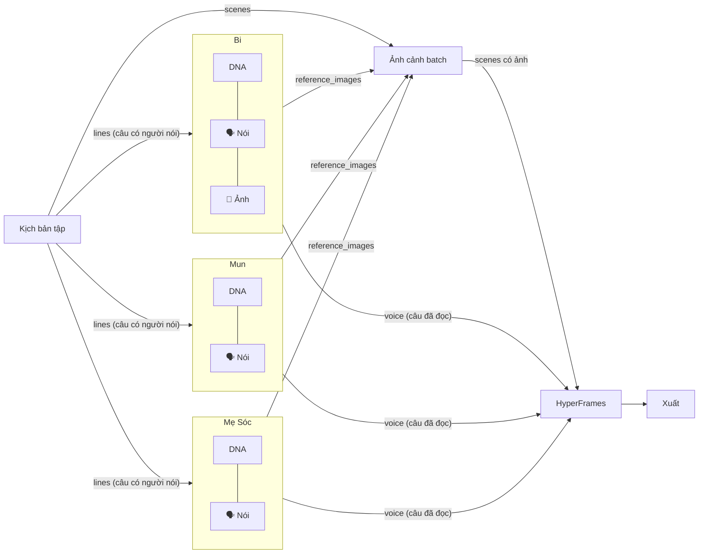

# E5 — Node Nhân vật biết nói và tự tạo ảnh theo kịch bản

> Viết 2026-11-06. Trạng thái: **Bước 1–6 ĐÃ LÀM (2026-11-06)**, xem mục 9–10. Bước 7 (Ảnh theo cảnh) và 8 (preset KOC, tài liệu còn lại) chưa làm.
> Thay phần B4 (node "Hội thoại" riêng) của `E4_dialogue_voice.md`. Giữ B1, B3, B5 của E4.
> Ý tưởng của người dùng: node Nhân vật có sẵn chức năng **nói** (đọc lời thoại của chính nhân vật trong kịch bản) và chức năng **tạo ảnh** (ảnh nhân vật hợp với từng cảnh), nhận text từ kịch bản.

## 0. Kết luận: khả thi

Khả thi, và hợp với cách hệ thống đã có:
- Node đã có **cổng động theo params** (`NodeRegistry.effective_ports`, `params._ports`). Bật/tắt chức năng thì cổng hiện/ẩn theo.
- Đọc giọng (`VoiceAdapter`, OmniVoice, mastering −14 LUFS) và tạo ảnh theo cảnh (`image_gen` batch, lọc ảnh tham chiếu theo nhân vật) **đã chạy được**. Node nhân vật chỉ gọi lại, không viết lại.
- Kịch bản tập đã tách sẵn từng câu có `speaker` (`episode_script.py`). Node nhân vật tự lọc câu của mình bằng `aliases`. Đây là hàm `_name_tokens` đã dùng cho lọc ảnh.

Ở E4 mình từng chọn **không** gắn giọng vào node nhân vật, vì 2 lý do. Cả 2 đều sửa được ở tầng engine:

| Lý do cũ | Cách xử lý trong E5 |
|---|---|
| Sửa 1 câu thoại thì node nhân vật chạy lại, mọi node nhận `reference_images` bị đánh dấu lỗi thời | **Lỗi thời theo từng cổng ra** (bước 1). Chỉ con nối vào cổng có dữ liệu thay đổi mới bị đánh dấu. Sửa câu thoại chỉ đổi cổng `voice`, ảnh DNA không đổi nên keyframe không bị đụng |
| Một node làm 2 việc thì khó tính chi phí và khó ghim kết quả | Mỗi chức năng có **khóa cache và ước tính chi phí riêng** (bước 2). Đọc giọng cache theo từng câu, tạo ảnh cache theo từng cảnh |

## 1. Thiết kế: Nhân vật = "Diễn viên" có các chức năng bật/tắt

**Chức năng (capability)** là một khối cắm vào node. Mỗi khối tự khai báo cổng vào, cổng ra, params, ước tính chi phí và khóa cache. Node nhân vật chỉ là vỏ chứa các khối:

| Chức năng | Bật bằng | Cổng vào thêm | Cổng ra thêm | Việc làm |
|---|---|---|---|---|
| **DNA** (luôn bật) | — | — | `character`, `reference_images` | Như hiện tại, sửa hồ sơ thật (B1 của E4) |
| **Nói** | `speak.enabled` | `lines` (DIALOGUE) hoặc `text` | `voice` (VOICE_CLIPS), `audio` (1 track gộp của riêng nhân vật) | Lọc câu của mình, đọc **từng câu** bằng `voiceId` của nhân vật |
| **Ảnh theo cảnh** | `draw.enabled` | `scenes` (SCENES) | `images`, `scenes` | Tạo ảnh nhân vật cho những cảnh nhân vật có mặt (biểu cảm, tư thế theo lời thoại và hành động) |
| Sau này | — | — | — | Nhép môi theo câu, video chuyển động của nhân vật, cảm xúc theo câu… thêm khối mới, **không đổi node** |

**Ranh giới "Ảnh theo cảnh"**: node nhân vật tạo ảnh **xoay quanh 1 nhân vật** (chân dung, biểu cảm, tư thế, ảnh tách nền để ghép). Cảnh có **nhiều nhân vật cùng khung** vẫn nên dùng 1 node ảnh cảnh batch nhận ảnh tham chiếu của cả 3. Nếu 3 node nhân vật mỗi node tự vẽ cả khung cảnh thì sẽ ra 3 bức khác nhau cho cùng 1 shot, tốn gấp 3 và lệch bối cảnh. Hai cách dùng:
- *Hoạt hình kiểu ghép lớp* (nền + nhân vật tách nền + chuyển động GSAP): bật **Ảnh** trên từng nhân vật, nền lấy từ node ảnh cảnh, HyperFrames ghép lại.
- *Hoạt hình khung hoàn chỉnh* (mỗi shot là 1 bức tranh đủ nhân vật): tắt **Ảnh** trên nhân vật, dùng node ảnh cảnh batch như flow hiện tại.

## 2. Hợp đồng dữ liệu

- `DIALOGUE` (từ kịch bản, giống E4): `[{id, speaker, characterId?, text, shotId, sceneIndex, startSec, endSec, delivery}]`.
- `VOICE_CLIPS` (mới, ra từ chức năng Nói): `[{lineId, characterId, text, audio: Artifact, durationSec, shotId, order}]`.
  Mỗi câu là 1 file riêng, chưa đặt mốc thời gian. Cổng `voice` của render là **cổng danh sách**: nhận nhiều dây, gộp nối tiếp, giống `image[]`/`scenes` đã làm.
- **Mốc thời gian do bộ dựng tính.** Từng node nhân vật chạy độc lập nên không biết câu của người khác dài bao nhiêu. Nếu mỗi node tự đặt mốc thì 2 người nói cùng shot sẽ chồng tiếng. `hyperframes_render` gom tất cả clip, xếp theo thứ tự câu trong kịch bản, chèn nghỉ `gapSec`, kéo dài shot nếu thoại dài hơn. Từ đó ra `timeline` để ducking BGM và làm phụ đề (B5 của E4).
- Tương thích ngược: `voice_tts` giữ nguyên. Cổng `audio` đơn của render vẫn chạy như cũ khi không có `voice`.

## 3. Các bước (mỗi bước có test và commit riêng, không phá logic cũ)

### Bước 1 — Engine: lỗi thời theo từng cổng ra *(nền móng, làm trước)*
- Sau khi node chạy lại, so từng cổng ra với ảnh chụp lần trước (`runs/_node_outputs`, đã có). Mỗi dây chỉ đánh dấu con lỗi thời khi **cổng nguồn của dây đó đổi**. Hiện tại thì mọi con trực tiếp đều bị đánh dấu (`graph_runner.py`, đoạn `direct_children … is_stale = True`).
- So bằng chữ ký: artifact id hoặc hash nội dung cho text/list.
- Có lợi cho mọi node, không riêng nhân vật.
- Test: đổi câu thoại thì keyframe không lỗi thời, render lỗi thời. Đổi `characterId` thì cả hai lỗi thời.

### Bước 2 — Khung "chức năng" cho node
- Mới `core/nodes/capabilities.py`: `Capability(name, input_ports, output_ports, default_params, estimate_cost(), cache_key(), run())`.
- `effective_ports` của node có chức năng thì gộp cổng của các chức năng đang bật (vẫn tôn trọng `params._ports` ghi đè).
- Runner: node có chức năng thì chạy lần lượt từng khối đang bật. **Khối nào có `cache_key` không đổi thì lấy lại kết quả**, không gọi lại provider. Ước tính chi phí bằng tổng các khối (SpendGuard chặn đúng).
- Test: bật hoặc tắt chức năng thì cổng hiện hoặc ẩn. Dây nối vào cổng bị ẩn thì validator cảnh báo, không âm thầm xoá.

### Bước 3 — Sửa hồ sơ nhân vật (= B1 của E4)
- Nhánh `character` đọc hồ sơ thật (`name`, `heightCm`, `promptLock`, `voiceId`, `aliases`). Bỏ `"soc-nho"` và `"100cm"` đang gán cứng.
- `resolve_voice_id`: `soc_nho_v1` thành `soc-nho`, `de_mun_v1` thành `mun`, `de_bong_v1` thành `bong`, `cho_lu_v1` thành `lu`, `meo_mimi_v1` thành `mimi`, `koala_doc_v1` thành `koala-voice`. Không tìm thấy thì báo rõ, không dùng giọng Sóc Nhỏ thay.
- Thêm `aliases` vào `studio_characters.json` (vd. Bi: "Sóc Bi", "Bi"; Mun: "Dê Mun", "Mun"; Mẹ: "Mẹ Sóc", "Mẹ").

### Bước 4 — Kịch bản xuất `lines` (= B3 của E4)
- `script` thêm cổng ra `lines` (DIALOGUE). Chế độ `episode` lấy thẳng từ file kịch bản tập. Chế độ `paste` tách dạng `Tên: lời`. Chế độ `ai` có thêm `speaker` trong schema.
- Câu không ghép được nhân vật thì đánh dấu `unmatched` và hiện trên card kịch bản.

### Bước 5 — Chức năng **Nói**
- Lọc `lines` theo `aliases`/`characterId` của chính nhân vật. Đọc từng câu bằng `VoiceAdapter`, tối đa 2 câu song song, cache theo `hash(voiceId, text, tempo)`. Sửa 1 câu thì chỉ đọc lại 1 câu.
- Params: `speak.enabled`, `speak.voiceId` (mặc định lấy từ hồ sơ), `speak.tempo`, `speak.deliveryHints: true` (dùng cột `voiceDelivery` của kịch bản nếu engine giọng hỗ trợ).
- Tiến độ SSE: "Bi đọc 7/19".
- Card nhân vật: danh sách câu của nhân vật, nút nghe thử từng câu, sửa câu ngay trên card (dùng chung component với `NodeTab`).

### Bước 6 — Bộ dựng nhận nhiều giọng và tự tính mốc (= B5 của E4)
- `hyperframes_render`: cổng `voice` (VOICE_CLIPS, danh sách nhiều dây). Xếp câu theo `order`, tính `timeline`, trộn 1 track, master −14 LUFS, ducking BGM.
- Phụ đề lấy từ `timeline` (đúng người nói, không cần Whisper). Có thể tự làm trong render, bỏ được node `captions`.
- Sửa luôn: `aspectRatio` 16:9 (1920×1080) cho YouTube, hiện đang cố định 1080×1920.

### Bước 7 — Chức năng **Ảnh theo cảnh**
- Lọc `scenes` có mặt nhân vật (dùng `_refs_for_scene`/`_name_tokens` đã có). Mỗi cảnh tạo 1 ảnh nhân vật, prompt gồm `promptLock` + hành động/cảm xúc + lời thoại của nhân vật trong cảnh, ảnh tham chiếu là DNA của chính nhân vật.
- Params: `draw.enabled`, `draw.style: pose|portrait|cutout` (`cutout` = tách nền để ghép lớp), `draw.model`, `draw.seed`.
- Chi phí = số cảnh có mặt × giá 1 ảnh, cộng vào ước tính.

### Bước 8 — Flow mẫu và tài liệu
- Flow Tập 1 mới (dưới đây). Preset "KOC nói kịch bản". Ghi vào `NODE_PARAMS_CONTRACT.md`. Cập nhật `E4_dialogue_voice.md` (B4 đã được E5 thay thế).

## 4. Số node

| Flow | Hiện tại (đang chạy) | E4 (node Hội thoại riêng) | **E5 (nhân vật biết nói)** |
|---|---|---|---|
| Tập 1, 3 nhân vật, ảnh khung hoàn chỉnh | 11: kịch bản, 3 nhân vật, ảnh cảnh, **3 giọng**, phụ đề, dựng, xuất | 8: kịch bản, 3 nhân vật, **hội thoại**, ảnh cảnh, dựng, xuất (+ phụ đề) | **7**: kịch bản, 3 nhân vật, ảnh cảnh, dựng, xuất (phụ đề làm trong dựng: còn 7) |
| Tập 1, ghép lớp (nhân vật tự vẽ) | — | — | **7**: kịch bản, 3 nhân vật (nói + vẽ), ảnh nền, dựng, xuất |
| KOC 1 người | 6: kịch bản, nhân vật, giọng, ảnh, dựng, xuất | 5 | **4**: kịch bản, nhân vật (nói + vẽ), dựng, xuất |
| Thêm 1 nhân vật vào tập | +2 node (nhân vật + giọng) và nối tay lời thoại | +1 node | **+1 node**, kéo 2 dây (kịch bản vào, giọng ra) |

Khả năng mở rộng: mỗi chức năng mới (nhép môi, video chuyển động, cảm xúc) là 1 khối cắm thêm, **số node không tăng**, flow cũ không phải sửa.

## 5. Rủi ro và cách chặn

| Rủi ro | Chặn bằng |
|---|---|
| Card nhân vật quá dày | Mỗi chức năng là 1 khối thu gọn trên card, chỉ hiện khi bật. Chi tiết mở trong `NodeTab` |
| Chồng tiếng khi 2 nhân vật nói cùng shot | Mốc thời gian do bộ dựng tính (mục 2), node nhân vật không tự đặt mốc |
| Đổi tên trong kịch bản thì không khớp nhân vật | `aliases` + câu `unmatched` hiện rõ trên card kịch bản |
| Nhân vật chưa có giọng (Mẹ Sóc, Mun đang `todo_clone`) | Chức năng Nói báo lỗi rõ ngay trên node, gợi ý chọn giọng có sẵn trong kho |
| Flow cũ đang dùng `voice_tts` | Giữ nguyên `voice_tts`. Chức năng tắt mặc định nên node nhân vật cũ chạy y như trước |

## 6. Nghiệm thu
1. Flow Tập 1 còn 7 node, chạy Mock ra đủ giọng 3 nhân vật đúng thứ tự câu, không chồng tiếng (kiểm `timeline`).
2. Sửa 1 câu của Mun: chỉ 1 câu được đọc lại (log cache), ảnh cảnh **không** lỗi thời, chỉ dựng chạy lại.
3. Nhân vật chưa có giọng thì báo rõ, không ra giọng Sóc Nhỏ.
4. Video 16:9 1920×1080, phụ đề đúng người nói.
5. Flow cũ (11 node, có `voice_tts`) vẫn chạy y như trước.
6. `pytest -q` không thêm lỗi so với nền (5 lỗi có sẵn); `npx tsc --noEmit` sạch; ảnh chụp `shots/E5_*.png`.

## 7. Cần người dùng quyết định trước khi làm Bước 5
- **Giọng Mẹ Sóc:** chọn 1 giọng có sẵn trong kho (`vn-bac-nu-01…05`, `vn-nam-nu-01…07`, `vn-chung-nu-01…09`) hoặc cấp mẫu được phép để clone.
- **Giọng Dê Mun:** `mun` chưa có mẫu. Chọn tạm `vn-be-01…04` hoặc cấp mẫu.

## 8. File dự kiến chạm
`core/contracts/types.py` (`PortType.DIALOGUE`, `VOICE_CLIPS`), mới `core/nodes/capabilities.py`, `core/nodes/registry.py`, `core/engine/graph_runner.py` (lỗi thời theo cổng, chạy chức năng, character, script, render), `core/engine/validator.py`, `core/engine/episode_script.py`, mới `tool/tests/test_character_capabilities.py`, `test_port_staleness.py`; dữ liệu `characters/studio_characters.json` (thêm `aliases`); dashboard `lib/core-api.ts`, `lib/node-ports.ts`, `components/canvas/NodeBody.tsx`, `NodeInputs.tsx`, `studio/tabs/NodeTab.tsx`; i18n vi/en.

## 9. Đã làm 2026-11-06 — Bước 1–4

**Bước 1 — Lỗi thời theo từng cổng ra**
- Ảnh chụp cổng ra (`runs/_node_outputs`) lưu thêm `portSigs` (chữ ký nội dung từng cổng; artifact rút về id theo mã băm nội dung, bỏ provenance).
- Node chạy lại: so chữ ký với lần trước, chỉ đánh dấu lỗi thời con nối vào cổng có dữ liệu đổi. Chưa có lần trước hoặc dây từ cổng không có trong kết quả thì đánh dấu như cũ.
- `GraphRunSummary.staleNodes` trả danh sách con bị đánh dấu; Studio đồng bộ lên thẻ sau lượt chạy.
- Studio khi sửa tham số: nếu mọi khoá sửa là tham số của chức năng (`params.<tên chức năng>`) thì chỉ lỗi thời node nối từ cổng ra của chức năng đó; còn lại như cũ.
- Hệ quả cần biết: ảnh Mock luôn là cùng 1 tệp, nên chạy lại node ảnh ở chế độ Mock không làm node sau lỗi thời. `test_generation_pinning_and_stale_propagation` đã sửa theo quy tắc mới.

**Bước 2 — Khung chức năng**: `core/nodes/capabilities.py` (`CapabilityRuntime`, `register_capability`, khoá cache), `CapabilityDefinition` + `NodeDefinition.capabilities`, `NodeRegistry.effective_ports` gộp cổng chức năng đang bật (`_ports` vẫn thắng), runner chạy chức năng sau phần lõi với cache riêng `runs/_node_outputs/<graph>/<node>.cap-<tên>.json`, ước tính chi phí cộng chi phí chức năng, validator chặn chức năng chưa sẵn sàng và gợi ý khi dây nối vào cổng của chức năng đang tắt. Dashboard `applyPortOverride` gộp cổng chức năng. **Chưa đăng ký chức năng thật nào** (Nói = bước 5, Ảnh = bước 7).

**Bước 3 — Hồ sơ nhân vật thật**: mới `core/engine/character_profile.py` (`load_profile`, `character_aliases`, `resolve_voice_id`, `match_speaker`). Node `character` hết gán cứng tên/giọng/100cm. `voice_tts` dùng giọng của nhân vật nối vào. Dữ liệu hiện tại: Bi `soc-nho`, Mun `vn-be-04`, Mẹ Sóc `vn-nam-nu-01` (đã có trong `studio_characters.json`, đều `ready`). `VoiceAdapter.resolve_voice_profile` vẫn tự rơi về `soc-nho` khi không thấy thư mục giọng — không sửa vì nơi khác còn dùng; bộ chạy đồ thị đã chặn trước.

**Bước 4 — Kịch bản xuất `lines`**: `PortType.DIALOGUE`, `script` có cổng ra `lines` (episode: lấy thẳng từ shot; paste/ai: tách "Tên: câu"; schema AI có thêm `speaker`). Tập 1: 30 câu (Bi 19, Mun 6, Mẹ 5), 0 câu lạc người nói. Endpoint `script-data` trả `characterId` từng shot; bộ chọn tập trên thẻ Kịch bản hiện số câu theo người nói và cảnh báo người nói chưa ghép được.
- Ghép người nói: bí danh phải nằm trọn trong tên VÀ phủ ít nhất nửa số từ ("Sóc Bi" khớp "Bi", "Ông Kẹ Bí Ẩn" không khớp "Bi").

**Test**: mới `tests/test_port_staleness.py` (6), `tests/test_character_capabilities.py` (8).

## 10. Đã làm 2026-11-06 — Bước 5–6

**Bước 5 — Chức năng Nói** (`core/engine/dialogue_voice.py`, đăng ký trong `NodeRegistry.initialize_defaults`)
- Bật: `character.params.speak = {enabled: true, voiceId?, tempo?, concurrency?}`. Cổng vào thêm `lines` (dialogue), `text`; cổng ra `voice` (kiểu mới `voice_clips`).
- Lọc câu theo `characterId` (câu chưa ghép thì khớp tên người nói với bí danh, cùng luật nửa số từ). Đọc từng câu, tối đa 2 câu song song, SSE "Sóc Nhỏ (Bi) đọc 7/19".
- Cache 2 tầng: cả chức năng (khoá gồm câu của nhân vật + voiceId + tempo) và từng câu `runs/_voice_lines/<sha>.json` theo `(voiceId, text, tempo, mock)` → sửa 1 câu chỉ đọc lại 1 câu.
- Mock: giọng giả (im lặng, độ dài ước theo số chữ) để chạy nhanh. Thật: `VoiceAdapter` (OmniVoice/Edge-TTS + mastering −14 LUFS).
- Nhân vật không có câu nào: trả danh sách rỗng + báo trên SSE. Không có giọng dùng được: lỗi rõ.
- Thẻ nhân vật: nút "Nói" (MorphIcon loa ↔ loa tắt); bật mà chưa nối `lines` thì hiện hướng dẫn nối dây.
- Chưa làm: cổng `audio` gộp riêng từng nhân vật, nghe thử/sửa từng câu trên thẻ, dùng cột `voiceDelivery`.

**Bước 6 — Bộ dựng nhận nhiều giọng**
- `hyperframes_render` cổng vào `voice_clips` (nhận nhiều dây, gộp như `image[]`/`scenes`), cổng ra mới `captions` (SRT).
- `build_timeline`: xếp câu theo thứ tự kịch bản, trong cảnh nói nối tiếp cách `gapSec` (0.35), `timing:"script"` giữ độ dài cảnh của kịch bản (thoại dài hơn thì kéo dài cảnh), `timing:"voice"` cảnh vừa đủ thoại (xem nhanh). `mix_timeline` trộn 1 track MP3 192kbps 44.1kHz bằng ffmpeg (`adelay` + `amix`), dài đúng tổng thời lượng. Phụ đề SRT "Tên: câu" theo mốc thật.
- `aspectRatio:"16:9"` (hoặc `platform:"youtube"`) → dựng 1920×1080 preset youtube. Trước đây luôn 1080×1920.
- Giới hạn: phụ đề trong video vẫn theo từng cảnh (với `granularity:"shot"` mỗi shot 1 câu nên khớp); chưa có BGM ducking theo timeline.

**Flow Tập 1 còn 7 node**: Kịch bản → (lines) → 3 Nhân vật (bật Nói) → (voice) → Dựng phim; Kịch bản → (scenes) → Ảnh cảnh → Dựng phim → Xuất.

**Test**: `tests/test_dialogue_voice.py` (6): lọc câu, xếp mốc không chồng tiếng + kéo dài cảnh, timing voice + SRT, cổng/validator, Tập 1 mock 3 nhân vật đọc 19/6/5 câu đúng giọng + sửa 1 câu chỉ đọc lại 1 câu, trộn 30 câu (đo độ dài MP3 khớp tổng cảnh).

**Chạy thật flow 7 node (Mock, 2026-11-06)**: Kịch bản + 3 nhân vật + Dựng + Xuất chạy thành công, $0. `output/tap01_nui_lua_trong_bung_bi.mp4` 1920×1080 16:9, 10:00, 30 cảnh, phụ đề SRT 30 câu đúng người nói (Bi 0.3s, Mun 20.3s, Bi 40.3s...). Giọng Mock là tệp im lặng nên video chưa có tiếng thật; ảnh cảnh là ảnh Mock dùng chung.

**Lỗi có sẵn phát hiện & sửa khi kiểm chứng**
- `HyperFramesEngine.post_process_audio` gọi `master_tiktok` với tốc độ mặc định 1.10 → track tiếng của MỌI video thành phẩm nhanh 10%, rồi `-shortest` cắt video còn ~91% (10:00 → 9:05) và lệch tiếng với hình. Sửa: hậu kỳ dùng `tempo_factor=1.0`. Test `tests/test_render_postprocess.py`.
- `autoLayout` coi thẻ chưa đo cao 380px → thẻ nhân vật (~700px) đè lên nhau khi mới tải. Sửa: chiều cao ước lượng theo loại node.
- Còn biết: trong lúc render, Core bị chặn (render HyperFrames chạy đồng bộ trong hàm async) nên Studio không tải được đồ thị cho tới khi render xong. Chưa sửa.
- Còn biết: node con được đánh dấu lỗi thời nhưng không tự chạy trong cùng lượt (vd. Xuất sau khi Dựng chạy lại) — quy tắc Mục 11 có sẵn; muốn ra file luôn thì chạy "từ node này trở xuống".
