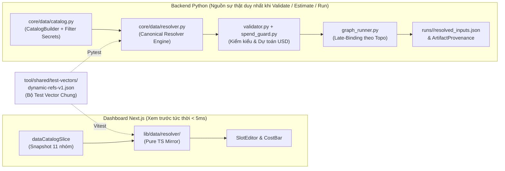
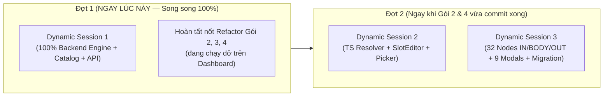

# KẾ HOẠCH KIẾN TRÚC HỆ THỐNG NODE DỮ LIỆU ĐỘNG (`IN / BODY / OUT`) & DANH MỤC DỮ LIỆU HỢP NHẤT

> **Tài liệu nguồn:** `ai/plans/dynamic-data-nodes.md`  
> **Vai trò:** Kiến trúc sư Hệ thống Dữ liệu (Data System Architect)  
> **Phạm vi:** Backend Python (`tool/src/socnhotv`) & Dashboard Next.js 15 (`tool/dashboard`)  
> **Ngày lập & Commit chuẩn khảo sát:** `2026-11-09` tại commit `bd7ad4f35` (`main`)  
> **Trạng thái:** Kế hoạch kiến trúc đóng băng hợp đồng (Frozen Contract) — sẵn sàng chia 3 Session Antigravity chạy song song không xung đột.

---

## 0. TÓM TẮT ĐIỀU HÀNH, SỐ ĐO THỰC TẾ & PHẠM VI MVP

### 0.1. Bài toán cốt lõi phát hiện từ mã nguồn thật
1. **Tham chiếu động trên UI hiện chỉ là "chuỗi chết" (Dead Strings):** Giao diện `DynamicValueFlyout.tsx` tạo ra 5 kiểu chuỗi `{...}` dựa trên tiêu đề hiển thị (`{<tiêu đề node>.<cổng>}`, `{Kịch bản.cảnh_1.prompt}`, `{<tên nhân vật>.promptLock}`, `{model.<key>}`, `{product.name}`), nhưng **không có bất kỳ dòng code nào ở Backend lẫn Frontend giải (resolve) các chuỗi `{...}` này trước khi gọi AI/FFmpeg/HyperFrames**. Nếu người dùng chọn `{model.fal-kling-v3-pro}` hoặc chèn `{Sóc Nhỏ.promptLock}`, hệ thống gửi nguyên văn chuỗi có dấu ngoặc nhọn xuống `ModelRegistry` (gây trượt tra cứu model) hoặc xuống nhà cung cấp AI.
2. **Dữ liệu bị "nướng cứng" (Baked Static Strings) lúc sinh flow:** Hàm `build_review_flow_graph` (`tool/src/socnhotv/intelligence/review_flow.py:503-783`) cho luồng review KOC (Gobi × NAVIE) nối chuỗi tĩnh vào `prompt` và `slot_mapping` ngay lúc tạo đồ thị (dòng `584-600`, `685-705`). Khi người dùng đổi `productId` ở node Sản phẩm hoặc đổi `characterId` ở node Nhân vật trên Canvas, toàn bộ prompt thử đồ, kịch bản video, tên KOC, ưu/nhược điểm và điểm đánh giá ở các node phía sau **bị đóng băng ở sản phẩm/nhân vật cũ**.
3. **Bất đối xứng giữa 3 vùng của Node và rò rỉ đọc `node.params` trực tiếp:** `StudioNode.tsx:850-986` đã vẽ 3 dải `Nhận` (`IN`), `Làm/Cung cấp` (`BODY`), `Trả` (`OUT`), nhưng: (a) 4 loại node nguồn (`text`, `image`, `video`, `audio`) trả về `null` ở `NodeBody.tsx:322-327` trên Canvas; (b) vùng `OUT` hoàn toàn tĩnh, không cho trích xuất trường con hay xuất ngược ra biến dự án; (c) trong `graph_runner.py:1572-3480`, hơn 18 nhánh thực thi node cùng `_effective_model_for_node` (`:405`) và `estimate_node_cost` (`:437`) đọc thẳng `node.params` thay vì `resolved_inputs`.

### 0.2. Bảng số đo thực tế trên mã nguồn (Measured Baseline)

Mọi con số dưới đây được đo trực tiếp tại commit `bd7ad4f35`, không ước đoán:

| Hạng mục đo | Kết quả đo | Lệnh kiểm chứng thực tế đã chạy |
| :--- | :---: | :--- |
| Số kiểu cổng `PortType` hiện hữu | **14** | `tool/.venv/bin/python -c "from socnhotv.core.contracts.types import PortType; print(len(PortType))"` |
| Số loại node đăng ký trong `NodeRegistry` | **32** (19 lõi + 5 `sources` + 6 `toolbox` + 2 `video`; `social.py` rỗng) | `tool/.venv/bin/python -c "from socnhotv.core.nodes.registry import NodeRegistry; print(len(NodeRegistry.list_all()))"` |
| Chênh lệch loại node giữa Backend và `FALLBACK_NODE_TYPES` | **0** (khớp 32/32) | So khớp `NodeRegistry.list_all()` với `tool/dashboard/lib/core/nodeDefinitions.ts:18-548` |
| Tổng số cổng `IN` / `OUT` khai báo trên 32 node | **62 cổng `IN`** / **65 cổng `OUT`** (+1 cổng `voice` khi bật capability `speak`) | Duyệt `d.inputs` và `d.outputs` trên `NodeRegistry.list_all()` |
| Tổng số khóa `default_params` khai báo trong Registry | **108 khóa** (+3 khóa từ capability `speak` = **111**) | Cộng `len(d.default_params)` trên 32 `NodeDefinition` |
| Số model AI trong `models.yaml` / `EXTENDED_MODELS_CATALOG` | **27 model** backend / **16 model** mở rộng UI | Đếm mục con dưới `models:` tại `core/models_registry/models.yaml:13-649` & `lib/data/extendedModelsCatalog.ts:23-286` |
| Số thực thể/dạng dữ liệu trong toàn dự án (Mục C) | **34 dạng dữ liệu** thuộc **11 nhóm không gian tên** | Kiểm kê từ `contracts/types.py`, `intelligence/*`, `episode_script.py`, `social/models.py`, `video/*`, `store/**`, `data/**` |
| Số vi phạm token thiết kế hiện tại | **0 vi phạm / 134 tệp** | `cd tool/dashboard && npm run -s check:design` |
| Số tệp Dashboard $\ge 1.000$ dòng tại `bd7ad4f35` | **4 tệp** (`StudioCanvas`, `ChatTab`, `NodeInputs`, `StudioNode` — đã giảm từ 9 xuống 4 sau khi Gói 1, 5, 6 hoàn tất!) | `wc -l` trên `tool/dashboard/{components,lib,store}/**/*.{ts,tsx}` |

### 0.3. Chốt phạm vi MVP (Vertical Slice đầu-cuối) và Hậu MVP

> [!IMPORTANT]
> **Lát cắt MVP bắt buộc chạy thông đầu-cuối (End-to-End Vertical Slice): Luồng Review Sản phẩm KOC "Gobi × NAVIE" + Luồng Tập Hoạt hình Sóc Nhỏ TV.**
> Khi đổi `productId` ở node `product` (ví dụ sang đầm NAVIE mới) hoặc đổi `characterId` ở node `character` (từ `gobi` sang nhân vật khác) hoặc đổi tập kịch bản ở node `script`, **không cần tạo lại đồ thị**, toàn bộ các node hạ nguồn tự động:
> 1. Hiển thị giá trị đã giải trực tiếp trên chip trong `SlotEditor` (Canvas & `NodeTab`).
> 2. Tính lại dự toán chi phí (`estimate_node_cost` & `estimateNodeCostUsd`) theo đúng `model`, `durationSec`, `variants` và độ dài `text` đã giải.
> 3. Tự động đánh dấu `isStale = true` cho các node phụ thuộc (cả qua dây nối lẫn qua tham chiếu ngầm `$node`) và đổi khóa cache `_params_signature`.
> 4. Giải tham chiếu muộn (late-binding) tại `GraphRunner` ở Backend, chạy thật/mock ra video MP4 9:16 và lưu bản chụp `resolvedSlots` + `refBindings` vào `runs/<run_id>/resolved_inputs.json` cùng `ArtifactProvenance`.

| Hạng mục | Thuộc **MVP** (3 Session song song này) | Để **Hậu MVP (Phase 2)** |
| :--- | :--- | :--- |
| **Mô hình `ValueSlot` (`IN / BODY / OUT`)** | Đủ 32 loại node có schema `ValueSlotSpec`; mọi slot ở `IN` và `BODY` nhận Literal / Reference (`$ref`) / Template (`{{...}}`); `OUT` cho phép đọc trường con (`out.<port>.<path>`) và gắn bí danh xuất ra biến đồ thị (`$var.<key>`). | Cho phép viết biểu thức biến đổi hậu kỳ phức tạp ngay trên cổng `OUT` (ví dụ cắt chuỗi regex, toán học đa toán tử) và tự động ghi ngược `OUT` thẳng vào `products/<id>/product.json` hoặc lịch đăng Social không qua node đích. |
| **Danh mục dữ liệu (11 nhóm)** | Đủ 11 nhóm trong `GET /projects/{id}/data-catalog` và `DataCatalogPicker`: `$node`, `$char`, `$script`, `$product`, `$model`, `$voice`, `$project`, `$policy`, `$run`, `$social` (chỉ đọc, đã lọc sạch secret), `$var`. | Đồng bộ realtime hai chiều qua WebSocket khi sửa file JSON trực tiếp bằng trình soạn thảo ngoài hệ thống (MVP dùng làm mới theo sự kiện lưu/SSE + TTL ngắn). |
| **Ngôn ngữ tham chiếu** | Khóa ID ổn định, truy cập sâu `a.b[0].c`, chỉ số âm `[-1]`, `.length`, lọc vị từ đơn giản `items[key=='val']`, toán tử dự phòng `??`, nội suy chuỗi hỗn hợp, ép kiểu an toàn, tương thích ngược 100% cú pháp `{...}` cũ & `$ref: "script"`. | Hàm ống dẫn nâng cao (`\| upper`, `\| currency("VND")`, `\| slice(0,3)`), biểu thức số học (`durationSec * 1.5`). |
| **Modal AI** | `ModelPicker`, `AIModelsLibraryModal`, `CreateVideoModal`, `ChatTab`, `PolicyEditor`, `CharacterDialog`, `VoiceCloneModal`, `ProductsManager`, `PublishCenterModal` tích hợp đọc/phát vào `dataCatalogSlice`. | Trình nhắc tự động gợi ý biến `{{$` kiểu autocomplete IDE ngay khi đang gõ phím tự do ở mọi `<textarea>` ngoài Studio (như ghi chú lịch Social). |

---

## A. KIỂM KÊ HIỆN TRẠNG & XÁC MINH 5 SỰ THẬT KHỞI ĐẦU

### A.1. Cách lưu trữ tham số, cổng và giá trị hiện tại

1. **Ở Backend (`tool/src/socnhotv/core/contracts/types.py`):**
   - `PortType` (`types.py:8-24`): Enum `str` gồm đúng **14 giá trị**: `text`, `image`, `image[]`, `video`, `audio`, `script`, `scenes`, `character`, `product`, `captions`, `composition`, `policy`, `dialogue`, `voice_clips` (bản sao đối xứng tại `tool/dashboard/lib/core-contracts.ts:6-23`).
   - `NodeInstance` (`types.py:170-183`): lưu `params: Dict[str, Any]` (dict tự do, chứa cả tham số thân node, giá trị gõ trực tiếp vào cổng `IN` chưa nối dây, lẫn các khóa meta bắt đầu bằng dấu gạch dưới) và `inputs: Dict[str, List[NodePortInputRef]]` (ít dùng vì dây thực tế đọc từ `Graph.edges` tại `types.py:186-192`).
   - **Các khóa ngầm nhét chung vào `node.params`:**
     - `_customName: string` — tên hiển thị do người dùng đổi tại chỗ (`StudioNode.tsx:814`).
     - `_collapsed: boolean`, `_userToggledCollapse: boolean` — trạng thái thu gọn node (`StudioNode.tsx:221-240`).
     - `_bypass: boolean` — bỏ qua node khi chạy (`graph_runner.py:1565`, `StudioNode.tsx:830`).
     - `_ports: { inputs?: PortDefinition[], outputs?: PortDefinition[] }` — ghi đè danh sách cổng cho Custom Node (`core/nodes/registry.py:66-76`, `lib/node-ports.ts:4-50`, `PortsEditor.tsx:230`).
     - Capability payload dạng lồng: ví dụ `params.speak = { enabled: bool, voiceId?: str, tempo?: float, concurrency?: int, text?: str, lines?: list }` (`core/nodes/capabilities.py:29-54`, `core/engine/dialogue_voice.py:42-60`).
2. **Ở Dashboard Store (`tool/dashboard/store/slices/canvas/types.ts:23-42`, re-export qua `store/slices/canvasSlice.ts:1-6`):**
   - `StudioNodeData` giữ `nodeType`, `title`, `category`, `params: Record<string, any>`, `inputPorts: PortDefinition[]`, `outputPorts: PortDefinition[]`, `status`, `outputs`, `generations`, `pinnedGenerationId`, `error`, `progress`, `isStale`, `costUsd`.
   - Mọi thao tác sửa cả cổng `IN` (khi chưa nối dây) lẫn tham số `BODY` đều ghi thẳng vào cùng một `data.params[key]` qua `updateNodeParams(nodeId, patch)` (`store/slices/canvas/subSlices/nodesEdgesSlice.ts:154-208`). Không có sự phân tách cấu trúc giữa giá trị cổng `IN` và tham số `BODY`.

### A.2. Kiểm kê các component nhập giá trị động hiện tại trên Dashboard

| Thành phần | Đường dẫn & Dòng | Hành vi thực tế hiện tại | Vấn đề kiến trúc |
| :--- | :--- | :--- | :--- |
| `PortValueInput` | `tool/dashboard/components/canvas/PortValueInput.tsx:55-684` | Dựng ô nhập trực tiếp trên dải `Nhận` (`IN`) khi cổng chưa nối dây (`canTypeIn` dòng `55-58` chỉ mở cho `text`, `image`, `image[]`, `character`, `product`, `scenes`, `dialogue`). Có menu "Lấy từ..." (`:160-325`). | (1) Chọn kịch bản (`:226-233`) thì ghi object `{"$ref": "script", ...}` vào `params[port.name]`. (2) Chọn thuộc tính nhân vật (`:252-315`, `pickAttr`) lại **chép cứng giá trị tức thời** (`set(a.value)`) thay vì lưu tham chiếu động! (3) Chọn cổng node khác (`:192-215`) thì tạo `Edge` thật. Ba cơ chế khác hẳn nhau trong cùng một menu. |
| `DynamicValueSelector` | `tool/dashboard/components/canvas/DynamicValueSelector.tsx:1-95` | Nút bấm nhỏ hình tia sét/biến đặt cạnh một số ô nhập trong `BODY` để mở `DynamicValueFlyout`. | Chỉ gắn thủ công ở 4 nơi: `AdaptiveExpandingTextarea.tsx:119,176`, `SpeakTextBox.tsx:95,139`, `NodeInputs.tsx:122,915`, `VideoGenParams.tsx:441,468,519`. Các tham số số, boolean, select, `GenericParams`, `SlotMappingView` không có. |
| `DynamicValueFlyout` | `tool/dashboard/components/canvas/DynamicValueFlyout.tsx:1-510` | Sinh ra 5 mẫu chuỗi `{...}`: `{<targetNode.title>.<port>}` (`:160,338,348`), `{Kịch bản.cảnh_N.prompt\|dialogue}` (`:373,386`), `{<char.name>.promptLock\|name\|voiceId}` (`:433,441,449`), `{model.<key>}` (`:469,477`), và biến mẫu `{character.promptLock}`... (`:219-226`). | **100% khóa theo tên hiển thị hoặc chữ tiếng Việt cứng**, đổi `_customName` hoặc trùng tên node/nhân vật là gãy. Nghiêm trọng hơn: `handleConnectNode` (`:158-180`) vừa trả về chuỗi `{Title.port}` vừa tự ý ghi đè `edges` với `portType: "text"` cứng! |
| `ModelPicker` & `AIModelsLibraryModal` | `tool/dashboard/components/studio/ModelPicker.tsx:269-320`<br>`tool/dashboard/components/studio/AIModelsLibraryModal.tsx:241,331` | Cho chèn `{model.<key>}` vào tham số `model` và hiện huy hiệu tím nếu `value.startsWith("{") && value.endsWith("}")`. | Backend không giải `{model.<key>}` nên chạy thật với giá trị này sẽ không tìm thấy model trong `ModelRegistry` (`models_registry/registry.py:74-82`). |

### A.3. Backend gom đầu vào ra sao & Kết quả xác minh 5 Sự thật khởi đầu

- **Luồng gom đầu vào hiện tại (`tool/src/socnhotv/core/engine/graph_runner.py:650-732`):**
  1. `_gather_node_inputs` khởi tạo `resolved = dict(node.params)` (dòng `661`).
  2. Duyệt `graph.edges` nối tới `node.id` (`:663-690`): lấy `upstream_outputs[edge.source_port]`, nếu là `Artifact` thì quy đổi sang đường dẫn/URI hoặc giá trị thực, gộp vào `resolved[edge.target_port]` (hỗ trợ cổng `multi=True` gom thành mảng).
  3. Duyệt lại các khóa của `resolved` (`:692-699`): **chỉ kiểm tra duy nhất** `isinstance(val, dict) and val.get("$ref") == "script"`, nếu khớp thì gọi `self._resolve_script_ref(val)` (`:1497-1509` → `episode_script.resolve_facet` tại `core/engine/episode_script.py:345-398`).
  4. **Lỗ hổng lớn phát hiện thêm khi đọc toàn bộ `_execute_node_handler` (`:1550-3480`):** Dù `_gather_node_inputs` trả về `resolved_inputs`, hơn 18 nhánh thực thi bên dưới vẫn đọc trực tiếp `node.params.get(...)` cho các cấu hình như `model`, `aspectRatio`, `resolution`, `durationSec`, `variants`, `voiceId`, `tempo`, `style`, `template`, `platforms`, `slot_mapping`, `thresholdScore`, `characterId`, `productId`... Đồng thời `_effective_model_for_node` (`:400-436`), `estimate_node_cost` (`:437-462`) và `_params_signature` (`:797-812`) cũng chỉ đọc `node.params` thô!

- **Bảng kết luận xác minh 5 Sự thật khởi đầu:**

| # | Sự thật khởi đầu của Chủ dự án | Kết luận xác minh | Bằng chứng `path:dòng` & Ghi chú mở rộng |
| :-: | :--- | :---: | :--- |
| **1** | `PortType` có 14 kiểu; `NodeRegistry` có 32 loại node. | **ĐÚNG 100%** | `core/contracts/types.py:8-24` (14 `PortType`); `core/nodes/registry.py:90-530` (19) + `plugins/sources.py:10-124` (5) + `plugins/toolbox.py:356-404` (6) + `plugins/video.py:11-58` (2) = **32 node**. |
| **2** | UI tạo `{<tiêu đề node>.<cổng>}` và `{model.<key>}` theo tiêu đề, dễ vỡ khi đổi tên/trùng tên. | **ĐÚNG & NGHIÊM TRỌNG HƠN** | Ngoài `DynamicValueFlyout.tsx:160,338,469,477`, còn 3 mẫu nữa ở dòng `:219-226`, `:373,386`, `:433-449` đều dùng tên hiển thị nhân vật hoặc chữ `"Kịch bản"` không kèm `episodeId`. |
| **3** | Không có mã backend/frontend nào giải `{...}` khi chạy flow; giá trị động hiện chỉ là chuỗi chữ. | **XÁC NHẬN ĐÚNG CHO MỌI `{...}`** *(kèm 1 ngoại lệ cục bộ)* | Đã quét toàn bộ `tool/src/socnhotv/**/*.py` và `tool/dashboard/{lib,store,components}/**/*.{ts,tsx}`: **0 nơi giải `{...}`**. Ngoại lệ duy nhất không dùng `{...}` là object `{"$ref": "script", ...}` (`PortValueInput.tsx:46-52` → `graph_runner.py:693-698, 1497-1509`). Ngoài ra `review_flow.py:585-594` chỉ `.replace("{product}", ...)` một lần tĩnh lúc sinh đồ thị. |
| **4** | Kịch bản (`episode_script.py`) và Sản phẩm (`products.py:24-46`) đã có cấu trúc trường rõ ràng. | **ĐÚNG 100%** | `EpisodeScript` (`episode_script.py:42-97`) có `FACETS` (`fulltext`, `summary`, `lesson`, `mantra`, `dialogue_all`, `environment`), `scenes[].shots[]` (`camera`, `characters`, `speaker`, `speaker_id`, `dialogue`, `prompt`). `Product` (`intelligence/products.py:24-58`) có thực tế **30 trường** (mở rộng tới dòng `58`, gồm cả `cutout_images`, `variants`, `colors`, `sizes`, `rating`, `review_count`, `review_status`...). |
| **5** | Trùng nhiều file với `refactor-components.md` (v2); Dashboard chưa có test; 9 file > 1.000 dòng. | **ĐÃ CẬP NHẬT TRÊN `main` (`bd7ad4f35`)** | Kể từ lúc viết v2 (`210e8e5ff`), các agent song song **ĐÃ hoàn thành 100% Gói 0** (`90795fb48`, Vitest + MSW + Playwright), **Gói 6** (`6f890d1a1`), **Gói 1** (`cd10586b6`..`6d3f1176d`: tách xong `lib/core/*`, `lib/api/social/*`, `store/slices/canvas/*`), và **Gói 5** (`9341d463c`..`bd7ad4f35`: tách xong `create-video-modal/*`, `publish-center-modal/*`, `toolbox/panel/*`, `user-bubble/*`). Hiện **Gói 2, 3, 4 đang được tách ngay trên cây làm việc** — cần điều phối chặt ở Mục I.4 để tuyệt đối không đè lên phiên đang chạy. |

---

## B. MÔ HÌNH NODE `IN / BODY / OUT` & KHÁI NIỆM THỐNG NHẤT `ValueSlot`

### B.1. Định nghĩa chính xác 3 vùng của MỌI Node

Từ nay, mọi loại node trên Canvas (kể cả node nguồn như `text`, `image`, `character`, `product` lẫn node xử lý và xuất bản) đều tuân theo một giải phẫu bất biến gồm đúng **3 vùng**:

1. **`IN` (Đầu vào — Nhận dữ liệu):** Các slot đại diện cho nguyên liệu đầu vào chính của node. Mặc định `exposeAsPort = true` (có chấm nối dây Handle bên trái). Khi **đã nối dây** (`mode = "wired"`), giá trị lấy từ cổng `OUT` của node nguồn (có thể kèm biểu thức trích xuất đường dẫn con, ví dụ chỉ lấy `.sale_price` từ dây `product`). Khi **chưa nối dây**, slot `IN` hiện ngay một `SlotEditor` thu gọn để người dùng nhập tay (`literal`), chọn tham chiếu từ Danh mục (`ref`), hoặc gõ chuỗi pha trộn (`template`).
2. **`BODY` (Thân node — Tham số điều khiển & Cấu hình):** Các slot cấu hình hành vi thực thi (ví dụ `model`, `aspectRatio`, `durationSec`, `voiceId`, `tempo`, `slot_mapping`, `criteria`, `speak.text`...). Mặc định `exposeAsPort = false` (nằm gọn trong thân node, không làm rối viền trái bằng hàng chục chấm nối dây), **NHƯNG** mọi slot `BODY` đều dùng chung `SlotEditor` (nên có thể nhận tham chiếu động như `{{$model.fal-kling-v3-pro.key}}`, `{{$char.soc_nho.voiceId}}`, `{{$var.defaultAspect}}`) **VÀ** người dùng có thể bấm nút "Phơi thành cổng `IN`" (`exposeAsPort = true`) nếu muốn nối dây trực tiếp từ node khác vào tham số đó!
3. **`OUT` (Đầu ra — Kết quả & Phát dữ liệu):** Các slot kết quả do node sinh ra sau khi thực thi (mặc định `exposeAsPort = true` ở viền phải). Điểm đột phá để `OUT` cũng **DYNAMIC**:
   - **Đọc sâu có cấu trúc:** Cổng `OUT` kiểu object (`character`, `product`, `script`, `scenes`, `composition`, `policy`) phơi bày toàn bộ cây trường con cho các node sau tham chiếu (`{{$node.n_product.out.product.sale_price}}`).
   - **Ghi đè / Biến đổi / Mặc định đầu ra (`outOverride`):** Người dùng có thể đặt giá trị dự phòng hoặc biểu thức ánh xạ trên slot `OUT` (ví dụ khi chạy nháp hoặc muốn ép `out.text` dùng mẫu định dạng `Giá ưu đãi: {{$self.out.product.sale_price}}đ`).
   - **Phát ngược vào Biến đồ thị / Danh mục (`emitToVar`):** Mỗi slot `OUT` có tùy chọn gắn vào một biến cục bộ (`$var.<tên_biến>`) để bất kỳ node hoặc Modal AI nào trong dự án đọc lại mà không cần kéo dây xuyên suốt cả mặt phẳng Canvas.

### B.2. Đặc tả khái niệm thống nhất `ValueSlot`

Mọi giá trị ở `IN`, `BODY`, `OUT` đều được mô tả bởi cặp **Đặc tả tĩnh (`ValueSlotSpec`)** (khai báo trên loại node) và **Liên kết giá trị (`ValueSlotBinding`)** (lưu trên từng instance node):

| Thuộc tính của `ValueSlotSpec` | Kiểu dữ liệu | Ý nghĩa & Vai trò dựng UI tự động |
| :--- | :--- | :--- |
| `slotId` | `string` | Định danh ổn định duy nhất trong phạm vi vùng (`in.<name>`, `body.<name>`, `out.<name>`), ví dụ `body.durationSec`, `body.speak.voiceId`. Không bao giờ phụ thuộc nhãn dịch thuật. |
| `zone` | `"in" \| "body" \| "out"` | Vùng hiển thị mặc định trên node. |
| `label` / `description` | `string` | Nhãn tiếng Việt hiển thị trên UI và chú giải tooltip. |
| `valueType` | `DataValueType` | Kiểu dữ liệu hợp nhất (mở rộng từ 14 `PortType` thêm các kiểu nguyên thủy cho `BODY`: `number`, `integer`, `boolean`, `string_list`, `enum`, `json`, `model_key`, `voice_id`, `character_id`, `product_id`, `episode_id`, `template_id`, `color`). |
| `defaultValue` | `any` | Giá trị mặc định khi người dùng chưa nhập và chưa nối dây. |
| `constraints` | `SlotConstraints` | `{ required?: boolean, min?: number, max?: number, step?: number, enumValues?: {value, label}[], pattern?: string, acceptMime?: string[], modelKind?: "llm"\|"image"\|"video"\|"tts", multi?: boolean }`. Đủ để `SlotEditor` tự dựng Slider, Select, Switch, ModelPicker, MediaPicker hay Textarea mà không cần viết component rời cho từng tham số. |
| `exposeAsPort` | `boolean` | Mặc định `true` với `IN`/`OUT`, `false` với `BODY`. Có thể bật/tắt trên từng instance qua `params._slotPorts[slotId]`. |
| `allowDynamic` | `boolean` | Cho phép gắn `$ref` / `{{...}}` (mặc định `true` cho 100% slot ở `IN`/`BODY`; ở `OUT` cho phép `fallback` & `emitToVar`). |
| `uiWidget` | `SlotWidgetKind` | `"text" \| "textarea" \| "number" \| "slider" \| "switch" \| "select" \| "multiselect" \| "color" \| "media" \| "model_picker" \| "voice_picker" \| "character_picker" \| "product_picker" \| "episode_picker" \| "kv_map" \| "port_status"`. |

**4 Chế độ giá trị (`SlotMode`) của một `ValueSlotBinding`:**
1. `"literal"` — Giá trị tĩnh người dùng tự nhập/chọn (số `6`, boolean `true`, chuỗi `"9:16"`).
2. `"ref"` — Tham chiếu đơn kiểu bảo toàn kiểu gốc (`{"$ref": "v1", "ns": "product", "id": "1734322298467354128", "path": ["cutout_images", 0], "fallback": ""}` hoặc chuỗi thuần `"{{$product.1734322298467354128.sale_price}}"`). Nếu đích là `number` hoặc `image[]`, kết quả giải giữ nguyên kiểu `number` / `list[str]`, không bị ép thành chuỗi!
3. `"template"` — Chuỗi văn bản pha trộn chữ tự do và một hoặc nhiều biểu thức `{{...}}` (luôn cho ra `text`).
4. `"wired"` — Nhận trực tiếp từ `Edge` nối vào cổng (có thể kèm `subPath` trích trường con của dữ liệu trên dây).

### B.3. Quy tắc phân biệt và hợp nhất "Cổng (Port)" với "Tham số (Parameter)"

$$\text{Port (Cổng nối dây)} \equiv \text{ValueSlot có } \texttt{exposeAsPort == true}$$

- **Không còn hai thế giới tách biệt:** Trước đây `PortValueInput` lưu ở `params[port.name]` còn `NodeBody` lưu ở `params[paramKey]`, khiến nhiều node trùng tên khóa (như `image_gen` vừa có cổng `IN` tên `prompt` vừa có `default_params["prompt"]`; `voice_tts` vừa có cổng `IN` tên `text` vừa có `default_params["text"]`; `quality_check` vừa có cổng `IN` tên `criteria` vừa có `default_params["criteria"]`!).
- **Quy tắc hợp nhất chống trùng lặp:** Nếu một khái niệm vừa nhận dây vừa nhập tay được (ví dụ `prompt` của `image_gen`/`video_gen`, `text` của `voice_tts`, `url` của `source_video`, `criteria` của `quality_check`), nó là **MỘT `ValueSlot` duy nhất** đặt ở vùng `IN` (với `exposeAsPort = true` và `uiWidget = "textarea"` hiển thị ngay khi chưa nối dây), **KHÔNG lặp lại lần thứ hai ở `BODY`**! Vùng `BODY` chỉ chứa các slot cấu hình chưa phơi làm cổng `IN` mặc định (`model`, `aspectRatio`, `durationSec`...). Khi người dùng bật "Phơi thành cổng" cho `body.durationSec`, handle nối dây xuất hiện mà `slotId` không đổi.
- **Thứ tự ưu tiên giải giá trị của một Slot (Precedence Rule):**
  1. Nếu `exposeAsPort == true` và có ít nhất 1 `Edge` hợp lệ nối tới cổng đó → dùng giá trị từ `Edge` (kèm `subPath` nếu có); nếu kết quả rỗng/`None`, xét `fallback`.
  2. Ngược lại, nếu `params[key]` chứa `RefEnvelope` (`{"$ref": "v1", ...}`) hoặc chuỗi chứa `{{...}}` (hoặc cú pháp di sản `{...}`) → giải qua `ResolverEngine`.
  3. Ngược lại, nếu `params[key]` khác `undefined`/`None` → dùng giá trị `literal` (kiểm tra/ép kiểu theo `valueType`).
  4. Cuối cùng → dùng `spec.defaultValue`.

### B.4. Bảng giải phẫu chi tiết 32 loại Node theo mô hình `IN / BODY / OUT`

> **Chú thích ký hiệu trong bảng:**  
> - `*` sau tên slot `IN`: `required = true`. `[]` sau kiểu: `multi = true` (nhận nhiều dây).  
> - `(Hợp nhất)`: khóa hiện đang khai báo trùng ở cả `inputs` lẫn `default_params` trong Registry — sẽ hợp nhất về 1 slot `IN` có ô nhập trực tiếp.  
> - `[UI+]`: tham số hiện UI (`NodeBody`/`NodeInputs`/`VideoGenParams`) có đọc/ghi qua `updateNodeParams` nhưng **thiếu trong `NodeRegistry.default_params`** (đã phát hiện khi đối chiếu code).  
> - **Dynamic?**: **Tất cả (100%)** các slot ở `IN` và `BODY` trong bảng dưới đều hỗ trợ Dynamic (`ref` / `template`); các slot `OUT` đều hỗ trợ đọc trường con (`$node.<id>.out.<port>.<path>`), đặt `fallback` và `emitToVar`.

| # | Loại Node (`type_name`) & Nhóm | Vùng `IN` (Slot : Kiểu) | Vùng `BODY` (Slot : Kiểu = Mặc định) | Vùng `OUT` (Slot : Kiểu & Trường con tiêu biểu) | Nguồn Registry / Executor / UI (`path:dòng`) |
| :-: | :--- | :--- | :--- | :--- | :--- |
| 01 | **`text`**<br>*(Input)* | *(0 cổng mặc định; có thể nâng `content` thành cổng nếu bật)* | `content`: `text` = `""` *(hiện trên Canvas qua `SlotEditor` thay vì trả `null`!)* | `text`: `text` | Reg: `registry.py:90-103`<br>Exec: `graph_runner.py:1572-1597`<br>UI: `NodeBody.tsx:322` (`null`), `NodeTab.tsx:168`, `NodeInputs.tsx:59` |
| 02 | **`image`**<br>*(Input)* | *(0 cổng mặc định)* | `uri`: `image` = `""`, `[UI+] alt`/`sourceKind`: `text` *(mở chọn thư viện/upload/tham chiếu trên Canvas)* | `image`: `image` (`.uri`, `.meta.width`, `.meta.height`) | Reg: `registry.py:105-118`<br>Exec: `graph_runner.py:1712-1742`<br>UI: `NodeBody.tsx:324` (`null`), `NodeTab.tsx:177`, `NodeInputs.tsx:175` |
| 03 | **`character`**<br>*(Identity)* | *(Khi bật `speak`)*: `[UI+/Cap] lines`: `dialogue` (tùy chọn nối dây thoại) | `characterId`: `character_id` = `"soc_nho"`; Capability `speak` (`dialogue_voice.py:42`): `speak.enabled`: `bool` = `false`, `speak.voiceId`: `voice_id` = `""`, `speak.tempo`: `number` = `null`, `speak.concurrency`: `int` = `2`, `[UI+] speak.text`: `text`, `[UI+] speak.lines`: `string_list` | `character`: `character` (`.id`, `.name`, `.promptLock`, `.voiceId`, `.heightCm`, `.scaleRatio`, `.appearances`, `.referenceImages[]`), `reference_images`: `image[]`, *(khi `speak.enabled`)* `voice`: `voice_clips` | Reg: `registry.py:120-137`, `dialogue_voice.py:42,198`<br>Exec: `graph_runner.py:1598-1606` + capability runner<br>UI: `NodeBody.tsx:319,452-476`, `CharacterHero.tsx:1-198`, `SpeakTextBox.tsx:1-160` |
| 04 | **`product`**<br>*(Identity)* | *(0 cổng mặc định)* | `productId`: `product_id` = `""`, `variant`: `text` = `""` *(chọn ảnh cutout/màu/size hoặc `$ref`)* | `product`: `product` (đủ 30 trường: `.id`, `.name`, `.brand`, `.price`, `.sale_price`, `.usp[]`, `.pain_points[]`, `.rating`, `.cutout_images[]`, `.affiliate_links.*`...), `image`: `image`, `images`: `image[]` | Reg: `registry.py:139-158`<br>Exec: `graph_runner.py:1607-1642`<br>UI: `NodeBody.tsx:449-451`, `ProductNodeCard.tsx:1-126` |
| 05 | **`cast`**<br>*(Identity)* | `lines`: `dialogue`, `scenes`: `scenes` | `speak.enabled`: `bool` = `true`, `include`: `string_list` = `[]`, `exclude`: `string_list` = `[]`, `onMissingVoice`: `enum("stop"\|"skip"\|"fallback")` = `"stop"` | `characters`: `character` *(danh sách hồ sơ dàn diễn viên)*, `reference_images`: `image[]`, `voice`: `voice_clips` | Reg: `registry.py:160-186`<br>Exec: `graph_runner.py:1643-1711`<br>UI: `NodeBody.tsx:446-448`, `CastPreview.tsx:1-157` |
| 06 | **`script`**<br>*(Structure)* | `text`: `text` | `mode`: `enum("ai"\|"manual"\|"episode")` = `"ai"`, `rawScript`: `text` = `""`, `targetSceneCount`: `int` = `6`, `targetDurationSec`: `number` = `45`, `[UI+] episodeId`: `episode_id`, `[UI+] model`: `model_key` | `scenes`: `scenes` (`[i].index`, `[i].title`, `[i].shots[j].prompt`, `.dialogue`, `.speaker`, `.camera`), `prompt`: `text`, `dialogue`: `text`, `lines`: `dialogue` | Reg: `registry.py:188-216`<br>Exec: `graph_runner.py:1771-1893`<br>UI: `NodeBody.tsx:329-358`, `NodeInputs.tsx:501-755`, `EpisodeScriptPicker.tsx:1-152` |
| 07 | **`vision_analyze`**<br>*(Intelligence)* | `video`: `video`, `image`: `image` | `goal`: `text` = `"extract_scenes_and_dialogue"`, `[UI+] model`: `model_key` | `script`: `script`, `scenes`: `scenes` | Reg: `registry.py:218-238`<br>Exec: `graph_runner.py:3072-3091`<br>UI: `NodeBody.tsx:661-678` |
| 08 | **`quality_check`**<br>*(Quality)* | `media`: `image`, `criteria`: `text` *(Hợp nhất)*, `text`: `text`, `captions`: `captions`, `scenes`: `scenes`, `policy`: `policy` | `thresholdScore`: `number(0..1)` = `0.85`, `maxRetries`: `int` = `2`, `policyAutoScan`: `bool` = `true`, `blockOnFail`: `bool` = `false`, `[UI+] model`: `model_key` | `media`: `image`, `pass_fail`: `text` (`"pass"\|"fail"`), `violations`: `text` | Reg: `registry.py:240-275`<br>Exec: `graph_runner.py:2829-2966`<br>UI: `NodeBody.tsx:660-678` |
| 09 | **`policy`**<br>*(Quality)* | *(0 cổng mặc định)* | `extraTerms`: `string_list` = `[]`, `extraSeverity`: `enum("block"\|"warn")` = `"block"` | `policy`: `policy` (`.name`, `.mode`, `.rules[]`, `.allowlist[]`) | Reg: `registry.py:277-293`<br>Exec: `graph_runner.py:2820-2828`<br>UI: `NodeBody.tsx:642-658` |
| 10 | **`image_gen`**<br>*(Generation)* | `prompt`: `text` *(Hợp nhất)*, `references`: `image[]`, `image`: `image`, `scenes`: `scenes` | `model`: `model_key` = `"mock-image"`, `[UI+] fallbackModels`: `string_list` = `[]`, `aspectRatio`: `enum` = `"9:16"`, `resolution`: `enum` = `"1080p"`, `referenceImages`: `image[]` = `[]`, `n`: `int(1..4)` = `1`, `seed`: `int?` = `null` | `images`: `image[]`, `image`: `image` *(ảnh đầu/đã ghim)*, `scenes`: `scenes` *(đã gắn ảnh từng shot)* | Reg: `registry.py:295-330`<br>Exec: `graph_runner.py:1894-1992`<br>UI: `NodeBody.tsx:393-424`, `NodeInputs.tsx:836-1005` |
| 11 | **`image_edit`**<br>*(Generation)* | `image*`: `image`, `references`: `image[]`, `prompt`: `text` | `model`: `model_key` = `"mock-image"`, `[UI+] fallbackModels`: `string_list` = `[]`, `aspectRatio`: `enum` = `"9:16"`, `[UI+] resolution`: `enum` = `"1080p"`, `[UI+] prompt`: *(hợp nhất lên `IN.prompt`)* | `image`: `image` | Reg: `registry.py:332-355`<br>Exec: `graph_runner.py:1993-2036`<br>UI: `NodeBody.tsx:394-424`, `NodeInputs.tsx:836-1005` |
| 12 | **`video_gen`**<br>*(Generation)* | `scenes`: `scenes`, `first_frame`: `image`, `image`: `image`, `prompt`: `text` *(Hợp nhất)*, `references`: `image[]`, `[UI+] end_frame`: `image` *(nếu bật frame cuối)* | `model`: `model_key` = `"mock-video"`, `[UI+] fallbackModels`: `string_list` = `[]`, `variants`: `int(1..4)` = `1`, `aspectRatio`: `enum` = `"16:9"`, `resolution`: `enum` = `"720p"`, `durationSec`: `number` = `6`, `hasAudio`: `bool` = `false`, `seed`: `int?` = `null`, `perShot`: `bool` = `true`, `maxClips`: `int` = `5`, `shotIds`: `string_list` = `[]`, `clipSource`: `enum("auto"\|"scenes"\|"prompt")` = `"auto"`, `[UI+] cameraPreset`: `text` | `video`: `video`, `videos`: `video` *(danh sách clip khi chạy perShot/variants)*, `scenes`: `scenes` | Reg: `registry.py:357-402`<br>Exec: `graph_runner.py:2037-2163`<br>UI: `NodeBody.tsx:426-444`, `VideoGenParams.tsx:1-764` |
| 13 | **`voice_tts`**<br>*(Audio)* | `text`: `text` *(Hợp nhất)*, `character`: `character` | `voiceId`: `voice_id` = `"soc-nho"`, `tempo`: `number(0.5..2.0)` = `1.1`, `mastering`: `bool` = `true`, `[UI+] model`: `model_key` | `audio`: `audio` (`.uri`, `.meta.durationSec`, `.meta.lufs`) | Reg: `registry.py:404-426`<br>Exec: `graph_runner.py:2164-2223`<br>UI: `NodeBody.tsx:360-391`, `NodeInputs.tsx:761-834` |
| 14 | **`captions`**<br>*(Audio)* | `audio*`: `audio`, `text`: `text` | `language`: `enum("vi"\|"en"\|"zh"\|"auto")` = `"vi"`, `style`: `enum` = `"kinetic_karaoke"` | `captions`: `captions` (`.srtUri`, `.vttUri`, `.cues[]`) | Reg: `registry.py:428-448`<br>Exec: `graph_runner.py:2224-2266`<br>UI: `NodeBody.tsx:478-501`, `NodeInputs.tsx:1158-1194` |
| 15 | **`hyperframes_render`**<br>*(Composition)* | `scenes`: `scenes`, `audio`: `audio`, `voice`: `audio`, `voice_clips`: `voice_clips`, `captions`: `captions`, `bgm`: `audio`, `gate`: `text`, `video`: `video`, `image`: `image` | `aspectRatio`: `enum` = `"9:16"`, `timing`: `enum("script"\|"audio"\|"fixed")` = `"script"`, `gapSec`: `number` = `0.35`, `template` / `templateId`: `template_id` = `"default_cartoon"` *(chuẩn hóa về `templateId`, giữ alias `template`)*, `platform`: `enum` = `"tiktok"`, `safeZonePaddingTop`: `int` = `180`, `safeZonePaddingBottom`: `int` = `320`, `duckingLevel`: `number(0..1)` = `0.25`, `requireHyperFrames`: `bool` = `true`, `[UI+] titleBadge`: `text` | `video`: `video`, `captions`: `captions` | Reg: `registry.py:450-496`<br>Exec: `graph_runner.py:2267-2475`<br>UI: `NodeBody.tsx:541-585` |
| 16 | **`export`**<br>*(Output)* | `video*`: `video` | `platforms`: `string_list` = `["tiktok", "youtube"]`, `outputFileName`: `text` = `"final_video.mp4"`, `[UI+] outputSlug`: `text`, `[UI+] caption`: `text`, `[UI+] hashtags`: `string_list` | `manifest`: `composition` (`.files[]`, `.platforms[]`, `.exportedAt`) | Reg: `registry.py:498-515`<br>Exec: `graph_runner.py:2476-2819`<br>UI: `NodeBody.tsx:587-640`, `NodeInputs.tsx:1031-1156` |
| 17 | **`character_image`**<br>*(Identity)* | *(0 cổng mặc định)* | `uri`: `image` = `""`, `name`: `text` = `""`, `[UI+] characterId`: `character_id` | `image`: `image`, `reference_images`: `image[]` | Reg: `registry.py:517-522`<br>Exec: `graph_runner.py:1712-1742`<br>UI: `NodeBody.tsx:882` (`GenericParams`), `NodeTab.tsx:177` |
| 18 | **`scene`**<br>*(Structure)* | `image*`: `image`, `text`: `text` | `title`: `text` = `"Cảnh mới"`, `durationSec`: `number` = `6`, `[UI+] camera`: `text` | `scenes`: `scenes`, `image`: `image` | Reg: `registry.py:524-527`<br>Exec: `graph_runner.py:1743-1760`<br>UI: `NodeBody.tsx:882` (`GenericParams`) |
| 19 | **`transition`**<br>*(Structure)* | `scenes*`: `scenes` | `style`: `enum("fade"\|"whip_pan"\|"match_cut"\|"zoom_through"\|"glitch"\|"cut")` = `"fade"`, `durationSec`: `number` = `0.5` | `scenes`: `scenes` | Reg: `registry.py:529-532`<br>Exec: `graph_runner.py:1761-1770`<br>UI: `NodeBody.tsx:503-539` |
| 20 | **`source_video`**<br>*(Input / Sources)* | `url`: `text` *(Hợp nhất)* | `rights`: `enum("owned"\|"licensed"\|"permission"\|"reference_only")` = `"reference_only"`, `[UI+] sourceId`: `text` | `video`: `video`, `audio`: `audio`, `metadata`: `text` *(JSON/summary `SourceItem`)* | Reg: `plugins/sources.py:10-33`<br>Exec: `graph_runner.py:3104-3217`<br>UI: `NodeBody.tsx:882` (`GenericParams`) |
| 21 | **`localize`**<br>*(Intelligence / Sources)* | `video*`: `video`, `audio*`: `audio` | `mode`: `enum("R"\|"T"\|"RT")` = `"R"`, `style`: `enum("faithful"\|"viral"\|"kids")` = `"faithful"`, `voice_id`: `voice_id` = `"soc-nho"`, `auto_draft`: `bool` = `true` | `script`: `script`, `audio`: `audio`, `captions`: `captions` | Reg: `plugins/sources.py:35-62`<br>Exec: `graph_runner.py:3218-3336`<br>UI: `NodeBody.tsx:882` (`GenericParams`) |
| 22 | **`blueprint_analyze`**<br>*(Intelligence / Sources)* | `video*`: `video` | `[UI+] sourceId`: `text` = `""`, `[UI+] model`: `model_key` *(hiện `default_params = {}`)* | `blueprint`: `text` *(JSON `VideoBlueprint`: `.hook_analysis`, `.beats[]`, `.pacing_wpm`)* | Reg: `plugins/sources.py:64-81`<br>Exec: `graph_runner.py:3337-3383`<br>UI: `NodeBody.tsx:882` (`GenericParams`) |
| 23 | **`script_from_blueprint`**<br>*(Intelligence / Sources)* | `blueprint*`: `text`, `character`: `character`, `[New IN] product`: `product` *(tùy chọn)* | `generator_type`: `enum("koc_review"\|"tiktok_sales"\|"affiliate_compare")` = `"koc_review"`, `voice_id`: `voice_id` = `"soc-nho"` | `script`: `script`, `render_request`: `text` | Reg: `plugins/sources.py:83-105`<br>Exec: `graph_runner.py:3427-3476`<br>UI: `NodeBody.tsx:882` (`GenericParams`) |
| 24 | **`channel_insight`**<br>*(Intelligence / Sources)* | `channel_url*`: `text` | `max_videos`: `int(1..200)` = `50` | `blueprint`: `text` *(JSON `ChannelBlueprint`)*, `pillars`: `text`, `summary`: `text` | Reg: `plugins/sources.py:107-124`<br>Exec: `graph_runner.py:3384-3426`<br>UI: `NodeBody.tsx:882` (`GenericParams`) |
| 25 | **`bg_remove`**<br>*(Structure / Toolbox)* | `image`: `image` | `model`: `enum("u2net"\|"isnet-general-use"\|"birefnet")` = `"u2net"`, `alpha_matting`: `bool` = `false`, `characterId`: `character_id` = `""`, `imageIndex`: `int` = `0` | `image`: `image` *(PNG tách nền)*, `mask`: `image` | Reg: `plugins/toolbox.py:356-363`<br>Exec: `graph_runner.py:3092-3103` → `toolbox.py:118`<br>UI: `NodeBody.tsx:680-691` |
| 26 | **`word_captions`**<br>*(Audio / Toolbox)* | `audio*`: `audio` | `model_size`: `enum("tiny"\|"base"\|"small"\|"medium")` = `"small"`, `language`: `enum` = `"vi"` | `captions`: `captions`, `words`: `text` *(JSON word-level timestamps)* | Reg: `plugins/toolbox.py:365-371`<br>Exec: `graph_runner.py:3092-3103` → `toolbox.py:165`<br>UI: `NodeBody.tsx:779-804` |
| 27 | **`scene_cut`**<br>*(Structure / Toolbox)* | `video*`: `video` | `threshold`: `number` = `3.0`, `min_scene_s`: `number` = `1.0`, `export_clips`: `bool` = `false`, `aspect`: `enum("keep"\|"9:16"\|"16:9"\|"1:1")` = `"keep"`, `max_scenes`: `int` = `200` | `scenes`: `scenes`, `report`: `text` | Reg: `plugins/toolbox.py:373-379`<br>Exec: `graph_runner.py:3092-3103` → `toolbox.py:201`<br>UI: `NodeBody.tsx:724-747` |
| 28 | **`depth_layers`**<br>*(Structure / Toolbox)* | `image`: `image` | `fg_pct`: `int(1..99)` = `70`, `mid_pct`: `int(1..99)` = `35`, `feather`: `int(0..20)` = `3`, `max_side`: `int` = `1280`, `characterId`: `character_id` = `""`, `imageIndex`: `int` = `0` | `bg`: `image`, `mid`: `image`, `fg`: `image`, `depth`: `image` | Reg: `plugins/toolbox.py:381-388`<br>Exec: `graph_runner.py:3092-3103` → `toolbox.py:249`<br>UI: `NodeBody.tsx:693-704` |
| 29 | **`handdraw`**<br>*(Generation / Toolbox)* | `image*`: `image` | `duration_sec`: `number` = `5.0`, `fps`: `int` = `24`, `width`: `int` = `540`, `height`: `int` = `960`, `show_hand`: `bool` = `true` | `video`: `video` | Reg: `plugins/toolbox.py:390-396`<br>Exec: `graph_runner.py:3092-3103` → `toolbox.py:293`<br>UI: `NodeBody.tsx:706-722` |
| 30 | **`voice_clone`**<br>*(Audio / Toolbox)* | `audio*`: `audio` | `name`: `text` = `""` *(slug voiceId)*, `display_name`: `text` = `""`, `consent_note`: `text` = `""`, `dialect`: `enum("north"\|"central"\|"south")` = `"south"`, `duration`: `number` = `4.5`, `verify`: `bool` = `true` | `voice_id`: `text` *(tự động phát vào `$voice` catalog!)*, `preview`: `audio`, `report`: `text` | Reg: `plugins/toolbox.py:398-404`<br>Exec: `graph_runner.py:3092-3103` → `toolbox.py:322`<br>UI: `NodeBody.tsx:749-777` |
| 31 | **`template_render`**<br>*(Composition / Video)* | `text`: `text`, `script`: `script`, `images`: `image[]`, `image`: `image`, `video`: `video`, `audio`: `audio`, `voice_clips`: `voice_clips`, `reference_images`: `image[]`, `product`: `product` | `template_id`: `template_id` = `"tiktok-sales-v1"`, `platforms`: `string_list` = `["tiktok"]`, `slot_mapping`: `kv_map<string, ValueSlotBinding>` = `{}` *(từng khóa con trong `slot_mapping` như `reviewer_badge`, `pros_text`, `rating_score` đều là một `ValueSlot` động!)* | `video`: `video` | Reg: `plugins/video.py:11-39`<br>Exec: `graph_runner.py:2967-3040`<br>UI: `NodeBody.tsx:806-843`, `GenericParams.tsx:377-409` (`SlotMappingView`) |
| 32 | **`platform_export`**<br>*(Output / Video)* | `video*`: `video` | `target_platforms`: `string_list` = `["tiktok", "youtube", "facebook"]`, `fit_strategy`: `enum("cover"\|"contain"\|"blur_pad")` = `"cover"` | `video`: `video` *(bản chính + danh sách file xuất theo nền tảng trong meta)* | Reg: `plugins/video.py:41-58`<br>Exec: `graph_runner.py:2967, 3041-3071`<br>UI: `NodeBody.tsx:845-879`, `GenericParams.tsx:207-375` (`PlatformsView`) |

> [!NOTE]
> **Hỗ trợ Custom Node (`custom:<slug>`):** Ngoài 32 loại node gốc, người dùng tạo Custom Node qua `POST /custom-node-types` (`core/api/app.py:344`) hoặc ghi đè `params._ports` (`PortsEditor.tsx:230`). Custom Node kế thừa toàn bộ `ValueSlotSpec` từ `baseType` và tự động sinh thêm `ValueSlotSpec` cho mọi cổng tùy chỉnh trong `_ports.inputs` / `_ports.outputs`.

---

## C. DANH MỤC DỮ LIỆU ĐẦY ĐỦ CỦA DỰ ÁN (UNIFIED DATA TYPE CATALOG)

Toàn bộ dữ liệu trong hệ sinh thái SocNhoTV được chuẩn hóa thành **11 không gian tên gốc (Namespaces)** gồm **34 dạng thực thể (Data Shapes)**. Mọi nguồn đều có thể gọi ra bằng đường dẫn ổn định trong `SlotEditor`, `ChatTab`, và các Modal AI.

### C.1. Tổng quan 11 Nhóm Không gian tên (Namespaces)

| # | Tiền tố Namespace | Tên nhóm dữ liệu | Phạm vi (Scope) | Tính khả biến khi chạy Flow | Bảo mật / Bộ lọc |
| :-: | :--- | :--- | :---: | :---: | :--- |
| 1 | *(Kiểu giá trị nền)* | Nguyên thủy, Media & `Artifact` | Toàn cục | Tạo mới qua `Artifact` | Chỉ cho phép đường dẫn bên trong `data/projects/<id>/` và `data/shared/` |
| 2 | **`$node`** | Đầu vào, Thân & Đầu ra của Node khác (`in` / `body` / `out`) | Theo đồ thị (`Graph`) | Sinh động theo thứ tự topo | Cấm tự tham chiếu tạo chu trình |
| 3 | **`$char`** | Nhân vật (DNA, ảnh góc máy, `promptLock`, `SCALE_LOCK`, giọng) | Theo dự án (`projectId`) | Đọc trong lúc chạy; sửa qua UI/API | Công khai trong dự án |
| 4 | **`$script`** | Kịch bản tập (`EpisodeScript`, `Scene`, `Shot`, `DialogueLine`, `FACETS`) | Theo dự án (`projectId`) | Đọc trong lúc chạy; biên dịch từ `.md`/JSON | Công khai trong dự án |
| 5 | **`$product`** | Sản phẩm Affiliate, ảnh Cutout, thông số & Phong cách KOC (`KOCStyle`) | Theo dự án (`projectId`) | Đọc trong lúc chạy; thu thập từ TikTok/URL | Công khai trong dự án |
| 6 | **`$voice`** | Giọng đọc, `VoiceVault` (OmniVoice) & `VoiceClip` | Dùng chung (`data/shared/voice_vault`) + dự án | Node `voice_clone` có thể phát giọng mới | Công khai metadata & file mẫu |
| 7 | **`$model`** | Danh mục Model AI (`models.yaml` + mở rộng), đơn giá & năng lực | Toàn hệ thống | Chỉ đọc (Read-only) | **KHÔNG** phơi trạng thái khóa API thô |
| 8 | **`$project`** | Cấu hình Dự án, Workspace, Thư viện Media, Template, Nguồn & Blueprint | Theo dự án + `data/shared` | Đọc cấu hình; thư viện thêm được file | Chặn thoát thư mục (`..`) |
| 9 | **`$run`** | Lần chạy, dự toán chi phí, hạn mức `SpendGuard`, `RunPolicy` | Theo phiên chạy / dự án | Cập nhật theo thời gian thực | Chỉ đọc đối với biểu thức node |
| 10 | **`$social`** | Tài khoản MXH (metadata sạch), Hàng đợi, Lịch, Bài đăng, KPI Analytics | Theo dự án (`projectId`) | Đọc metadata; ghi qua luồng xuất bản | **CẤM TUYỆT ĐỐI** `auth.token_ref`, cookie, OAuth secret, `social/vault.py` |
| 11 | **`$var`** | Biến cục bộ do người dùng hoặc cổng `OUT` đặt (`graph.variables` & `project.variables`) | Đồ thị hoặc Dự án | Đọc + Ghi (qua UI hoặc `emitToVar`) | Kiểu hóa theo `DataValueType` |

---

### C.2. Bảng chi tiết 34 Dạng Dữ liệu theo từng nhóm (Kèm `path:dòng` & Trạng thái Kiểu hóa)

#### Nhóm 1: Nguyên thủy, Media & Artifact nền tảng (6 dạng)

| Mã dạng | Mô tả & Nơi định nghĩa (`path:dòng`) | Nơi lưu / API / Store | Sinh bởi → Tiêu thụ bởi | Các trường chính & Cấu trúc lồng | Trạng thái kiểu & Khả biến | Ví dụ đường dẫn gọi ra |
| :--- | :--- | :--- | :--- | :--- | :--- | :--- |
| `Primitive` (`text`, `number`, `integer`, `boolean`, `color`, `string_list`, `enum`) | Các kiểu nguyên thủy mở rộng cho `ValueSlot` (hợp nhất với `PortType.TEXT` ở `core/contracts/types.py:9`). | Lưu trực tiếp trong `node.params` (`graph.json`) hoặc `graph.variables`. | Người dùng nhập / Modal AI → Mọi slot `IN`/`BODY`. | Giá trị đơn hoặc mảng chuỗi `string[]` (hỗ trợ `.length`, `[i]`). | **Kiểu tường minh** (Pydantic / TS primitive); Khả biến trên UI. | `{{$var.brandColor}}`<br>`{{$var.hashtags[0]}}` |
| `MediaAsset` (`image`, `image[]`, `video`, `audio`) | Tệp phương tiện đầu vào/ra (`PortType` tại `types.py:10-13`). | File vật lý tại `data/projects/<id>/{library,raw,output,shots}/` hoặc `artifacts/`; phục vụ qua `GET /projects/{id}/files/{path}` (`data_routes.py:981`). | Upload, `image_gen`, `video_gen`, `voice_tts`, `toolbox` → Các node xử lý/render. | Chuỗi URI hoặc danh sách URI `string[]`; khi đi qua `Artifact` có thêm `.uri`, `.kind`, `.meta.width`, `.meta.height`, `.meta.durationSec`, `.meta.fps`, `.meta.mimeType`. | **Kiểu tường minh** (`Artifact` tại `types.py:86-98`); Bất biến theo `artifact_id`. | `{{$node.n_tryon.out.image}}`<br>`{{$node.n_char.out.reference_images[0]}}` |
| `Artifact` & `ArtifactProvenance` | Đơn vị lưu vết kết quả chạy node (`types.py:66-98`, `core-contracts.ts:64-92`). | `data/projects/<id>/artifacts/<id>.json` (`GET /projects/{id}/artifacts/{artifact_id}` tại `app.py:497`). | `GraphRunner` → `StudioNode` history, `NodeTab`, `PublishCenterModal`. | `id*`: `str`, `kind*`: `ArtifactKind`, `uri*`: `str`, `meta`: `ArtifactMeta` (`mime_type`, `duration_sec`, `width`, `height`, `size_bytes`, `extra`), `provenance`: `ArtifactProvenance` (`node_id`, `node_type`, `model`, `prompt`, `seed`, `cost_usd`, `created_at` + **sẽ thêm `resolved_slots`, `ref_bindings`**). | **Kiểu tường minh** (Pydantic `BaseModel`); Chỉ đọc sau khi sinh. | `{{$node.n_video.out.video.meta.durationSec}}` |

#### Nhóm 2: Nhân vật — `$char` (4 dạng)

| Mã dạng | Mô tả & Nơi định nghĩa (`path:dòng`) | Nơi lưu / API / Store | Sinh bởi → Tiêu thụ bởi | Các trường chính & Cấu trúc lồng | Trạng thái kiểu & Khả biến | Ví dụ đường dẫn gọi ra |
| :--- | :--- | :--- | :--- | :--- | :--- | :--- |
| `CharacterProfile` | Hồ sơ nhân vật chuẩn hợp nhất (`core/engine/character_profile.py:29-195`, `lib/repositories/types.ts:55-74`). | `data/projects/<id>/characters/<charId>/{studio.json, consistency.json}` & `characters/studio_characters.json`; `GET/POST/PUT /projects/{id}/characters` (`data_routes.py:306,381,418`); `workspaceSlice.characters` (`store/slices/workspaceSlice.ts:13`). | `CharacterDialog`, `CharacterProfileDetail`, `POST /ai/character` → Node `character`, `cast`, `image_gen`, `video_gen`, `voice_tts`, `CreateVideoModal`, `ChatTab`. | `id*`: `str`, `name*`: `str`, `role`: `"lead"\|"supporting"\|"antagonist"\|"narrator"`, `description`: `str`, `personality`: `str`, `promptLock`: `str`, `voiceId`: `str`, `tempo`: `float`, `heightCm`: `float` (Sóc Nhỏ `100`, Koala `150` theo `SCALE_LOCK.md`), `scaleRatio`: `float`, `aliases[]`: `str[]`, `appearances[]`: `{id, label, promptLock, images[]}`, `memory`: `{catchphrases[], habits[], events[]}`, `referenceImages[]`: `CharacterImageAsset[]`, `videoClips[]`: `CharacterClipAsset[]`. | **Bán tường minh** (TS có `Character` interface chặt; Backend `character_profile.py` gom từ nhiều dict JSON — **Session 1 sẽ đóng khung Pydantic `CharacterCatalogItem`**); Khả biến qua UI. | `{{$char.soc_nho.promptLock}}`<br>`{{$char.soc_nho.voiceId}}`<br>`{{$char.soc_nho.heightCm}}`<br>`{{$char.soc_nho.referenceImages[0].url}}`<br>`{{$char.gobi.memory.catchphrases[0]}}` |
| `CharacterConsistency` | Chuẩn khóa nhận diện & nhãn AIGC (`data/projects/*/characters/*/consistency.json`). | `data/projects/<id>/characters/<charId>/consistency.json`. | Khởi tạo nhân vật / quy chuẩn DNA → `character_profile.py`, `quality_check`. | `schemaVersion`: `int`, `id*`: `str`, `status`: `str`, `identity`: `{name, promptName, aliases[], species, ageYears, role, heightCm, scaleRatio, weightKg, headBodyRatio, scaleNote}`, `locked.features`: `dict`, `aigcDisclosure`: `bool`, `aigcLabel`: `str`. | **Dict tự do** trên đĩa (cần Pydantic hóa vào `CharacterCatalogItem.consistency`); Ít đổi. | `{{$char.gobi.consistency.identity.heightCm}}`<br>`{{$char.gobi.consistency.aigcLabel}}` |
| `CharacterPosePack` | Bộ 36 tư thế chuẩn của nhân vật (`poses_36.json`). | `data/projects/<id>/characters/<charId>/poses_36.json`. | Công cụ tạo pose DNA → `CharacterProfileDetail`, `image_gen`. | Mảng 36 phần tử `poses[0..35]`: `{id*: str, code*: str, title*: str, pose_ref: str, prompt*: str}`. | **Dict tự do** (`list[dict]`); Chỉ đọc. | `{{$char.gobi.poses[0].prompt}}`<br>`{{$char.gobi.poses[code=='P04'][0].pose_ref}}` |

#### Nhóm 3: Kịch bản & Tập phim — `$script` (4 dạng)

| Mã dạng | Mô tả & Nơi định nghĩa (`path:dòng`) | Nơi lưu / API / Store | Sinh bởi → Tiêu thụ bởi | Các trường chính & Cấu trúc lồng | Trạng thái kiểu & Khả biến | Ví dụ đường dẫn gọi ra |
| :--- | :--- | :--- | :--- | :--- | :--- | :--- |
| `EpisodeScript` | Kịch bản tập phim đã biên dịch thành cây có cấu trúc (`core/engine/episode_script.py:42-97`, `lib/api/nodes.ts:80-100`). | Biên dịch từ `data/projects/<id>/content/episodes/<epId>/` hoặc `scripts/`; `GET /projects/{id}/script-data/{episode_id}` (`data_routes.py:786`). | `compile_episode_script` (`episode_script.py:165`), `POST /ai/script`, `CreateVideoModal` → Node `script`, `cast`, `image_gen`, `video_gen`, `hyperframes_render`. | `episode_id*`: `str`, `title*`: `str`, `source_path`: `str`; **6 trường Facet văn bản (`FACETS` dòng `80-97`)**: `fulltext`: `str`, `summary`: `str`, `lesson`: `str`, `mantra`: `str`, `dialogue_all`: `str`, `environment`: `str`; danh sách lồng `scenes[]`: `ScriptScene[]`, `shots[]` (trải phẳng toàn tập): `ScriptShot[]`, `characters[]`: `str[]`. | **Kiểu tường minh** (`@dataclass` tại `episode_script.py:18-78`); Khả biến khi biên tập lại tập. | `{{$script.ep01.summary}}`<br>`{{$script.ep01.lesson}}`<br>`{{$script.ep01.mantra}}`<br>`{{$script.ep01.scenes.length}}` |
| `ScriptScene` & `ScriptShot` | Phân cảnh và cú máy chi tiết bên trong `EpisodeScript` (`episode_script.py:18-40`). | Nằm trong `EpisodeScript.scenes[n].shots[m]`; phơi qua `GET /episodes/{epId}/shot-pack` (`data_routes.py:1015`). | Bộ phân tích kịch bản / AI Script → `video_gen` (`perShot`), `image_gen`, `hyperframes_render`. | `ScriptScene`: `index*`: `int`, `title*`: `str`, `summary`: `str`, `environment`: `str`, `shots[]`: `ScriptShot[]`.<br>`ScriptShot`: `id*`: `str` (vd `"s01_sh02"`), `scene_index*`: `int`, `shot_index*`: `int`, `camera`: `str`, `visual` / `prompt`: `str`, `characters[]`: `str[]`, `speaker`: `str`, `speaker_id`: `str`, `dialogue`: `str`, `duration_sec`: `float`. | **Kiểu tường minh** (`@dataclass`); Chỉ đọc trong lúc chạy flow. | `{{$script.ep01.scenes[1].shots[0].dialogue}}`<br>`{{$script.ep01.shots[speaker_id=='soc_nho'][0].dialogue}}`<br>`{{$script.ep01.scenes[0].shots[0].camera}}` |
| `DialogueLine` & `VoiceClip` | Dòng thoại phân vai (`PortType.DIALOGUE`) và clip thoại đã thu (`PortType.VOICE_CLIPS`) (`core/engine/dialogue_voice.py:19-40`, `video/episode/planner.py:8-12`). | Truyền trên dây `lines` / `voice` hoặc lưu trong `runs/<run_id>/`. | Node `script` (`lines`) → Node `character`/`cast` (`voice`) → `hyperframes_render` / `template_render`. | `DialogueLine`: `{index: int, shotId: str, speaker: str, characterId: str, text: str, emotion?: str}`.<br>`VoiceClip`: `{index: int, shotId: str, characterId: str, voiceId: str, text: str, audioUri: str, durationSec: float}`. | **Bán tường minh** (Pydantic ở `planner.py:8`, `dict` ở `dialogue_voice.py` — cần chuẩn hóa Pydantic chung). | `{{$node.n_script.out.lines[0].text}}`<br>`{{$node.n_char.out.voice[0].audioUri}}` |

#### Nhóm 4: Sản phẩm & Phong cách KOC — `$product` (3 dạng)

| Mã dạng | Mô tả & Nơi định nghĩa (`path:dòng`) | Nơi lưu / API / Store | Sinh bởi → Tiêu thụ bởi | Các trường chính & Cấu trúc lồng | Trạng thái kiểu & Khả biến | Ví dụ đường dẫn gọi ra |
| :--- | :--- | :--- | :--- | :--- | :--- | :--- |
| `Product` & `AffiliateLinks` | Hồ sơ sản phẩm thương mại điện tử / TikTok Shop (`intelligence/products.py:17-58`, `lib/api/intel.ts:6-48`). | `data/projects/<id>/products/<productId>/product.json`; `GET/POST/PUT/DELETE /projects/{id}/products` (`routes/intel.py:68-135`). | `collect_product` (`tiktok_product.py:188`), `ProductsManager.tsx` → Node `product`, `review_flow.py`, `template_render`, `script_from_blueprint`. | **Đủ 30 trường:** `id*`: `str`, `name*`: `str`, `brand`: `str`, `category`: `str`, `price`: `float?`, `sale_price`: `float?`, `original_price`: `float?`, `discount`: `str`, `currency`: `str` (`"VND"`), `affiliate_links`: `{tiktok_shop, shopee, lazada, other}`, `usp[]`: `str[]`, `pain_points[]`: `str[]`, `specs`: `dict[str,str]`, `images[]`: `str[]`, `cutout_images[]`: `str[]`, `raw_images[]`: `str[]`, `videos[]`: `str[]`, `colors[]`: `str[]`, `sizes[]`: `str[]`, `variants[]`: `dict[]`, `shop_name`: `str`, `sold_count`: `int?`, `rating`: `float?`, `review_count`: `int?`, `target_audience`: `str`, `compliance_notes`: `str`, `description`: `str`, `source_url`: `str`, `review_status`: `"chua_lam"\|"dang_lam"\|"da_lam"`, `review_videos[]`: `str[]`, `reviewed_at`: `str`, `notes`: `str`. | **Kiểu tường minh** (Pydantic `BaseModel` tại `products.py:24-58` & TS `Product` tại `lib/api/intel.ts:6`); Khả biến qua `ProductsManager`. | `{{$product.1734322298467354128.name}}`<br>`{{$product.1734322298467354128.sale_price ?? $product.1734322298467354128.price}}`<br>`{{$product.1734322298467354128.cutout_images[0]}}`<br>`{{$product.1734322298467354128.usp[0]}}`<br>`{{$product.1734322298467354128.affiliate_links.tiktok_shop}}` |
| `KOCStyle` | Mẫu nhịp điệu, hook & bố cục phân cảnh KOC thực chiến (`intelligence/koc_styles.py:56-112`, `intelligence/review_flow.py:30-75`). | `data/projects/<id>/products/<productId>/koc_styles/<styleId>.json` & cấp dự án `GET /projects/{id}/koc-styles` (`data_routes.py:1154`, `routes/intel.py:144`). | `analyze_koc_video` (`koc_styles.py:751`) → `ProductsManager`, `build_review_flow_graph`, `script_from_blueprint`. | `styleId*`: `str`, `productId`: `str`, `name*`: `str`, `archetype`: `str`, `aspectRatio`: `str`, `hook`: `{type, openingLine, visualCue, durationSec}`, `structure[]` / `beats[]`: `{index, role, startSec, endSec, camera, visual, voiceoverTemplate}`, `pacing`: `{wpm, avgShotSec, cutCount}`, `promptTemplate`: `str`. | **Kiểu tường minh** (2 class Pydantic gần giống nhau ở `koc_styles.py:86` và `review_flow.py:50` — nên hợp nhất đọc chung). | `{{$product.1734322298467354128.kocStyles[0].hook.openingLine}}`<br>`{{$product.1734322298467354128.kocStyles[0].pacing.wpm}}` |

#### Nhóm 5: Giọng đọc & Voice Vault — `$voice` (1 dạng hợp nhất từ 2 file đĩa)

| Mã dạng | Mô tả & Nơi định nghĩa (`path:dòng`) | Nơi lưu / API / Store | Sinh bởi → Tiêu thụ bởi | Các trường chính & Cấu trúc lồng | Trạng thái kiểu & Khả biến | Ví dụ đường dẫn gọi ra |
| :--- | :--- | :--- | :--- | :--- | :--- | :--- |
| `VoiceVaultProfile` | Hồ sơ giọng nhân bản OmniVoice (`data/shared/voice_vault/<voiceId>/{voice.json, profile.json}`, `lib/repositories/character-assets.ts:57-68`, `video/contracts.py:15-19`). | `data/shared/voice_vault/<voiceId>/` (hiện có **79 tệp JSON** trên các giọng `soc-nho`, `koala-voice`, `be-an-voice`, `bong`, `koc-lyly`...); `GET /voices/{id}/{file}` (`data_routes.py:502`), `POST /voice/clone` (`voice_routes.py:268`). | `VoiceCloneModal`, node `voice_clone`, CLI `vietnamese-voice-clone` → Node `voice_tts`, `character`, `localize`, `CreateVideoModal`, `CharacterDialog`. | Hợp nhất từ `voice.json` + `profile.json`: `id*`: `str` (vd `"soc-nho"`), `displayName*`: `str`, `speakerName`: `str`, `aliases[]`: `str[]`, `engine`: `str` (`"omnivoice"`), `lang`: `str` (`"vi"`), `dialect`: `"north"\|"central"\|"south"`, `style`: `str`, `durationSec`: `float`, `loudnessLufs`: `float` (`-14`), `transcript`: `str`, `defaultGreeting`: `str`, `sampleUrl`: `str`, `status`: `str`. | **Dict tự do** trên đĩa (`voice.json` và `profile.json` khác tên khóa — **Session 1 sẽ hợp nhất thành Pydantic `VoiceCatalogItem`**); Thêm mới được qua clone. | `{{$voice.soc-nho.id}}`<br>`{{$voice.soc-nho.dialect}}`<br>`{{$voice.soc-nho.sampleUrl}}`<br>`{{$voice.koc-lyly.defaultGreeting}}` |

#### Nhóm 6: Model AI — `$model` (2 dạng)

| Mã dạng | Mô tả & Nơi định nghĩa (`path:dòng`) | Nơi lưu / API / Store | Sinh bởi → Tiêu thụ bởi | Các trường chính & Cấu trúc lồng | Trạng thái kiểu & Khả biến | Ví dụ đường dẫn gọi ra |
| :--- | :--- | :--- | :--- | :--- | :--- | :--- |
| `ModelSpec` & `ModelPricing` | Đặc tả 27 model AI chính thức kèm giá và năng lực (`core/models_registry/registry.py:12-55`, `core/models_registry/models.yaml:1-649`, `lib/api/models.ts:7-37`). | `tool/src/socnhotv/core/models_registry/models.yaml`; `GET /models` (`app.py:180`); `lib/data/extendedModelsCatalog.ts:1-286` (16 mục mở rộng). | Cấu hình hệ thống → `ModelPicker`, `AIModelsLibraryModal`, `VideoGenParams`, `NodeInputs`, `estimate_node_cost`. | `key*`: `str` (vd `"fal-veo-3.1-fast"`, `"fal-kling-v3-pro"`, `"gemini-2.5-flash"`), `provider*`: `str` (`"fal"`, `"gemini"`, `"openai"`, `"local"`, `"mock"`), `kind*`: `"llm"\|"image"\|"video"\|"tts"`, `display_name*`: `str`, `tier`: `"free"\|"budget"\|"standard"\|"premium"`, `description`: `str`, `strengths[]`: `str[]`, `weaknesses[]`: `str[]`, `resolutions[]`: `str[]`, `aspect_ratios[]`: `str[]`, `max_duration_sec`: `int?`, `supports_audio`: `bool`, `supports_first_frame`: `bool`, `supports_references`: `bool`, `pricing`: `{per_image_usd, per_second_usd, per_1k_chars_usd, input_per_1m_tokens_usd, output_per_1m_tokens_usd, resolution_multipliers}`. | **Kiểu tường minh** (`ModelSpec` Pydantic tại `registry.py:25-55` & TS `ModelItem` tại `lib/api/models.ts:15`); Chỉ đọc. | `{{$model['fal-veo-3.1-fast'].key}}`<br>`{{$model['fal-veo-3.1-fast'].pricing.per_second_usd}}`<br>`{{$model['fal-kling-v3-pro'].max_duration_sec}}`<br>`{{$model['fal-veo-3.1-fast'].resolutions[0]}}` |
| `ProviderStatus` *(Safe)* | Trạng thái nhà cung cấp AI đã ẩn khóa bí mật (`app.py:233-305`, `lib/api/models.ts:39-48`). | `GET /providers` (chỉ trả `configured: bool`, **không** trả chuỗi API key từ `KeyVault`). | `KeyVault` status → `UserBubble`, `ModelPicker` (cảnh báo thiếu key). | `id*`: `str`, `name*`: `str`, `configured*`: `bool`, `modelsCount`: `int`. *(Cấm tuyệt đối truy cập giá trị key trong `KeyVault`!)*. | **Kiểu tường minh**; Chỉ đọc. | `{{$model._providers.fal.configured}}` |

#### Nhóm 7: Dự án, Workspace, Thư viện, Template & Nguồn — `$project` (7 dạng)

| Mã dạng | Mô tả & Nơi định nghĩa (`path:dòng`) | Nơi lưu / API / Store | Sinh bởi → Tiêu thụ bởi | Các trường chính & Cấu trúc lồng | Trạng thái kiểu & Khả biến | Ví dụ đường dẫn gọi ra |
| :--- | :--- | :--- | :--- | :--- | :--- | :--- |
| `ProjectConfig` & `WorkspaceConfig` | Cấu hình dự án đang mở và danh sách dự án (`data/workspace.json`, `data/projects/*/project.json`, `lib/repositories/types.ts:151-173`). | `data/workspace.json`, `data/projects/<id>/project.json`; `GET/PUT /projects/{id}` (`data_routes.py:282,287`); `workspaceSlice` (`store/slices/workspaceSlice.ts:9-26`). | Khởi tạo dự án / `ProjectTab` → Mọi node cần thông số mặc định dự án (`default_aspect_ratio`, `default_character`, `default_voice_id`, `target_platforms`). | `id*`: `str` (`"soc-nho-tv"`, `"gobi"`), `name*`: `str`, `description`: `str`, `version`: `str`, `language`: `str` (`"vi"`), `target_platforms[]`: `str[]`, `default_aspect_ratio`: `str` (`"9:16"`), `supported_aspect_ratios[]`: `str[]`, `default_character`: `str`, `default_voice_id`: `str`, `scale_lock_path`: `str`. | **Bán tường minh** (TS có `Project`; Backend đọc `dict` qua `workspace/paths.py:26-57` — **Session 1 sẽ tạo Pydantic `ProjectCatalogMeta`**); Khả biến. | `{{$project.name}}`<br>`{{$project.default_aspect_ratio}}`<br>`{{$project.default_voice_id}}`<br>`{{$project.target_platforms[0]}}` |
| `BrandKit` & `DataManifest` | Bộ nhận diện thương hiệu (`data/shared/brand_kits/`) & manifest dữ liệu dự án (`data/projects/<id>/data.manifest.json`). | `data/shared/brand_kits/<kitId>.json` *(hiện trên đĩa có `0` file JSON)* & `data.manifest.json` *(hiện `MISSING` ở cả `soc-nho-tv` và `gobi` — **đã xác minh bằng script kiểm tra đĩa**)*. | Người dùng / cấu hình thương hiệu → `hyperframes_render`, `template_render`. | Khung chuẩn dự phòng khi file tồn tại: `brandKit`: `{id, primaryColor, secondaryColor, fontHeading, fontBody, logoUri, watermarkUri}`; nếu thiếu trả mặc định rỗng an toàn. | **Chưa có model backend** (ghi nhận thực tế đĩa đang trống — cấp schema Pydantic tùy chọn với mặc định an toàn). | `{{$project.brandKit.primaryColor ?? '#FFD60A'}}`<br>`{{$project.brandKit.logoUri ?? ''}}` |
| `LibraryItem` | Tài nguyên media/script trong thư viện dự án & dùng chung (`lib/api/nodes.ts:11-16`, `lib/repositories/library.ts:3-41`). | `data/projects/<id>/library/` & `data/shared/{library,music_sfx}/`; `GET /projects/{id}/library` (`data_routes.py:517`), `POST /library/upload` (`data_routes.py:924`). | Upload / lưu từ Toolbox / Output → Node `image`, `hyperframes_render` (`bgm`), `template_render`. | `id*`: `str`, `name*`: `str`, `kind*`: `"image"\|"video"\|"audio"`, `url*`: `str`, `relPath`: `str`, `sizeBytes`: `int`, `createdAt`: `str`. | **Kiểu tường minh** ở TS (`LibraryItem`); `dict` ở `data_routes.py:517`. | `{{$project.library.audio[0].url}}`<br>`{{$project.library.images[name=='logo.png'][0].url}}` |
| `TemplateMeta` | Mẫu dựng video HyperFrames (`video/templates/schema.py:13-68`, `video/contracts.py:21-28`, `lib/api/video.ts:28-73`). | `data/shared/templates/<templateId>/template.json` (hiện có **43 tệp JSON** trong `data/shared/templates/`); `GET /video/templates` (`routes/video.py:63`). | Thiết kế template HyperFrames → Node `template_render`, `hyperframes_render`, `CreateVideoModal`. | `id*`: `str`, `name*`: `str`, `version`: `str`, `category`: `str`, `aspect_ratio`: `str`, `slots[]`: `{name*: str, type*: str, required: bool, default: any, description: str}`, `platforms[]`: `str[]`. | **Kiểu tường minh** (Pydantic `TemplateMeta` tại `video/templates/schema.py:54`); Chỉ đọc. | `{{$project.templates['koc-review-v1'].slots[0].default}}` |
| `SourceItem` | Video nguồn thu thập từ TikTok/Douyin/YouTube (`sources/models.py:1-64`, `lib/api/sources.ts:28-48`). | `data/projects/<id>/raw/sources/<sourceId>/`; `GET/POST /projects/{id}/sources` (`routes/sources.py:36,82`); `useSourcesStore`. | Ingest URL/File → Node `source_video`, `localize`, `blueprint_analyze`. | `id*`: `str`, `url`: `str`, `title`: `str`, `platform`: `str`, `rights`: `RightsType`, `status`: `SourceStatus`, `duration_sec`: `float`, `files`: `{video, audio, thumbnail, transcript}`, `stats`: `{views, likes, comments, shares}`. | **Kiểu tường minh** (`SourceItem` tại `sources/models.py` & `lib/api/sources.ts:28`); Khả biến `rights`. | `{{$project.sources[0].files.video}}`<br>`{{$project.sources[0].title}}` |
| `VideoBlueprint`, `ChannelBlueprint` & `ContentIdea` | Tri thức phân tích đối thủ & ý tưởng nội dung (`intelligence/contracts.py:11-61`, `lib/api/intel.ts:62-222`). | `data/projects/<id>/content/{blueprints,ideas}/` (hiện có **216 tệp JSON** trong `content/`!); `GET /projects/{id}/intel/{blueprints,channels,ideas}` (`routes/intel.py:223,292,352`). | `analyze_video`, `analyze_channel`, `generate_ideas_batch` → Node `script_from_blueprint`, `channel_insight`, `CreateVideoModal`, lịch Social. | `VideoBlueprint`: `{id*, source_id, hook_analysis, beats[]: {role, start_s, end_s, summary}, pacing_wpm, cta_style}`.<br>`ChannelBlueprint`: `{id*, channel_url, niche, pillars[], title_patterns[], avg_duration_s, best_hooks[], top_videos[]}`.<br>`ContentIdea`: `{id*, title, hook, angle, pillar, status, target_platform}`. | **Kiểu tường minh** (Pydantic `BaseModel` tại `intelligence/contracts.py:20,35,50`); Khả biến `status`. | `{{$project.blueprints.channels[0].best_hooks[0]}}`<br>`{{$project.ideas[status=='new'][0].hook}}` |

#### Nhóm 8: Thực thi, Lần chạy & Chi phí — `$run` (3 dạng)

| Mã dạng | Mô tả & Nơi định nghĩa (`path:dòng`) | Nơi lưu / API / Store | Sinh bởi → Tiêu thụ bởi | Các trường chính & Cấu trúc lồng | Trạng thái kiểu & Khả biến | Ví dụ đường dẫn gọi ra |
| :--- | :--- | :--- | :--- | :--- | :--- | :--- |
| `RunPolicy` & `GraphRunRequest` | Chính sách chế độ chạy (`quick` / `animatic` / `full` / `custom`) (`core/contracts/types.py:210-258`, `lib/core-contracts.ts:189-244`). | Gửi theo request `POST /projects/{id}/run` (`app.py:551`); lưu trên `canvasSlice` (`runPolicy`). | Thanh điều khiển chạy Canvas → `GraphRunner`, các biểu thức có điều kiện theo chế độ chạy. | `real_execution`: `bool`, `max_clips`: `int?`, `max_variants`: `int?`, `spending_limit_usd`: `float?`, `use_cache`: `bool`, `target_node_id`: `str?`. | **Kiểu tường minh** (Pydantic `RunPolicy`); Chỉ đọc trong lúc chạy. | `{{$run.policy.real_execution}}`<br>`{{$run.policy.max_clips ?? 5}}` |
| `RunRecord` & `SpendSummary` | Trạng thái phiên chạy và sổ cái chi tiêu USD (`core/engine/run_manager.py:25-175`, `core/providers/spend_guard.py:28-196`). | `data/projects/<id>/runs/<runId>/` & `spend_ledger.json`; `GET /projects/{id}/runs`, `GET /projects/{id}/spend` (`app.py:521,696`); `jobsSlice` (`store/slices/jobsSlice.ts:4-15`). | `RunManager` & `SpendGuard` → `JobsCostTab`, thanh chi phí trên Canvas. | `runId*`: `str`, `mode`: `"mock"\|"real"`, `status`: `str`, `startedAt`: `str`, `totalCostUsd`: `float`, `spendTodayUsd`: `float`, `dailyCapUsd`: `float`, `remainingBudgetUsd`: `float`. | **Kiểu tường minh** (`SpendGuard` / `GraphRunSummary`); Chỉ đọc. | `{{$run.id}}`<br>`{{$run.remainingBudgetUsd}}` |

#### Nhóm 9: Mạng xã hội & Xuất bản (Đã lọc sạch khóa bí mật) — `$social` (4 dạng)

> [!CAUTION]
> **RANH GIỚI BẢO MẬT TUYỆT ĐỐI CHO `$social`:**  
> Trong `tool/src/socnhotv/social/models.py:24-31`, `SocialAccount.auth` chứa `token_ref` trỏ tới kho mã hóa `social/vault.py`, và `lib/socialConfig.ts:31-38` lưu thông tin kết nối cục bộ. Bộ xây dựng danh mục (`CatalogBuilder`) **BẮT BUỘC loại bỏ hoàn toàn trường `auth`, `token_ref`, `cookies`, `session`, `access_token`, `refresh_token`, `client_secret`** trước khi đưa vào `CatalogSnapshot` và chặn cứng ở `ResolverEngine`.

| Mã dạng | Mô tả & Nơi định nghĩa (`path:dòng`) | Nơi lưu / API / Store | Sinh bởi → Tiêu thụ bởi | Các trường chính CHO PHÉP tham chiếu (Safe Fields) | Trạng thái kiểu & Khả biến | Ví dụ đường dẫn gọi ra |
| :--- | :--- | :--- | :--- | :--- | :--- | :--- |
| `SocialAccountSafe` | Thông tin công khai của tài khoản MXH (`social/models.py:33-57`, `lib/api/social/types.ts:17-39`). | `data/projects/<id>/accounts/`; `GET /projects/{id}/social/accounts` (`routes/social.py:423`); `useSocialStore` (`store/modules/social.ts:34`). | Kết nối tài khoản → `PublishCenterModal`, node `export`, `platform_export`. | `id*`: `str`, `platform*`: `PlatformType` (`"tiktok"`, `"youtube"`, `"facebook"`, `"instagram"`...), `handle*`: `str` (vd `"@socnhotv"`), `display_name`: `str`, `status`: `str`, `default_hashtags[]`: `str[]`, `posting_windows[]`: `{day_of_week, start_hour, end_hour}` — **ĐÃ CẮT BỎ `.auth`**. | **Kiểu tường minh** (Pydantic `SocialAccount` lọc trường an toàn); Chỉ đọc trong Flow. | `{{$social.accounts[platform=='tiktok'][0].handle}}`<br>`{{$social.accounts[0].default_hashtags}}` |
| `SocialPost`, `PostTarget` & `RecurringSlot` | Bài đăng, hàng đợi và khung giờ lịch đăng (`social/models.py:85-168`, `lib/api/social/types.ts:340-393`). | `data/projects/<id>/publishing/`; `GET /projects/{id}/social/{posts,queue,slots}` (`routes/social.py:135,596,842`). | `PublishCenterModal` → `PublishTab`, lịch xuất bản. | `Post`: `{id*, title, caption, hashtags[], status: PostStatus, scheduled_at, targets[]: {platform, account_id, status, published_url}}`.<br>`RecurringSlot`: `{id, platform, day_of_week, time_hhmm, pillar}`. | **Kiểu tường minh** (Pydantic); Đọc trong Flow, ghi qua API Social. | `{{$social.slots[platform=='tiktok'][0].time_hhmm}}` |
| `ContentTemplate` & `KPISummary` | Mẫu caption/hashtag & chỉ số hiệu suất kênh (`social/models.py:170-263`, `lib/api/social/types.ts:303-457`). | `data/projects/<id>/{publishing,analytics}/`; `GET /projects/{id}/social/{templates,analytics/overview}` (`routes/social.py:524,1152`). | Thu thập Analytics / Tạo mẫu → Tối ưu hook kịch bản, `PublishCenterModal`, `export`. | `ContentTemplate`: `{id*, name, platform, caption_template, hashtags[], cta_text}`.<br>`KPISummary`: `{total_views, avg_retention_pct, engagement_rate, best_golden_hour, top_outlier_hook}`. | **Kiểu tường minh** (Pydantic); Chỉ đọc trong Flow. | `{{$social.templates[0].cta_text}}`<br>`{{$social.kpi.top_outlier_hook}}` |

#### Nhóm 10: Cấu hình Hệ thống, Phụ đề & Bố cục — `$policy` / Dữ liệu chuyên biệt (3 dạng)

| Mã dạng | Mô tả & Nơi định nghĩa (`path:dòng`) | Nơi lưu / API / Store | Sinh bởi → Tiêu thụ bởi | Các trường chính & Cấu trúc lồng | Trạng thái kiểu & Khả biến | Ví dụ đường dẫn gọi ra |
| :--- | :--- | :--- | :--- | :--- | :--- | :--- |
| `ContentPolicy` | Bộ quy tắc kiểm duyệt nội dung dự án (an toàn trẻ em, từ cấm TikTok Shop/Affiliate) (`core/engine/content_policy.py:25-115`, `lib/api/policy.ts:3-40`). | `data/projects/<id>/policy.json` + gói mẫu; `GET/PUT /projects/{id}/policy` (`data_routes.py:819,828`). | `PolicyEditor.tsx` → Node `policy`, `quality_check`, `script`, `compliance.py`. | `name*`: `str`, `mode*`: `"strict"\|"advisory"\|"off"`, `scopes`: `{script: bool, prompt: bool, captions: bool, voice: bool}`, `rules[]`: `{id, label, severity: "block"\|"warn", enabled: bool, terms[]: str[]}`, `allowlist[]`: `str[]`. | **Kiểu tường minh** (`ContentPolicy` tại `content_policy.py` & `lib/api/policy.ts:32`); Khả biến qua `PolicyEditor`. | `{{$policy.mode}}`<br>`{{$policy.allowlist}}`<br>`{{$policy.rules[enabled==true].length}}` |
| `CaptionsPayload` | Phụ đề định thời gian theo câu/từ (`PortType.CAPTIONS` tại `types.py:18`). | Artifacts `.srt`/`.vtt`/`.json` trong `artifacts/` hoặc `runs/`. | Node `captions`, `word_captions`, `localize` → `hyperframes_render`, `quality_check`. | `srtUri`: `str`, `vttUri`: `str`, `language`: `str`, `style`: `str`, `text`: `str`, `cues[]`: `{startSec: float, endSec: float, text: str, words?: {w, s, e}[]}`. | **Dict tự do** giữa các node (cần đóng khung Pydantic `CaptionsData` trong Session 1). | `{{$node.n_cap.out.captions.cues[0].text}}`<br>`{{$node.n_cap.out.captions.srtUri}}` |
| `CompositionManifest` | Bản kê bố cục HyperFrames / kết quả xuất bản (`PortType.COMPOSITION` tại `types.py:19`, `PlatformPreset` tại `video/platforms.py:10-45`). | `runs/<runId>/` & `output/`; `GET /video/platforms` (`routes/video.py:54`). | Node `export`, `hyperframes_render` → `PublishCenterModal`. | `templateId`: `str`, `aspectRatio`: `str`, `durationSec`: `float`, `safeZone`: `{top, bottom, left, right}`, `outputs[]`: `{platform, videoUri, width, height}`. | **Bán tường minh** (`PlatformPreset` đã có Pydantic; output `export` là `dict` — chuẩn hóa `ExportManifest`). | `{{$node.n_export.out.manifest.outputs[0].videoUri}}` |

#### Nhóm 11: Biến cục bộ do Người dùng hoặc Node tự đặt — `$var` (1 dạng mở)

| Mã dạng | Mô tả & Nơi định nghĩa (`path:dòng`) | Nơi lưu / API / Store | Sinh bởi → Tiêu thụ bởi | Các trường chính & Cấu trúc lồng | Trạng thái kiểu & Khả biến | Ví dụ đường dẫn gọi ra |
| :--- | :--- | :--- | :--- | :--- | :--- | :--- |
| `UserVariable` | Biến tùy chỉnh cấp Đồ thị (`graph.variables`) hoặc cấp Dự án (`project.variables`) — **MỚI hoàn toàn**. | Lưu trong `Graph.variables: Dict[str, VariableDef]` (`graph.json`) và `project.json` (`variables`); chỉnh qua bảng Biến trên Canvas / `ProjectTab` / `OUT.emitToVar`. | Người dùng khai báo hoặc cổng `OUT` của node phát ra → Mọi node `IN`/`BODY`, `ChatTab`, `CreateVideoModal`. | `{key*: str, label: str, valueType*: DataValueType, value: any, scope: "graph"\|"project", description?: str}` (hỗ trợ cả kiểu nguyên thủy lẫn `json` lồng nhau). | **Kiểu tường minh** (`VariableDef` mới trong Frozen Contract); **Đọc & Ghi**. | `{{$var.campaignTag}}`<br>`{{$var.flashSalePrice}}`<br>`{{$var.heroHook}}` |

---
## D. NGÔN NGỮ THAM CHIẾU THỐNG NHẤT (UNIFIED REFERENCE LANGUAGE — URL v1)

### D.1. Nguyên tắc thiết kế & Hai dạng biểu diễn tương đương

1. **Khóa định danh bất biến (Stable ID First):** Mọi tham chiếu **BẮT BUỘC** định vị qua `id` / `key` ổn định (`n_tryon`, `soc_nho`, `ep01`, `1734322298467354128`, `fal-veo-3.1-fast`). Đổi `_customName` của node hay đổi tên hiển thị của nhân vật **chỉ làm đổi nhãn trên chip giao diện, không bao giờ làm hỏng chuỗi lưu trong `graph.json`**.
2. **Dấu ngoặc kép đôi `{{$...}}` cho văn bản:** Dùng `{{$...}}` thay vì `{...}` đơn để không bao giờ va chạm với JSON nhúng trong prompt LLM, CSS/GSAP snippet của HyperFrames hay lời thoại thông thường. Bộ parser vẫn hỗ trợ đọc tương thích ngược cú pháp `{...}` di sản (Mục D.6).
3. **Hai dạng lưu trữ đồng cấu (Isomorphic Representations) — cùng sinh một AST:**
   - **Dạng chuỗi (`Template / Pure Ref String`):** Dùng trong mọi slot văn bản hoặc gõ nhanh:
     - Chuỗi thuần đơn tham chiếu: `"{{$product.1734322298467354128.sale_price ?? 199000}}"` → **bảo toàn kiểu gốc** (`float` `199000.0`, không biến thành chuỗi nếu slot đích là `number`).
     - Chuỗi nội suy pha trộn: `"Nhân vật {{$char.soc_nho.name}} ({{$char.soc_nho.heightCm}}cm), {{$char.soc_nho.promptLock}}"` → luôn trả về `text`.
   - **Dạng phong bì JSON có cấu trúc (`RefEnvelope`):** Khuyến nghị cho các slot phi văn bản (`number`, `boolean`, `image[]`, `character`, `product`, `scenes`) khi chọn từ `DataCatalogPicker`:
     ```json
     {
       "$ref": "v1",
       "expr": "$script.ep01.scenes[1].shots",
       "fallback": [],
       "expectedType": "scenes"
     }
     ```

### D.2. Ngữ pháp hình thức (EBNF)

```ebnf
Template         := ( EscapedBrace | Interpolation | PlainText )* ;
EscapedBrace     := "\{{" ;                          (* Giải thành chuỗi "{{" nguyên văn *)
Interpolation    := "{{" WS* FallbackExpr WS* "}}" ;
FallbackExpr     := ChainExpr ( WS* "??" WS* ( ChainExpr | Literal ) )* ;
ChainExpr        := "$" Namespace ( Segment )* ;
Namespace        := "node" | "char" | "script" | "product" | "model"
                  | "voice" | "project" | "policy" | "run" | "social" | "var"
                  | "self" ;                         (* $self chỉ hợp lệ ở vùng OUT của chính node đó *)
Segment          := "." Identifier
                  | "[" IntIndex "]"                 (* [0], [1], [-1] lấy từ cuối mảng *)
                  | "[" QuotedKey "]"                (* ['fal-veo-3.1-fast'] cho khóa có dấu chấm *)
                  | "[" FilterPred "]" ;             (* [speaker_id=='soc_nho'] lọc mảng đơn giản *)
Identifier       := [a-zA-Z_][a-zA-Z0-9_-]* ;        (* Cho phép dấu '-' để viết $voice.soc-nho.id *)
IntIndex         := "-"? [0-9]+ ;
FilterPred       := Identifier WS* ("==" | "!=") WS* Literal ;
Literal          := QuotedString | Number | "true" | "false" | "null" | "[]" ;
```

**Các thuộc tính dựng sẵn trên mảng và chuỗi (chỉ đọc, an toàn tuyệt đối):**
- `.length`: độ dài mảng hoặc độ dài chuỗi (ví dụ `$script.ep01.scenes.length` → `6`).
- Chỉ số âm `[-1]`: lấy phần tử cuối cùng (ví dụ `$node.n_img.out.images[-1]` → ảnh biến thể cuối).
- Lọc vị từ `[field=='value']`: trả về **mảng con** các phần tử khớp điều kiện; kết hợp `[0]` để lấy phần tử đầu tiên khớp (ví dụ `$social.accounts[platform=='tiktok'][0].handle`).

### D.3. Quy tắc Ép kiểu (Type Coercion Matrix) & Kiểm lỗi

Khi một biểu thức giải ra giá trị nguồn $V_{src}$ cho một slot đích có `valueType` = $T_{dst}$:

| Nguồn $V_{src}$ \ Đích $T_{dst}$ | `text` | `number` / `integer` | `boolean` | `image` (đơn) | `image[]` (danh sách) | Kiểu Object (`character`, `product`, `script`, `scenes`, `policy`) |
| :--- | :--- | :--- | :--- | :--- | :--- | :--- |
| **`string`** | Giữ nguyên | Parse số hợp lệ (`"6"` → `6`, `"199000.5"` → `199000.5`); sai định dạng → **Lỗi `TYPE_MISMATCH`** | `"true"`/`"1"` → `true`; `"false"`/`"0"`/`""` → `false`; khác → **Lỗi** | Hợp lệ nếu là URI/path ảnh hợp lệ | Bọc thành mảng 1 phần tử `[uri]` | Nếu là ID hợp lệ của `$char`/`$product`/`$script` → tự tra cứu object tương ứng; khác → **Lỗi** |
| **`number` / `int`** | `str(v)` (bỏ `.0` nếu nguyên) | Giữ nguyên (`int` làm tròn kiểm tra nguyên) | `0` → `false`, $\neq 0$ → `true` | **Lỗi `TYPE_MISMATCH`** | **Lỗi `TYPE_MISMATCH`** | **Lỗi `TYPE_MISMATCH`** |
| **`boolean`** | `"true"` / `"false"` | `1` / `0` | Giữ nguyên | **Lỗi** | **Lỗi** | **Lỗi** |
| **`image` URI / `Artifact(image)`** | Trích `.uri` | **Lỗi** | `bool(uri)` | Giữ nguyên `.uri` | Bọc thành `[uri]` | **Lỗi** |
| **`image[]` (`list[str]`)** | Nối `", "` *(kèm cảnh báo)* | **Lỗi** (dùng `.length` nếu muốn đếm) | `len > 0` | Lấy phần tử đầu `v[0]` *(nếu rỗng → fallback/lỗi)* | Giữ nguyên | **Lỗi** |
| **Object (`Product`, `Character`, `EpisodeScript`)** | Trích trường tóm tắt chuẩn (`Product.name`, `Character.promptLock`, `EpisodeScript.fulltext`) *(kèm badge ép kiểu trên UI)* | **Lỗi** (phải chỉ rõ `.sale_price`, `.heightCm`...) | `true` | Trích ảnh đại diện đầu (`cutout_images[0]` / `referenceImages[0].url`) | Trích mảng ảnh (`images` / `referenceImages`) | Khớp đúng họ kiểu → Giữ nguyên; lệch họ → **Lỗi `TYPE_MISMATCH`** |

### D.4. Phát hiện Chu trình (Cycle Detection) & Xử lý thiếu nguồn

1. **Đồ thị phụ thuộc hợp nhất $G_{dep} = (V, E_{wires} \cup E_{refs} \cup E_{vars})$:**
   - Một tham chiếu `$node.<A>.(in|body|out).*` đặt trong bất kỳ slot nào của node `<B>` tạo ra một **cạnh phụ thuộc có hướng ngầm** $A \to B$ thuộc $E_{refs}$.
   - Nếu node `<A>` phát biến `emitToVar = "heroHook"` và node `<B>` đọc `$var.heroHook`, bộ phân tích thêm cạnh $A \to B$ thuộc $E_{vars}$ (cấm hai node cùng `emitToVar` trùng tên biến trong 1 đồ thị — lỗi `DUPLICATE_VAR_EMITTER`).
   - Thuật toán duyệt DFS ba màu chạy trên $G_{dep}$ tại cả Dashboard (`lib/graph/wouldCreateCycle.ts` + `graphValidator.ts`) lẫn Backend (`core/engine/validator.py`). Nếu tạo vòng ($A \to B \to A$ hoặc tự tham chiếu `$node.A` bên trong `IN`/`BODY` của chính `A`), hệ thống báo lỗi `REF_CYCLE_DETECTED` kèm đường đi vòng cụ thể và chặn chọn ngay trong `DataCatalogPicker`.
2. **Chính sách khi thiếu nguồn hoặc đường dẫn trả về `None` (`Missing Source Policy`):**
   - **Bước 1:** Nếu biểu thức có toán tử dự phòng `??`, đánh giá vế kế tiếp từ trái sang phải cho tới khi gặp giá trị khác `None` và khác chuỗi rỗng `""` (với `null` tường minh ở cuối `?? null` thì nhận `None`).
   - **Bước 2:** Nếu không có `??` và kết quả vẫn `None`:
     - Ở **Xem trước UI (`preview`)**: hiện huy hiệu vàng `⚠ Thiếu nguồn: <đường dẫn>` trên `SlotEditor`, dùng `spec.defaultValue` để không làm sập giao diện.
     - Ở **Chạy thử (`mock` mode)**: nếu `slot.constraints.required == false` → ghi `ResolveDiagnostic(severity="warning")` vào nhật ký chạy và dùng `spec.defaultValue`; nếu `required == true` → dừng ở bước kiểm tra trước khi chạy.
     - Ở **Chạy thật tốn tiền (`real` mode)**: nếu tham chiếu trỏ tới thực thể không tồn tại (`MISSING_ENTITY`: nhân vật/sản phẩm/node đã bị xóa) và **không khai báo `??` dự phòng**, **CHẶN NGAY TRƯỚC KHI GỌI PROVIDER TRẢ PHÍ** (`REF_UNRESOLVED_STRICT`) để tuyệt đối không đốt tiền API vào câu prompt bị rỗng!

### D.5. Bảng 18 Ví dụ Tham chiếu Thực tế trong Dự án

| # | Tình huống thực tế | Slot đích (`Node.Zone.Slot`) | Biểu thức chuẩn lưu trữ (Canonical URL v1) | Giá trị giải ra (Ví dụ thực tế) & Kiểu |
| :-: | :--- | :--- | :--- | :--- |
| 01 | Khóa nhận diện nhân vật chính Sóc Nhỏ (Bi) kèm chiều cao khóa cứng | `image_gen.in.prompt` | `"Cận cảnh {{$char.soc_nho.name}} cao {{$char.soc_nho.heightCm}}cm, {{$char.soc_nho.promptLock}}, ánh sáng ban mai Pixar 3D"` | `"Cận cảnh Sóc Nhỏ (Bi) cao 100cm, 3D chibi squirrel boy wearing yellow t-shirt..., ánh sáng ban mai Pixar 3D"` (`text`) |
| 02 | Lấy tự động `voiceId` chuẩn của nhân vật đang chọn ở node `n_char` | `voice_tts.body.voiceId` | `"{{$node.n_char.out.character.voiceId ?? $project.default_voice_id}}"` | `"soc-nho"` hoặc `"koc-lyly"` (`voice_id`) |
| 03 | Lời thoại của shot đầu tiên trong Cảnh 2 của kịch bản tập `ep01` | `voice_tts.in.text` | `"{{$script.ep01.scenes[1].shots[0].dialogue}}"` | `"Bạn Koala ơi, nhìn kìa!"` (`text`) |
| 04 | Lọc tất cả shot có người nói là `soc_nho` trong tập `ep01`, lấy thoại đầu | `character.body.speak.text` | `"{{$script.ep01.shots[speaker_id=='soc_nho'][0].dialogue}}"` | `"Hôm nay mình cùng khám phá khu rừng nhé!"` (`text`) |
| 05 | Lấy bài học (`lesson`) cuối tập kèm câu thần chú (`mantra`) cho thẻ kết | `hyperframes_render.body.titleBadge` | `"Bài học: {{$script.ep01.lesson ?? $script.ep01.mantra}}"` | `"Bài học: Biết chia sẻ giúp tình bạn thêm vui"` (`text`) |
| 06 | Giá bán ưu đãi của sản phẩm Gobi × NAVIE (nếu không giảm giá thì lấy giá gốc) | `template_render.body.slot_mapping.price_badge` | `"{{$node.n_product.out.product.sale_price ?? $node.n_product.out.product.price}}"` | `289000` (`number` → chuỗi khi vào slot text) |
| 07 | Ảnh tách nền (cutout) đầu tiên của sản phẩm, dự phòng sang ảnh gốc đầu tiên | `image_gen.in.references` | `{"$ref": "v1", "expr": "$product['1734322298467354128'].cutout_images[0] ?? $product['1734322298467354128'].images[0]"}` | `["/projects/gobi/files/products/.../cutout_01.png"]` (`image[]` qua ép kiểu đơn→mảng) |
| 08 | Ghép ưu điểm nổi bật (`usp[0]`) và điểm đánh giá sao của sản phẩm vào KOC card | `template_render.body.slot_mapping.rating_score` | `"⭐ {{$node.n_product.out.product.rating ?? 5.0}} · {{$node.n_product.out.product.review_count ?? 100}} đánh giá"` | `"⭐ 4.9 · 1240 đánh giá"` (`text`) |
| 09 | Chọn động model tạo video từ biến đồ thị (để đổi 1 chỗ cho 5 node `video_gen`) | `video_gen.body.model` | `"{{$var.activeVideoModel ?? 'fal-veo-3.1-fast'}}"` | `"fal-kling-v3-pro"` (`model_key`) |
| 10 | Đọc đơn giá mỗi giây của model Veo 3.1 Fast để hiện cảnh báo hoặc ghi chú | `text.body.content` | `"Đơn giá Veo 3.1 Fast: \${{$model['fal-veo-3.1-fast'].pricing.per_second_usd}}/giây"` | `"Đơn giá Veo 3.1 Fast: $0.15/giây"` (`text`) |
| 11 | Khóa thời lượng `video_gen` không vượt quá `max_duration_sec` của model | `video_gen.body.durationSec` | `{"$ref": "v1", "expr": "$model['fal-veo-3.1-fast'].max_duration_sec", "fallback": 6}` | `8` (`number`) |
| 12 | Lấy ảnh đầu ra từ node thử đồ `n_tryon` làm khung hình đầu (`first_frame`) không cần dây (hoặc kiểm chéo) | `video_gen.in.first_frame` | `"{{$node.n_tryon.out.image}}"` | `"/projects/gobi/artifacts/art_9f82c.png"` (`image`) |
| 13 | Tỉ lệ khung hình mặc định theo cấu hình dự án (`project.json`) | `image_gen.body.aspectRatio` | `"{{$project.default_aspect_ratio ?? '9:16'}}"` | `"9:16"` (`enum`) |
| 14 | Lấy nhạc nền đầu tiên trong thư viện dùng chung của dự án | `hyperframes_render.in.bgm` | `"{{$project.library.audio[0].url ?? ''}}"` | `"/projects/soc-nho-tv/files/library/happy_ukulele.mp3"` (`audio`) |
| 15 | Đọc danh sách từ cho phép (`allowlist`) từ chính sách dự án | `policy.body.extraTerms` | `{"$ref": "v1", "expr": "$policy.allowlist", "fallback": []}` | `["Sóc Nhỏ", "TikTok Shop"]` (`string_list`) |
| 16 | Lấy handle kênh TikTok đã kết nối để chèn watermark/CTA cuối video | `export.body.caption` | `"Follow kênh {{$social.accounts[platform=='tiktok'][0].handle ?? '@socnhotv'}} ngay nhé!"` | `"Follow kênh @gobi.official ngay nhé!"` (`text`) |
| 17 | Giới hạn số clip sinh thử theo `RunPolicy` hiện hành của phiên chạy | `video_gen.body.maxClips` | `{"$ref": "v1", "expr": "$run.policy.max_clips ?? 5"}` | `2` (khi chạy `quick`) hoặc `5` (`integer`) |
| 18 | Escape dấu ngoặc nhọn đôi khi cần gửi nguyên mẫu biến sang hệ thống ngoài | `text.body.content` | `"Mẫu cú pháp của chúng tôi là \{{$char.soc_nho.name}}"` | `"Mẫu cú pháp của chúng tôi là {{$char.soc_nho.name}}"` (`text`) |

### D.6. Tương thích ngược 100% với Cú pháp Di sản & Quy tắc Di trú sang ID

Bộ phân tích cú pháp (`LegacyRefAdapter`) nhận diện toàn bộ 6 mẫu tham chiếu cũ đang tồn tại trong `graph.json` và UI hiện hành, tự động dịch sang AST chuẩn lúc chạy (và nâng cấp vĩnh viễn khi chạy script di trú ở Mục G):

| # | Mẫu cũ trong code hiện tại (`path:dòng`) | Ví dụ cũ trên đĩa | Cách giải tương thích ngược (Runtime) & Đích di trú chuẩn (v2) |
| :-: | :--- | :--- | :--- |
| 1 | `{<tiêu đề node>.<cổng>}` (`DynamicValueFlyout.tsx:160,338,348`) | `{Tạo ảnh thử đồ.image}` | Tìm trong `graph.nodes` theo thứ tự: (a) khớp `id` chính xác → (b) khớp `params._customName` → (c) khớp `NodeDefinition.display_name` tiếng Việt/Anh. Nếu trùng >1 node cùng tiêu đề: ưu tiên node có cạnh nối trực tiếp tới node hiện tại và phát cảnh báo `AMBIGUOUS_LEGACY_TITLE`. **Di trú thành:** `{{$node.<node.id>.out.<port>}}`. |
| 2 | `{model.<key>}` (`DynamicValueFlyout.tsx:469,477`, `AIModelsLibraryModal.tsx:241`) | `{model.fal-kling-v3-pro}` | Ánh xạ 1-1 không nhập nhằng sang khóa model trong `ModelRegistry`. **Di trú thành:** `{{$model['fal-kling-v3-pro'].key}}` (hoặc lưu thẳng `"fal-kling-v3-pro"` nếu người dùng chỉ muốn chọn tĩnh). |
| 3 | `{Kịch bản.cảnh_<N>.prompt\|dialogue}` (`DynamicValueFlyout.tsx:373,386`) | `{Kịch bản.cảnh_2.dialogue}` | Tìm `episodeId` từ node `script` (`mode=="episode"`) trong cùng đồ thị (`NodeBody.tsx:216`); lưu ý trong `DynamicValueFlyout.tsx:369-388`, danh sách thực tế duyệt qua `scriptShots` (1-based `idx + 1`), nên ánh xạ chuẩn sang `shots[N-1].dialogue` (dự phòng `scenes[N-1].shots[0].dialogue`). **Di trú thành:** `{{$script.<epId>.shots[1].dialogue}}`. |
| 4 | `{<tên nhân vật>.promptLock\|name\|voiceId}` (`DynamicValueFlyout.tsx:433-449`) | `{Sóc Nhỏ.promptLock}` | Tra trong `project.characters` theo `id`, `name` hoặc `aliases[]` không phân biệt hoa thường (`character_profile.py:92`). **Di trú thành:** `{{$char.soc_nho.promptLock}}`. |
| 5 | Biến ngữ cảnh `{character.*}`, `{product.*}`, `{script.*}` (`DynamicValueFlyout.tsx:219-226`, `koc_styles.py:105`) | `{product.name}`, `{character.promptLock}` | Tìm node `product` / `character` / `script` nối dây gần nhất phía thượng nguồn (nếu không có dây, lấy node duy nhất thuộc loại đó trong đồ thị hoặc `project.default_character`). **Di trú thành:** `{{$node.<upstreamId>.out.product.name}}`. |
| 6 | Object `ScriptRef` (`PortValueInput.tsx:46-52`, `graph_runner.py:693-698`) | `{"$ref": "script", "episode": "ep01", "facet": "lesson"}` | Giữ nhánh đọc trực tiếp và quy đổi sang `RefEnvelope` v1: `{"$ref": "v1", "expr": "$script.ep01.lesson"}` (hoặc `$script.ep01.shots[id=='s01_sh02'][0].dialogue` nếu có trường `"shot"`). |

---

## E. ENGINE GIẢI THAM CHIẾU (UNIFIED RESOLVER ENGINE)

### E.1. Kiến trúc Nguồn sự thật & Luồng thực thi



1. **Giải ở đâu?**
   - **Backend Python (`tool/src/socnhotv/core/data/`) là Nguồn sự thật duy nhất (SSOT)** cho mọi quyết định kiểm tra hợp lệ trước khi chạy, tính tiền `estimate_node_cost`, khóa cache và thực thi `GraphRunner`.
   - **Dashboard TypeScript (`tool/dashboard/lib/data/resolver/`) là bản nhân bản thuần hàm (Zero-I/O Pure Function)** chạy trực tiếp trên `CatalogSnapshot` trong bộ nhớ Zustand để hiển thị chip xem trước tức thời khi người dùng gõ phím mà không tốn vòng lặp mạng cho từng ký tự. Khi biểu thức phức tạp hoặc trước lúc bấm Chạy, Dashboard có thể đối chiếu qua `POST /projects/{id}/resolve-preview`.
   - Hai bản cài đặt **bắt buộc vượt qua cùng một tệp JSON Test Vectors** (`tool/shared/test-vectors/dynamic-refs-v1.json`, tối thiểu 60 ca kiểm thử bao phủ mọi nhánh ngữ pháp, ép kiểu, dự phòng, lỗi chu trình và chặn bảo mật).

2. **Giải khi nào & Cách sửa dứt điểm lỗ hổng đọc thẳng `node.params` trong `GraphRunner`:**
   - **Liên kết muộn lúc chạy (Late-Binding per Node):** Ngay trước khi thực thi từng node $u$ theo thứ tự topo trong `GraphRunner`:
     1. Cập nhật `ResolveContext.node_outputs` bằng đầu ra thực tế vừa sinh của mọi node thượng nguồn $v \prec u$ (kể cả kết quả biến `emitToVar` nếu $v$ có phát ra `$var`).
     2. Gọi `resolved_bundle = resolve_node_slots(node=u, node_def=def_u, wired_inputs=raw_wired, catalog=run_catalog, ctx=run_ctx)`.
     3. Tạo bản sao tạm thời trong bộ nhớ **`exec_node = u.model_copy(update={"params": resolved_bundle.merged_params})`** và `resolved_inputs = resolved_bundle.merged_inputs`.
     4. Truyền **`exec_node`** (đã giải sạch 100% `IN` + `BODY`) vào `_effective_model_for_node`, capability runners (`dialogue_voice.py`), và toàn bộ 32 nhánh `_execute_node_handler` (`graph_runner.py:1572-3480`)! Nhờ kiến trúc tạo `exec_node` bất biến này:
        - **Toàn bộ 18+ handler đang đọc `node.params.get(...)` tự động nhận được giá trị đã giải sạch** mà không có nguy cơ bỏ sót bất kỳ tham số nào!
        - **Đồ thị gốc `graph.json` tuyệt đối không bị ghi đè** bởi giá trị đã giải (vẫn giữ nguyên biểu thức `{{$char.soc_nho.promptLock}}` cho lần chạy sau).
     5. Sau khi handler trả về `outputs`, chạy bước giải vùng `OUT` (`outOverride` nếu có và xuất `emitToVar` vào `run_catalog.variables`).

### E.2. Kiểm tra kiểu trước khi chạy, Dự toán chi phí, Lưu vết tái lập & Cache

1. **Kiểm tra tĩnh trước khi chạy (`Pre-flight Validation`):**
   - Tích hợp vào `GraphValidator.validate` (`core/engine/validator.py`) và `validateGraphLocally` (`lib/core/graphValidator.ts`):
     - Xây đồ thị $G_{dep} = E_{wires} \cup E_{refs} \cup E_{vars}$ → phát hiện chu trình (`REF_CYCLE_DETECTED`) và tính thứ tự topo thực thi chuẩn (nếu node B không nối dây từ A nhưng viết `{{$node.A.out.image}}`, **A bắt buộc được xếp chạy trước B**!).
     - Kiểm tra cú pháp mọi biểu thức `{{...}}` / `$ref` (`REF_SYNTAX_ERROR`).
     - Đối chiếu kiểu dữ liệu đầu ra dự kiến của đường dẫn tham chiếu với `spec.valueType` của slot đích theo Ma trận D.3 (`TYPE_MISMATCH`).
2. **Dự toán chi phí chính xác (`Cost Estimation`):**
   - Trong `POST /projects/{id}/estimate` (`app.py:529` → `graph_runner.py:437`) và `estimateNodeCostUsd` (`lib/core/costEstimator.ts:3`), hệ thống chạy `resolve_node_slots(..., mode="estimate")` trước khi tính tiền. Nhờ vậy:
     - Nếu `video_gen.body.model = "{{$var.activeVideoModel}}"` (giải ra `"fal-kling-v3-pro"`) và `durationSec = "{{$script.ep01.shots[0].duration_sec}}"` (giải ra `10`), dự toán tính đúng đơn giá của Kling v3 Pro nhân 10 giây thay vì rơi về `$0.00` của `mock-video`!
3. **Lưu vết tái lập 100% (`Provenance & Deterministic Replay`):**
   - Mỗi lần chạy lưu tệp `data/projects/<id>/runs/<run_id>/resolved_inputs.json` ghi lại cho từng `node_id`: `{ rawSlots, resolvedSlots, refBindings: [{slotId, expr, resolvedValue, sourceHash}], resolvedAt }`.
   - Trong mỗi `Artifact` sinh ra, `ArtifactProvenance` (`core/contracts/types.py:74-84`) ghi lại `model` đã giải, `prompt` đã giải, và đính kèm `ref_bindings` trong `meta.extra["refBindings"]` để người dùng mở lịch sử Generation biết chính xác tấm ảnh/video đó đã dùng `promptLock` hay giá sản phẩm nào tại thời điểm sinh.
4. **Khóa Cache thông minh & Lan truyền `isStale`:**
   - **Sửa lỗi ngầm chí mạng của cache:** Hiện tại `_params_signature(node)` (`graph_runner.py:797`) băm `node.params` thô. Nếu `node.params["prompt"] = "{{$product.p1.name}}"` và người dùng vào `ProductsManager` sửa tên sản phẩm `p1`, chữ `{{$product.p1.name}}` không đổi nên cache cũ sẽ trả nhầm ảnh cũ!
   - **Giải pháp:** `_params_signature` chuyển sang băm **`resolved_bundle.merged_params` + `catalog_entity_versions`** (SHA-256 rút gọn của giá trị đã giải). Đồng thời `_children_to_mark_stale` (`graph_runner.py:910`) và `collectDownstreamIds` (`store/slices/canvas/utils.ts:4`) duyệt trên cả `edges` lẫn các cạnh tham chiếu `$node.<id>`!

### E.3. Ranh giới Bảo mật Cứng (Hard Security Sandbox)

| Mối đe dọa | Cơ chế chặn cứng ở cả `CatalogBuilder` và `ResolverEngine` |
| :--- | :--- |
| **Lộ API Key nhà cung cấp AI (`KeyVault`)** | `CatalogBuilder` không bao giờ import `KeyVault.get_key`. Namespace `$model` chỉ đọc `models.yaml` tĩnh và boolean `configured` từ `/providers`. Mọi truy cập chứa từ khóa `api_key`, `secret`, `token`, `vault`, `password`, `cookie`, `credential` bị bộ lọc từ chối với mã lỗi `SECURITY_FORBIDDEN_KEY`. |
| **Lộ OAuth Token / Session MXH (`social/vault.py`)** | Khi nạp `SocialAccount` (`social/models.py:33`), `CatalogBuilder` chuyển qua DTO trắng `SocialAccountSafe` (chỉ giữ `id`, `platform`, `handle`, `display_name`, `status`, `default_hashtags`, `posting_windows`), cắt đứt hoàn toàn trường `.auth` và `localStorage` social credentials. |
| **Đọc tệp ngoài phạm vi dự án (`Path Traversal`)** | Mọi giá trị URI/đường dẫn tệp sau khi giải qua slot kiểu media (`image`, `video`, `audio`) đều phải qua hàm kiểm định `is_safe_project_or_shared_path(uri, project_id)` (tương tự `lib/toolbox-paths.ts:11` và `data_routes.py:981`). Đường dẫn chứa `..`, đường dẫn tuyệt đối ngoài `data/projects/<project_id>/` và `data/shared/`, hoặc scheme `file://` đều bị chặn cứng (`SECURITY_PATH_OUTSIDE_SANDBOX`). |
| **Thực thi mã tùy ý (`Arbitrary Code Execution`)** | Bộ parser là **Finite-State Lexer + Recursive-Descent Parser tự viết (~220 dòng)**, chỉ đọc dữ liệu thuần (`dict` / `list` / Pydantic dump). **CẤM TUYỆT ĐỐI** `eval()`, `exec()`, `str.format()` của Python (vốn bị lỗi đọc `.__class__.__init__.__globals__`!), `new Function()` của JS, và chặn mọi `Identifier` bắt đầu bằng gạch dưới `_` (trừ `_providers` đã khai báo tường minh). Giới hạn độ sâu lồng tối đa `MAX_REF_DEPTH = 8` và kích thước kết quả chuỗi tối đa `MAX_INTERPOLATED_CHARS = 64_000` chống khuếch đại bộ nhớ (Billion Laughs). |

---

## F. THIẾT KẾ GIAO DIỆN THỐNG NHẤT (`SlotEditor`) & TÍCH HỢP CÁC MODAL AI

### F.1. Component Ô nhập Thống nhất `SlotEditor` (Dùng chung cho `IN`, `BODY`, `OUT`)

Mọi dòng trong dải `Nhận` (`IN`), thân cấu hình (`BODY`), và dải `Trả` (`OUT` khi mở chi tiết hoặc đặt `emitToVar`) trên cả `StudioNode` lẫn `NodeTab` đều dựng bằng `<SlotEditor>` (`components/canvas/slots/SlotEditor.tsx`), sử dụng **100% Morphicons** (`@/components/ui/icons` + `<MorphIcon spring="snappy" />`, giữ `check:design = 0`):

1. **Chuyển chế độ mượt mà trên cùng một hàng:**
   - Góc phải mỗi slot có nút chuyển trạng thái `<MorphIcon>` giữa **Nhập tay (`Keyboard` / `Edit3`)** ↔ **Tham chiếu động (`Link2` / `Sparkles`)**, cộng nút **Phơi thành cổng nối dây (`GitCommit` / `CircleDot`)** cho các slot vùng `BODY`.
   - Khi slot đang ở chế độ `wired` (có dây cắm vào), `SlotEditor` hiện chip nguồn dây `⚡ <Tên node nguồn> · <cổng>` kèm xem trước giá trị thực và nút chọn trường con (ví dụ bấm vào dây `product` để rút riêng `.sale_price` nếu slot là `number`!).
2. **Chip Tham chiếu Thông minh (`RefChip`):**
   - Trong ô nhập văn bản hoặc ô chọn đơn, biểu thức `{{$char.soc_nho.promptLock}}` **không hiện chuỗi ID thô kệch** mà hiển thị thành viên thuốc (pill chip) giàu ngữ nghĩa: `[🐿️ Sóc Nhỏ (Bi) · Khóa ngoại hình ×]` (màu viền theo `PORT_TYPE_COLORS` tại `store/slices/canvas/types.ts:44`).
   - Rê chuột (hover) lên chip mở popover nhỏ hiển thị: **(a) Giá trị thực đã giải hiện tại**, **(b) Kiểu dữ liệu**, **(c) Đường dẫn chuẩn `{{$char.soc_nho.promptLock}}` (có nút copy)**, và **(d) Ô nhập nhanh giá trị dự phòng `?? Mặc định`**.
   - Nếu nguồn bị xóa hoặc lệch kiểu, chip chuyển sang viền cảnh báo vàng/đỏ kèm thông điệp tiếng Việt rõ ràng (`"Nhân vật 'soc_nho_v2' không tồn tại — bấm để chọn lại"`).
3. **Bộ chọn Nguồn Dữ liệu dạng Cây (`DataCatalogPicker`):**
   - Thay thế hoàn toàn `DynamicValueFlyout.tsx` cũ. Mở dạng Popover có:
     - Ô tìm kiếm tức thời (tìm theo tên trường, tên nhân vật, tên sản phẩm, giá trị mẫu, hoặc đường dẫn `$...`).
     - Công tắc **"Chỉ hiện kiểu tương thích với `<slot.valueType>`"** (bật mặc định: ví dụ đang đứng ở slot `voiceId` thì tự nổi lên đầu `$voice.*`, `$char.*.voiceId`, `$project.default_voice_id`, và cổng `OUT` kiểu `text`/`character` của các node trước; có thể tắt lọc để xem toàn bộ 11 nhóm và dùng ép kiểu).
     - Cây phân cấp 11 nhóm theo đúng Mục C, cho phép mở rộng sâu tới từng `scenes[i].shots[j].dialogue` hoặc `product.cutout_images[k]` và xem trước giá trị thật ngay bên phải mỗi dòng trước khi bấm chọn.

### F.2. Tích hợp hai chiều với 9 Modal & Bảng điều khiển AI (Đọc Tham chiếu & Phát Dữ liệu)

Theo yêu cầu kiến trúc, các Modal AI không còn là "ốc đảo đóng kín" mà nối thẳng vào `dataCatalogSlice` + `ResolverEngine`:

| # | Modal / Panel AI (`path:dòng` hiện tại) | Dữ liệu & Tham chiếu ĐỌC VÀO (Consumes) | Dữ liệu PHÁT RA Danh mục / Đồ thị (Emits) |
| :-: | :--- | :--- | :--- |
| 1 | **`CreateVideoModal`**<br>`components/studio/CreateVideoModal.tsx:1-1226` | Ô `topic` (`:712`), `scriptText` (`:731`), `batchTopicsText` (`:671`), `selectedCharacterId` (`:922`), `selectedVoiceId` (`:933`) dùng `SlotEditor` để chèn trực tiếp `{{$product.<id>.name}}`, `{{$project.ideas[0].hook}}`, `{{$char.<id>.voiceId}}`. Trước khi gửi API sinh video ngắn, giải tham chiếu qua `ResolverEngine`. | Kịch bản/tập mới vừa sinh tự động ghi vào `$script.<newEpId>`; đồ thị sinh ra từ modal gắn sẵn các liên kết động `$char.<id>` / `$voice.<id>` thay vì chép chuỗi tĩnh; gọi `refreshCatalog(["script", "node"])`. |
| 2 | **`ModelPicker`**<br>`components/studio/ModelPicker.tsx:1-585` | Đọc danh sách `$model` + biến `$var` kiểu `model_key`; giải biểu thức nếu giá trị hiện tại là `{{$var.activeVideoModel}}` hoặc `{model.<key>}` (`:273`) để hiển thị đúng logo, tên model giải ra và bảng giá USD thực tế thay vì chỉ hiện chuỗi thô (`:318`). | Khi chọn 1 model: cho phép chọn **"Gán tĩnh (`fal-veo-3.1-fast`)"** hoặc **"Gắn qua biến dự án (`{{$var.defaultVideoModel}}`)"** để đổi model hàng loạt cho toàn flow. |
| 3 | **`AIModelsLibraryModal`**<br>`components/studio/AIModelsLibraryModal.tsx:1-342` | Đọc hợp nhất `fetchModels()` (`models.yaml`) + `EXTENDED_MODELS_CATALOG` (`lib/data/extendedModelsCatalog.ts:23`) + trạng thái `ProviderStatus` (`configured`). | Nút "Dùng trên Node đang chọn" phát `model.key` hoặc biểu thức tham chiếu trường con (ví dụ chèn `{{$model['fal-kling-v3-pro'].max_duration_sec}}` vào slot đang mở); cho phép lưu model yêu thích vào `$var`. |
| 4 | **`ChatTab` (Trợ lý AI Studio)**<br>`components/studio/tabs/ChatTab.tsx:1-1207` | Ô chat `SophisticatedChatInput` hỗ trợ `@` / `{{` chọn từ đủ 11 nhóm Danh mục (nâng cấp từ `@character` & `episode` ở `:1115-1185`). Khi gửi lệnh tới `/projects/{id}/chat` (`app.py:1085`), đính kèm `resolvedContext` của các thực thể được nhắc tới. | Khi AI Chat sinh kịch bản nháp, tạo nhân vật nháp, hoặc sửa flow (`ChatActionCard`), dữ liệu mới phát thẳng vào `$script` / `$char` / `$var` và các node do AI thêm vào Canvas dùng chuẩn tham chiếu `{{$...}}` v2. |
| 5 | **`PolicyEditor`**<br>`components/studio/PolicyEditor.tsx:1-454` | Trong các quy tắc `terms` (`:383`) và `allowlist` (`:398`), cho phép nhúng tham chiếu động như `{{$product.<id>.brand}}` hoặc `{{$char.<id>.name}}` để tự động miễn trừ tên thương hiệu/nhân vật hợp lệ của dự án; ô kiểm thử `sample` (`:423`) có thể lấy `{{$script.<epId>.fulltext}}`. | Khi bấm Lưu (`saveProjectPolicy` tại `:91`), phát sự kiện làm mới nhánh `$policy` trong `dataCatalogSlice` và đánh dấu `isStale` cho các node `policy` / `quality_check` đang tham chiếu `$policy.*`. |
| 6 | **`CharacterDialog` & `CharacterProfileDetail`**<br>`components/characters/CharacterDialog.tsx:1-523`<br>`studio/tabs/CharacterProfileDetail.tsx:1-795` | Trường `voiceId` (`:280`) đọc trực tiếp từ `$voice` catalog; `scaleRatio` tham chiếu chuẩn `SCALE_LOCK` của `$project`. | Khi tạo/cập nhật nhân vật hoặc tải thêm ảnh góc máy DNA, phát tức thời vào `$char.<id>` và tự động làm mới preview + khóa cache của mọi node đang trỏ tới `$char.<id>.*`! |
| 7 | **`VoiceCloneModal`**<br>`components/voice/VoiceCloneModal.tsx:1-464` | Có thể lấy mẫu âm thanh đầu vào từ `{{$project.sources[0].files.audio}}` hoặc `{{$node.<id>.out.audio}}` thay vì chỉ upload file rời. | Ngay khi nhân bản giọng thành công (`POST /voice/clone`), đăng ký giọng mới vào `$voice.<newVoiceId>` và tùy chọn gán luôn vào `$char.<selectedChar>.voiceId` hoặc slot `voiceId` đang mở. |
| 8 | **`ProductsManager`**<br>`components/project/ProductsManager.tsx:1-472` | Đọc `$product` & `kocStyles`; xem trước câu prompt KOC mẫu với dữ liệu thật của sản phẩm. | Khi thu thập link TikTok Shop mới (`collectProductFromUrl` tại `:350`), cập nhật giá `sale_price` hoặc tạo ảnh cutout, phát ngay vào `$product.<id>`; nút **"Tạo Flow Review"** sinh đồ thị động v2 (xem Mục G.3). |
| 9 | **`PublishCenterModal`**<br>`components/social/PublishCenterModal.tsx:1-1188` | Ô `caption`, `title`, `hashtags` đọc được tham chiếu `{{$product.<id>.name}}`, `{{$product.<id>.affiliate_links.tiktok_shop}}`, `{{$script.<epId>.summary}}`, `{{$social.templates[0].cta_text}}`, và lấy video từ `{{$node.n_export.out.video}}`. | Sau khi lên lịch / xuất bản (`commitPlan` tại `:323`), phát trạng thái bài đăng mới vào `$social.posts` và cập nhật `review_status = "da_lam"` cho `$product.<id>`. |

---

## G. DI TRÚ & TƯƠNG THÍCH NGƯỢC (MIGRATION & COMPATIBILITY)

### G.1. Phiên bản hóa `Graph` (`schemaVersion: 2`)
- Bổ sung vào `Graph` (`core/contracts/types.py:194-208` và `lib/core-contracts.ts:169-176`) hai trường tùy chọn tương thích ngược hoàn toàn:
  - `schema_version: int = 1` (alias JSON `"schemaVersion"`, mặc định `1` khi đọc mọi file `graph.json` cũ chưa có trường này; đồ thị mới lưu ở phiên bản `2`).
  - `variables: Dict[str, VariableDef] = Field(default_factory=dict)` (danh sách biến cục bộ `$var` của đồ thị).
- Bổ sung vào `NodeInstance.params` khóa cấu trúc tùy chọn `_slotMeta?: Record<string, { exposeAsPort?: boolean, emitToVar?: string, outFallback?: any }>` để giữ nguyên 100% cấu trúc `params[key]` phẳng cho các giá trị đơn giản, giúp các bài test và công cụ cũ đọc `graph.json` không bị gãy!

### G.2. Công cụ Di trú An toàn & Chế độ Chạy Song song Cũ/Mới
1. **Chế độ Đọc Kép Tự động (Zero-Downtime Dual-Read):**
   - Mọi đồ thị `schemaVersion == 1` (`data/projects/soc-nho-tv/graph.json`, `data/projects/gobi/graph.json`, các mẫu trong `data/shared/templates/**`, `socNhoStoryTemplate.ts`, `lib/graph-presets.ts`, `lib/template-graphs.ts`) **chạy tiếp ngay lập tức mà KHÔNG bắt buộc sửa file trên đĩa** nhờ `LegacyRefAdapter` (Mục D.6) tự động thông dịch cả giá trị tĩnh, `{"$ref": "script", ...}` lẫn `{<tiêu đề>.<cổng>}` lúc chạy.
2. **Script Di trú Tường minh (`tool/src/socnhotv/core/data/migrate_graph.py`):**
   - Chạy qua CLI: `tool/.venv/bin/python -m socnhotv.core.data.migrate_graph --project <id|--all> [--dry-run | --apply]`.
   - Hành vi:
     - `--dry-run` (mặc định): quét toàn bộ node, liệt kê bảng đối chiếu từng tham chiếu cũ → biểu thức ID ổn định mới, báo cáo các chỗ trùng tên node (`AMBIGUOUS_LEGACY_TITLE`) mà **không chạm vào bất kỳ byte nào trong `data/`**.
     - `--apply`: tạo bản sao lưu `graph.v1.bak.<timestamp>.json` ngay cạnh `graph.json` rồi mới nâng `schemaVersion: 2` và ghi biểu thức chuẩn `{{$...}}`. *(Lưu ý quy tắc dự án: tuyệt đối không commit các thay đổi trong `data/` lên git!).*

### G.3. Nâng cấp Luồng Review KOC `build_review_flow_graph` (Gobi × NAVIE)
- Trong `tool/src/socnhotv/intelligence/review_flow.py:503-783`:
  - Giữ hàm cũ hoạt động và bổ sung cờ `dynamic_slots: bool = True` (điều khiển bởi feature flag Mục H.2).
  - Khi `dynamic_slots=True`, `n_tryon.params["prompt"]`, `n_char.params["speak"]["voiceId"]`, và `n_render.params["slot_mapping"]` (`reviewer_badge`, `pros_text`, `cons_text`, `rating_score`) được sinh bằng biểu thức `{{$node.n_char.out.character.*}}` và `{{$node.n_product.out.product.*}}` kèm giá trị `??` dự phòng. Nhờ vậy đồ thị Gobi × NAVIE vừa chạy ra đúng kết quả y hệt hiện tại, vừa trở thành **mẫu động tái sử dụng vĩnh viễn** cho mọi sản phẩm tiếp theo!

---

## H. AN TOÀN, KIỂM THỬ, LỘ TRÌNH BẬT DẦN & HOÀN TÁC

### H.1. Ma trận Kiểm thử Đa tầng (Testing Matrix)

| Tầng kiểm thử | Bộ công cụ & Vị trí file test | Nội dung kiểm chứng bắt buộc |
| :--- | :--- | :--- |
| **1. Hợp đồng Ngôn ngữ & Ép kiểu (Shared Vectors)** | `tool/shared/test-vectors/dynamic-refs-v1.json`<br>• Backend: `tool/tests/core/test_dynamic_resolver_vectors.py`<br>• Dashboard: `tool/dashboard/test/data/resolverVectors.test.ts` | **$\ge 60$ test vectors dùng chung** kiểm chứng kết quả giải, kiểu dữ liệu trả về, mã lỗi (`TYPE_MISMATCH`, `REF_CYCLE_DETECTED`, `SECURITY_FORBIDDEN_KEY`, `SECURITY_PATH_OUTSIDE_SANDBOX`) khớp tuyệt đối 100% giữa Python và TypeScript. |
| **2. Catalog, Validator, Cost & `GraphRunner` (Backend)** | `tool/tests/core/test_data_catalog.py`<br>`tool/tests/core/test_graph_runner_dynamic.py` | (a) `CatalogBuilder` lọc sạch 100% `auth.token_ref` và `KeyVault`; (b) Topo sort tự xếp node A chạy trước B khi B chỉ tham chiếu `$node.A` không nối dây; (c) Đổi `product.sale_price` làm đổi `_params_signature` (miss cache đúng); (d) Chạy mock đầu-cuối flow Gobi × NAVIE 6 node sinh đủ `runs/<id>/resolved_inputs.json`. |
| **3. Di trú & Tương thích ngược** | `tool/tests/core/test_graph_migration.py` | Đọc đồ thị v1 có `{Node A.text}`, `{model.fal-kling-v3-pro}`, `{Sóc Nhỏ.promptLock}`, `{"$ref": "script", ...}` → nâng lên v2 không mất dữ liệu, giải ra đúng giá trị. |
| **4. Giao diện `SlotEditor` & `DataCatalogPicker` (Dashboard)** | `tool/dashboard/test/slots/SlotEditor.test.tsx`<br>`tool/dashboard/test/slots/DataCatalogPicker.test.tsx` | Chuyển chế độ Literal ↔ Ref ↔ Template; hiển thị chip tên người đọc khi lưu ID; lọc đúng kiểu dữ liệu tương thích; cảnh báo khi nguồn thiếu; chặn chọn node tạo chu trình. |
| **5. 32 Loại Node & Modal AI** | `tool/dashboard/test/nodes/all32NodesSlots.test.tsx` | Dựng thử đủ **32/32 loại node** với schema `ValueSlot` không ném ngoại lệ; kiểm chứng `ModelPicker` và `review_flow` hiển thị đúng giá trị đã giải. |

### H.2. Thứ tự Bật dần bằng Cờ Tính năng (Feature Flag Rollout)

Sử dụng cặp biến môi trường đồng bộ: `SOCNHOTV_DYNAMIC_SLOTS` (Backend) và `NEXT_PUBLIC_DYNAMIC_SLOTS` (Dashboard) với 3 giai đoạn:
1. **`shadow` (Giai đoạn 1 — Kiểm tra bóng ngầm):** Luồng cũ chạy chính; `ResolverEngine` chạy song song ở chế độ chỉ đọc và ghi nhật ký so sánh nếu phát hiện khác biệt trên các đồ thị v1. Không thay đổi đầu ra hiện hành.
2. **`opt_in` (Giai đoạn 2 — Bật cho đồ thị `schemaVersion: 2` & nút gạt trên Studio):** Mọi đồ thị mới hoặc người dùng bật `SlotEditor` dùng toàn bộ sức mạnh giải tham chiếu động; đồ thị v1 chỉ giải khi có `$ref` hoặc `{{...}}`.
3. **`on` (Giai đoạn 3 — Mặc định toàn cục sau khi xanh toàn bộ test & nghiệm thu MVP Gobi × NAVIE):** Mặc định `on`; giữ cờ `SOCNHOTV_DYNAMIC_SLOTS=off` làm cầu dao ngắt khẩn cấp (kill-switch) quay về hành vi cũ trong 1 giây mà không cần deploy lại code.

### H.3. Cổng Chất lượng Bắt buộc & Quy tắc Hoàn tác (Safety Gates & Rollback)

Mọi commit của cả 3 Session đều phải vượt qua đủ 5 cổng:
```bash
# Backend
/Volumes/Data/socnhotv/tool/.venv/bin/pytest tool/tests/core/ -q

# Dashboard (tuyệt đối KHÔNG ghi tsconfig.tsbuildinfo, KHÔNG đụng .next của dev server cổng 3000)
cd /Volumes/Data/socnhotv/tool/dashboard
npx tsc --noEmit --incremental false
npx vitest run
npm run -s check:design                                    # BẮT BUỘC: 0 vi phạm
NEXT_DIST_DIR=.next-build-<tên-session> npx next build     # Build vào thư mục cô lập riêng
rm -rf .next-build-<tên-session>
```
- **Phương án hoàn tác (Rollback):** Mỗi session commit thành các commit nguyên tử độc lập theo file sở hữu riêng. Nếu bất kỳ commit nào gây hồi quy, hoàn tác sạch bằng `git revert <sha>` — **TUYỆT ĐỐI CẤM `git reset --hard` hay `git checkout -- .`** vì có các session song song khác đang làm việc trên cùng repo.

---
## I. KẾ HOẠCH CHIA 3 SESSION ANTIGRAVITY CHẠY SONG SONG KHÔNG XUNG ĐỘT

### I.1. HỢP ĐỒNG ĐÓNG BĂNG (FROZEN CONTRACT — PYTHON & TYPESCRIPT)

> [!IMPORTANT]
> Toàn bộ chữ ký kiểu dữ liệu, hàm giải tham chiếu và hợp đồng HTTP dưới đây được **ĐÓNG BĂNG**. Ba Session bắt đầu **cùng một lúc** bằng cách chép đúng chữ ký này vào module sở hữu riêng (hoặc dùng stub mỏng khi nhánh kia chưa merge) mà không phải chờ nhau.

#### 1. Hợp đồng TypeScript (`tool/dashboard/lib/data/contracts.ts` — sở hữu bởi Session 2, Session 3 chỉ đọc/import kiểu)

```ts
import type { PortType } from "@/lib/core-contracts";

export type SlotZone = "in" | "body" | "out";
export type SlotMode = "literal" | "ref" | "template" | "wired";

export type DataValueType =
  | PortType // 14 kiểu cổng gốc: text, image, image[], video, audio, script, scenes, character, product, captions, composition, policy, dialogue, voice_clips
  | "number"
  | "integer"
  | "boolean"
  | "string_list"
  | "enum"
  | "json"
  | "color"
  | "model_key"
  | "voice_id"
  | "character_id"
  | "product_id"
  | "episode_id"
  | "template_id";

export type DataNamespace =
  | "node"
  | "char"
  | "script"
  | "product"
  | "model"
  | "voice"
  | "project"
  | "policy"
  | "run"
  | "social"
  | "var"
  | "self";

export type SlotWidgetKind =
  | "text"
  | "textarea"
  | "number"
  | "slider"
  | "switch"
  | "select"
  | "multiselect"
  | "color"
  | "media"
  | "model_picker"
  | "voice_picker"
  | "character_picker"
  | "product_picker"
  | "episode_picker"
  | "kv_map"
  | "port_status";

export interface SlotConstraints {
  required?: boolean;
  multi?: boolean;
  min?: number;
  max?: number;
  step?: number;
  enumValues?: Array<{ value: string; label: string }>;
  acceptMime?: string[];
  modelKind?: "llm" | "image" | "video" | "tts";
  placeholder?: string;
}

export interface ValueSlotSpec {
  slotId: string;          // Ổn định: "in.prompt", "body.durationSec", "body.speak.voiceId", "out.product"
  paramKey: string;        // Khóa tương ứng trong node.params (hỗ trợ đường dẫn chấm "speak.voiceId")
  zone: SlotZone;
  label: string;
  description?: string;
  valueType: DataValueType;
  defaultValue: unknown;
  constraints?: SlotConstraints;
  exposeAsPort: boolean;   // Mặc định true cho IN/OUT, false cho BODY
  allowDynamic: boolean;   // Mặc định true
  uiWidget: SlotWidgetKind;
  group?: string;          // Nhóm thu gọn nâng cao trong thân node (vd: "advanced", "safeZone")
}

export interface RefEnvelopeV1 {
  $ref: "v1";
  expr: string;            // Ví dụ: "$product['1734322298467354128'].sale_price ?? 199000"
  fallback?: unknown;
  expectedType?: DataValueType;
}

export interface SlotInstanceMeta {
  exposeAsPort?: boolean;
  emitToVar?: string;      // Chỉ dùng cho vùng OUT: tên biến trong $var để xuất kết quả
  wiredSubPath?: string;   // Trích trường con trên dây nối, vd "sale_price" từ cổng product
  outFallback?: unknown;
}

export interface VariableDef {
  key: string;
  label?: string;
  valueType: DataValueType;
  value: unknown;
  scope: "graph" | "project";
  description?: string;
}

export type DiagnosticCode =
  | "REF_SYNTAX_ERROR"
  | "MISSING_ENTITY"
  | "MISSING_FIELD"
  | "TYPE_MISMATCH"
  | "REF_CYCLE_DETECTED"
  | "DUPLICATE_VAR_EMITTER"
  | "AMBIGUOUS_LEGACY_TITLE"
  | "REF_UNRESOLVED_STRICT"
  | "SECURITY_FORBIDDEN_KEY"
  | "SECURITY_PATH_OUTSIDE_SANDBOX";

export interface ResolveDiagnostic {
  code: DiagnosticCode;
  severity: "error" | "warning" | "info";
  message: string;
  slotId?: string;
  nodeId?: string;
  expr?: string;
}

export interface CatalogFieldNode {
  path: string;            // Ví dụ: "$char.soc_nho.promptLock"
  label: string;           // Ví dụ: "Khóa ngoại hình (promptLock)"
  valueType: DataValueType;
  previewValue?: unknown;  // Rút gọn an toàn <= 160 ký tự để hiển thị ngay trong Picker
  children?: CatalogFieldNode[];
}

export interface CatalogSnapshot {
  projectId: string;
  generatedAt: string;
  versionHash: string;
  namespaces: Record<Exclude<DataNamespace, "node" | "self">, Record<string, unknown>>;
  tree: Record<Exclude<DataNamespace, "node" | "self">, CatalogFieldNode[]>;
}

export interface ResolveContext {
  mode: "preview" | "estimate" | "mock" | "real";
  currentNodeId?: string;
  graphNodes: Array<{ id: string; type: string; title?: string; params: Record<string, unknown> }>;
  graphEdges: Array<{ sourceNodeId: string; sourcePort: string; targetNodeId: string; targetPort: string }>;
  nodeOutputs: Record<string, Record<string, unknown>>; // Đầu ra thực/pinned của các node thượng nguồn
  variables: Record<string, VariableDef>;
  catalog: CatalogSnapshot;
}

export interface ResolveSlotResult<T = unknown> {
  slotId: string;
  mode: SlotMode;
  rawValue: unknown;
  resolvedValue: T;
  valueType: DataValueType;
  referencedNodes: string[]; // Các nodeId được tham chiếu ngầm qua $node.<id>
  diagnostics: ResolveDiagnostic[];
}

// Chữ ký hàm thuần bắt buộc khớp hành vi với Backend Python:
export declare function resolveSlot(
  spec: ValueSlotSpec,
  rawValue: unknown,
  wiredValue: { connected: boolean; value: unknown } | undefined,
  ctx: ResolveContext,
): ResolveSlotResult;

export declare function resolveNodeSlots(
  nodeId: string,
  nodeType: string,
  specs: ValueSlotSpec[],
  rawParams: Record<string, unknown>,
  wiredInputs: Record<string, unknown>,
  ctx: ResolveContext,
): {
  mergedParams: Record<string, unknown>;
  mergedInputs: Record<string, unknown>;
  slots: Record<string, ResolveSlotResult>;
  referencedNodes: string[];
  diagnostics: ResolveDiagnostic[];
};
```

#### 2. Hợp đồng Python đối xứng (`tool/src/socnhotv/core/data/contracts.py` — sở hữu bởi Session 1)

```python
from __future__ import annotations
from enum import Enum
from typing import Any, Dict, List, Literal, Optional
from pydantic import BaseModel, ConfigDict, Field


class SlotZone(str, Enum):
    IN = "in"
    BODY = "body"
    OUT = "out"


class SlotMode(str, Enum):
    LITERAL = "literal"
    REF = "ref"
    TEMPLATE = "template"
    WIRED = "wired"


class SlotConstraints(BaseModel):
    model_config = ConfigDict(populate_by_name=True)
    required: bool = False
    multi: bool = False
    min: Optional[float] = None
    max: Optional[float] = None
    step: Optional[float] = None
    enum_values: Optional[List[Dict[str, str]]] = Field(default=None, alias="enumValues")
    accept_mime: Optional[List[str]] = Field(default=None, alias="acceptMime")
    model_kind: Optional[Literal["llm", "image", "video", "tts"]] = Field(default=None, alias="modelKind")
    placeholder: Optional[str] = None


class ValueSlotSpec(BaseModel):
    model_config = ConfigDict(populate_by_name=True)
    slot_id: str = Field(alias="slotId")
    param_key: str = Field(alias="paramKey")
    zone: SlotZone
    label: str
    description: str = ""
    value_type: str = Field(alias="valueType")
    default_value: Any = Field(default=None, alias="defaultValue")
    constraints: SlotConstraints = Field(default_factory=SlotConstraints)
    expose_as_port: bool = Field(default=False, alias="exposeAsPort")
    allow_dynamic: bool = Field(default=True, alias="allowDynamic")
    ui_widget: str = Field(default="text", alias="uiWidget")
    group: Optional[str] = None


class VariableDef(BaseModel):
    model_config = ConfigDict(populate_by_name=True)
    key: str
    label: Optional[str] = None
    value_type: str = Field(default="text", alias="valueType")
    value: Any = None
    scope: Literal["graph", "project"] = "graph"
    description: str = ""


class ResolveDiagnostic(BaseModel):
    model_config = ConfigDict(populate_by_name=True)
    code: str
    severity: Literal["error", "warning", "info"]
    message: str
    slot_id: Optional[str] = Field(default=None, alias="slotId")
    node_id: Optional[str] = Field(default=None, alias="nodeId")
    expr: Optional[str] = None


class ResolveSlotResult(BaseModel):
    model_config = ConfigDict(populate_by_name=True)
    slot_id: str = Field(alias="slotId")
    mode: SlotMode
    raw_value: Any = Field(default=None, alias="rawValue")
    resolved_value: Any = Field(default=None, alias="resolvedValue")
    value_type: str = Field(alias="valueType")
    referenced_nodes: List[str] = Field(default_factory=list, alias="referencedNodes")
    diagnostics: List[ResolveDiagnostic] = Field(default_factory=list)


class NodeResolveBundle(BaseModel):
    model_config = ConfigDict(populate_by_name=True)
    merged_params: Dict[str, Any] = Field(default_factory=dict, alias="mergedParams")
    merged_inputs: Dict[str, Any] = Field(default_factory=dict, alias="mergedInputs")
    slots: Dict[str, ResolveSlotResult] = Field(default_factory=dict)
    referenced_nodes: List[str] = Field(default_factory=list, alias="referencedNodes")
    diagnostics: List[ResolveDiagnostic] = Field(default_factory=list)
```

#### 3. Hợp đồng 2 Endpoint HTTP mới (`tool/src/socnhotv/core/api/routes/data_catalog.py`)
1. **`GET /projects/{project_id}/data-catalog?include_tree=true`**
   - Trả về `CatalogSnapshot` JSON (đã lọc sạch 100% khóa API, token OAuth, đường dẫn ngoài dự án) kèm `versionHash` (hỗ trợ `If-None-Match` → `304 Not Modified`).
2. **`POST /projects/{project_id}/resolve-preview`**
   - Body: `{ "graph": Graph, "nodeId"?: string, "expr"?: string, "expectedType"?: DataValueType, "mode": "preview" | "estimate" }`.
   - Trả về: kết quả giải cho một biểu thức lẻ hoặc toàn bộ các slot của `nodeId` / cả `Graph`, kèm danh sách `diagnostics` và `estimatedCostUsd`.

---

### I.2. Bảng Phân quyền Sở hữu File Độc quyền ($S_1 \cap S_2 = S_2 \cap S_3 = S_1 \cap S_3 = \emptyset$)

| Session | Tệp / Thư mục Sở hữu ĐỘC QUYỀN (Chỉ Session này được phép sửa/tạo) | Tệp Chỉ ĐỌC (Read-Only) |
| :--- | :--- | :--- |
| **Session 1**<br>`s1-backend-engine` | • `tool/src/socnhotv/core/contracts/types.py` *(chỉ thêm trường tùy chọn `schema_version`, `variables` vào `Graph` và `slots` vào `NodeDefinition`)*<br>• `tool/src/socnhotv/core/data/**` *(gói mới: `contracts.py`, `lexer.py`, `parser.py`, `coercion.py`, `security.py`, `legacy_adapter.py`, `catalog.py`, `resolver.py`)*<br>• `tool/src/socnhotv/core/engine/graph_runner.py`<br>• `tool/src/socnhotv/core/engine/validator.py`<br>• `tool/src/socnhotv/core/api/routes/data_catalog.py` *(mới)* & `tool/src/socnhotv/core/api/app.py` *(chỉ gắn `include_router` + trả `slots` ở `/node-types`)*<br>• `tool/shared/test-vectors/dynamic-refs-v1.json` *(mới)*<br>• `tool/tests/core/test_dynamic_resolver_vectors.py`, `test_data_catalog.py`, `test_graph_runner_dynamic.py`<br>• Báo cáo: `ai/knowledge/audits/dynamic-s1-backend-engine.md` | `core/nodes/**`, `intelligence/**`, `social/models.py`, `episode_script.py`, `character_profile.py`, `models.yaml` |
| **Session 2**<br>`s2-slot-system` | • `tool/dashboard/lib/core-contracts.ts`<br>• `tool/dashboard/lib/core/costEstimator.ts`, `tool/dashboard/lib/core/graphValidator.ts`<br>• `tool/dashboard/lib/data/contracts.ts`, `catalogClient.ts`, `slotHelpers.ts`, `resolver/**` *(KHÔNG sửa `lib/data/extendedModelsCatalog.ts`)*<br>• `tool/dashboard/store/slices/dataCatalogSlice.ts` *(mới)*, `tool/dashboard/store/index.ts` *(đăng ký slice)*, `tool/dashboard/store/slices/canvas/utils.ts` *(lan truyền `isStale` qua `$node`)*<br>• `tool/dashboard/components/canvas/slots/**` *(mới: `SlotEditor.tsx`, `RefChip.tsx`, `DataCatalogPicker.tsx`, `TemplateSlotInput.tsx`, `OutSlotInspector.tsx`, `index.ts`)*<br>• `tool/dashboard/components/canvas/DynamicValueFlyout.tsx`, `DynamicValueSelector.tsx`, `PortValueInput.tsx`<br>• `tool/dashboard/test/data/**`, `tool/dashboard/test/slots/**`<br>• Báo cáo: `ai/knowledge/audits/dynamic-s2-slot-system.md` | `tool/shared/test-vectors/dynamic-refs-v1.json`, `lib/data/extendedModelsCatalog.ts`, `components/canvas/StudioNode.tsx`, `NodeBody.tsx` |
| **Session 3**<br>`s3-nodes-modals` | • Backend: `tool/src/socnhotv/core/nodes/slot_schemas.py` *(mới)*, `core/nodes/registry.py`, `core/nodes/capabilities.py`, `core/nodes/plugins/{sources,toolbox,video}.py`, `core/nodes/migrate_graph.py` *(mới)*, `tool/src/socnhotv/intelligence/review_flow.py`, `tool/tests/core/{test_node_slots_32.py,test_graph_migration.py}`<br>• Dashboard Nodes: `tool/dashboard/lib/core/nodeDefinitions.ts`, `lib/node-ports.ts`, `components/canvas/{nodeSlotBridge.tsx,StudioNode.tsx,NodeBody.tsx,NodeInputs.tsx,VideoGenParams.tsx,GenericParams.tsx,AdaptiveExpandingTextarea.tsx,SpeakTextBox.tsx}` *(cùng các thư mục con `node-inputs/**`, `node-body/**`, `video-gen-params/**`, `studio-node/**` do Gói 2 tách)*, `components/studio/{PortsEditor.tsx,tabs/NodeTab.tsx}`<br>• Dashboard 9 Modals: `components/studio/{CreateVideoModal.tsx,create-video-modal/**,ModelPicker.tsx,AIModelsLibraryModal.tsx,PolicyEditor.tsx,tabs/ChatTab.tsx,chat/**,tabs/CharacterProfileDetail.tsx,tabs/character-profile-detail/**}`, `components/characters/CharacterDialog.tsx`, `components/voice/VoiceCloneModal.tsx`, `components/project/ProductsManager.tsx`, `components/social/{PublishCenterModal.tsx,publish-center-modal/**}`<br>• `tool/dashboard/test/nodes/**`<br>• Báo cáo: `ai/knowledge/audits/dynamic-s3-nodes-modals.md` | `core/contracts/types.py`, `core/data/**`, `lib/data/**`, `components/canvas/slots/**`, `PortValueInput.tsx` |

> **Kiểm chứng không xung đột:** Không một đường dẫn tệp nào xuất hiện ở hai hàng trong bảng trên. Thậm chí ở tầng thư mục Python, script di trú được đặt tại `core/nodes/migrate_graph.py` để `core/data/**` thuộc độc quyền 100% về Session 1.

---

### I.3. Chi tiết Thứ tự Việc, Điều kiện Bắt đầu/Xong & 3 Prompt Sẵn Dán

#### SESSION 1: Danh mục Dữ liệu + Engine Giải Tham chiếu Backend (`s1-backend-engine`)
- **Điều kiện bắt đầu:** Chạy được ngay lập tức ở $t = 0$ (không phụ thuộc bất kỳ gói Frontend nào của `refactor-components.md`).
- **Thứ tự thực hiện:**
  1. Tạo `tool/shared/test-vectors/dynamic-refs-v1.json` ($\ge 60$ test cases) và `core/data/contracts.py` đúng Hợp đồng đóng băng I.1; mở rộng tương thích ngược `Graph` (`schema_version`, `variables`) và `NodeDefinition` (`slots`) trong `core/contracts/types.py`.
  2. Xây dựng `lexer.py`, `parser.py`, `coercion.py`, `security.py`, `legacy_adapter.py`, `resolver.py` (không dùng `eval`/`str.format`, chặn cứng secret & path traversal). Chạy xanh `test_dynamic_resolver_vectors.py`.
  3. Xây dựng `catalog.py` gom đủ 11 nhóm dữ liệu từ dự án thật (`characters`, `episode_script`, `products` + `koc_styles`, `voice_vault`, `models.yaml`, `project.json` + `library` + `templates` + `sources` + `blueprints`, `runs`/`spend`, `social` đã cắt bỏ `.auth`, `policy`, `variables`). Chạy xanh `test_data_catalog.py` (có bài kiểm chứng không rò rỉ `token_ref`/`KeyVault`).
  4. Nâng cấp `validator.py` (thêm cạnh ngầm `$node`/`$var` vào kiểm chu trình & thứ tự topo) và `graph_runner.py` (giải muộn sang bản sao `exec_node` trước `_effective_model_for_node`, `estimate_node_cost`, `_params_signature` và mọi handler; ghi `runs/<run_id>/resolved_inputs.json`; điều khiển qua cờ `SOCNHOTV_DYNAMIC_SLOTS`).
  5. Mở 2 route mới trong `core/api/routes/data_catalog.py` và gắn vào `app.py` (nếu `NodeRegistry.get_slots` của Session 3 chưa merge thì tự suy diễn `ValueSlotSpec` mặc định từ `inputs`/`default_params`/`outputs`).
- **Phụ thuộc mềm:** Đọc `NodeRegistry.get_slots(type_name)` nếu Session 3 đã merge; nếu chưa có, hàm fallback tự sinh slot từ `NodeDefinition` hiện hữu.
- **Điều kiện hoàn thành:** Toàn bộ `pytest` xanh 100% (cả test cũ lẫn 3 file test mới), `/data-catalog` và `/resolve-preview` trả đúng chuẩn trên dự án `soc-nho-tv` và `gobi`.

**Prompt sẵn dán cho Session 1:**
```text
Bạn phụ trách SESSION 1 (s1-backend-engine) trong kế hoạch ai/plans/dynamic-data-nodes.md tại repo /Volumes/Data/socnhotv.
BẮT BUỘC đọc kỹ ai/AGENTS.md và ai/plans/dynamic-data-nodes.md (đặc biệt Mục C, D, E, H, I.1, I.2) trước khi viết bất kỳ dòng code nào.

QUY TẮC CHỐNG XUNG ĐỘT NGHIÊM NGẶT:
1. Bạn CHỈ ĐƯỢC SỬA/TẠO các file thuộc sở hữu độc quyền của Session 1:
   - tool/src/socnhotv/core/contracts/types.py (chỉ thêm trường tùy chọn có default tương thích ngược: Graph.schema_version=1, Graph.variables={}, NodeDefinition.slots=[])
   - tool/src/socnhotv/core/data/** (gói mới)
   - tool/src/socnhotv/core/engine/graph_runner.py
   - tool/src/socnhotv/core/engine/validator.py
   - tool/src/socnhotv/core/api/routes/data_catalog.py (mới) và gắn router trong tool/src/socnhotv/core/api/app.py
   - tool/shared/test-vectors/dynamic-refs-v1.json (tối thiểu 60 test vectors chuẩn cho cả Python và TS)
   - tool/tests/core/test_dynamic_resolver_vectors.py, test_data_catalog.py, test_graph_runner_dynamic.py
   - Báo cáo cuối tại ai/knowledge/audits/dynamic-s1-backend-engine.md
2. TUYỆT ĐỐI KHÔNG chạm vào bất kỳ file nào trong tool/dashboard/**, core/nodes/**, intelligence/**, hoặc data/**.
3. Trước mỗi lần commit: chạy `git status` kiểm tra cây thư mục (hiện có thể có session khác đang sửa file của họ — KHÔNG đụng vào file của họ, KHÔNG dùng git reset --hard hay git checkout .), chạy `git pull --rebase --autostash origin main`, và CHỈ `git add` đích danh các file của Session 1. Không commit data/ hay file tạm.

NHIỆM VỤ THEO THỨ TỰ:
1. Cài đặt đúng từng chữ ký trong Mục I.1 (Frozen Contract) tại core/data/contracts.py và tạo bộ >= 60 test vectors tại tool/shared/test-vectors/dynamic-refs-v1.json (bao phủ $node, $char, $script, $product, $model, $voice, $project, $policy, $run, $social, $var, truy cập mảng/âm/.length/filter [k=='v'], toán tử ??, nội suy chuỗi, ép kiểu, escape \{{, tương thích ngược {...} và {"$ref":"script"}, lỗi chu trình và chặn bảo mật).
2. Cài đặt Lexer + Recursive-Descent Parser + Type Coercion + Security Sandbox (CẤM eval/exec/str.format; chặn tuyệt đối KeyVault, social/vault.py, .auth, token_ref và đường dẫn thoát khỏi project/shared).
3. Cài đặt CatalogBuilder gom đủ 11 nhóm dữ liệu thực tế theo Mục C.
4. Tích hợp vào validator.py (cạnh phụ thuộc ngầm $node/$var cho kiểm chu trình & topo sort) và graph_runner.py (tạo bản sao tạm `exec_node` đã giải sạch IN+BODY trước _effective_model_for_node, estimate_node_cost, _params_signature, _children_to_mark_stale và toàn bộ 32 nhánh _execute_node_handler; không làm bẩn graph gốc; lưu runs/<run_id>/resolved_inputs.json; cờ SOCNHOTV_DYNAMIC_SLOTS). Dùng `getattr(NodeRegistry, "get_slots", None)` kèm fallback tự suy diễn từ NodeDefinition để không phụ thuộc cứng vào Session 3.
5. Tạo GET /projects/{project_id}/data-catalog và POST /projects/{project_id}/resolve-preview; chạy xanh toàn bộ `/Volumes/Data/socnhotv/tool/.venv/bin/pytest`, ghi báo cáo đầy đủ vào ai/knowledge/audits/dynamic-s1-backend-engine.md và commit nguyên tử.
```

---

#### SESSION 2: Lớp Dữ liệu, Resolver TS, Store Slice & `SlotEditor` phía Dashboard (`s2-slot-system`)
- **Điều kiện bắt đầu:** Xác nhận Gói 1 của `refactor-components.md` không còn sửa `costEstimator.ts`/`graphValidator.ts` (đã xong tại `cd10586b6`). Nếu Gói 2 được chọn chạy trước theo Mục I.4, chạy sau bước tách Gói 2 (hoặc chạy ngay nếu gộp phần `PortValueInput` / `DynamicValue*` của Gói 2 vào Session 2).
- **Thứ tự thực hiện:**
  1. Tạo `lib/data/contracts.ts` đúng Hợp đồng đóng băng I.1; cập nhật tương thích ngược `lib/core-contracts.ts`.
  2. Viết bộ giải thuần hàm `lib/data/resolver/` (`lexer.ts`, `parser.ts`, `coercion.ts`, `legacyAdapter.ts`, `resolve.ts`) và kiểm thử đối chứng trực tiếp với `tool/shared/test-vectors/dynamic-refs-v1.json` (kèm bộ fixture nội bộ nếu Session 1 chưa đẩy file vector lên `main`, sau khi rebase thì khóa cứng vào file chung).
  3. Tạo `lib/data/catalogClient.ts` (gọi `/data-catalog` + fallback lắp ghép từ các API sẵn có `fetchModels`, `intelApi.fetchProducts`, `workspaceSlice.characters`, `fetchProjectScriptEpisodes`, `fetchVoiceVault`, `fetchProjectPolicy` khi backend chưa nâng cấp!) và `store/slices/dataCatalogSlice.ts` + đăng ký vào `store/index.ts`; cập nhật `costEstimator.ts`, `graphValidator.ts`, `store/slices/canvas/utils.ts`.
  4. Xây dựng bộ component `components/canvas/slots/` (`SlotEditor.tsx`, `RefChip.tsx`, `DataCatalogPicker.tsx`, `TemplateSlotInput.tsx`, `OutSlotInspector.tsx`) chuẩn token thiết kế (`check:design = 0`) và **100% Morphicons** (`@/components/ui/icons` + `<MorphIcon spring="snappy" />`).
  5. Nâng cấp `PortValueInput.tsx`, `DynamicValueSelector.tsx`, `DynamicValueFlyout.tsx` dùng lõi `DataCatalogPicker` + `SlotEditor` mới (sửa dứt điểm lỗi chép cứng snapshot nhân vật ở `PortValueInput.tsx:252` và lỗi ghi đè `edges` ở `DynamicValueFlyout.tsx:158`, xuất biểu thức ID ổn định `{{$...}}` trong khi **giữ nguyên 100% chữ ký props hiện tại** để mọi file của Session 3 luôn compile xanh).
- **Điều kiện hoàn thành:** `tsc --noEmit --incremental false` xanh, `vitest run` xanh (bao gồm test vector chung & test RTL cho `SlotEditor`/`DataCatalogPicker`), `npm run -s check:design` = 0, `NEXT_DIST_DIR=.next-build-s2-slots npx next build` thành công.

**Prompt sẵn dán cho Session 2:**
```text
Bạn phụ trách SESSION 2 (s2-slot-system) trong kế hoạch ai/plans/dynamic-data-nodes.md tại repo /Volumes/Data/socnhotv (dashboard ở tool/dashboard).
BẮT BUỘC đọc kỹ ai/AGENTS.md, ai/plans/refactor-components.md (v2) và ai/plans/dynamic-data-nodes.md (đặc biệt Mục C, D, E, F.1, H, I.1, I.2, I.4) trước khi làm.

QUY TẮC CHỐNG XUNG ĐỘT & CHUẨN GIAO DIỆN NGHIÊM NGẶT:
1. Bạn CHỈ ĐƯỢC SỬA/TẠO các file thuộc sở hữu độc quyền của Session 2:
   - tool/dashboard/lib/core-contracts.ts
   - tool/dashboard/lib/core/costEstimator.ts, tool/dashboard/lib/core/graphValidator.ts
   - tool/dashboard/lib/data/contracts.ts, catalogClient.ts, slotHelpers.ts, resolver/** (KHÔNG sửa lib/data/extendedModelsCatalog.ts)
   - tool/dashboard/store/slices/dataCatalogSlice.ts (mới), tool/dashboard/store/index.ts, tool/dashboard/store/slices/canvas/utils.ts
   - tool/dashboard/components/canvas/slots/** (mới: SlotEditor.tsx, RefChip.tsx, DataCatalogPicker.tsx, TemplateSlotInput.tsx, OutSlotInspector.tsx, index.ts)
   - tool/dashboard/components/canvas/DynamicValueFlyout.tsx, DynamicValueSelector.tsx, PortValueInput.tsx (GIỮ NGUYÊN chữ ký props export hiện có để không làm gãy code bên ngoài!)
   - tool/dashboard/test/data/**, tool/dashboard/test/slots/**
   - Báo cáo cuối tại ai/knowledge/audits/dynamic-s2-slot-system.md
2. Icon BẮT BUỘC dùng Morphicons từ "@/components/ui/icons" và `<MorphIcon spring="snappy" />` khi chuyển trạng thái (cấm import lucide-react trực tiếp).
3. `npm run -s check:design` PHẢI giữ đúng 0 vi phạm. Build kiểm chứng CHỈ chạy bằng `NEXT_DIST_DIR=.next-build-s2-slots npx next build` rồi xóa `.next-build-s2-slots` (CẤM build vào `.next`). Không commit tsconfig.tsbuildinfo hay data/.
4. Trước mỗi commit: kiểm tra `git status`, chạy `git pull --rebase --autostash origin main`, chỉ `git add` đúng đường dẫn của Session 2. Hoàn tác nếu lỗi bằng `git revert`, cấm `git reset --hard`.

NHIỆM VỤ THEO THỨ TỰ:
1. Khai báo đầy đủ Frozen Contract (Mục I.1) trong lib/data/contracts.ts và cập nhật lib/core-contracts.ts.
2. Cài đặt bộ giải thuần hàm TypeScript tại lib/data/resolver/ khớp 100% ngữ pháp EBNF, ma trận ép kiểu D.3, tương thích ngược D.6 và sandbox bảo mật E.3. Viết vitest chạy trên tool/shared/test-vectors/dynamic-refs-v1.json (có fallback bộ test nội bộ nếu Session 1 chưa push file đó).
3. Cài đặt catalogClient.ts (ưu tiên GET /projects/{id}/data-catalog, tự động fallback gom từ các endpoint hiện có nếu backend chưa mở route mới) + dataCatalogSlice.ts; tích hợp giải tham chiếu vào costEstimator.ts, graphValidator.ts và lan truyền isStale trong canvas/utils.ts.
4. Xây dựng SlotEditor, RefChip (hiển thị tên thân thiện nhưng lưu ID ổn định `{{$...}}` / `RefEnvelopeV1`, tooltip giá trị thực & ô dự phòng `??`), DataCatalogPicker (cây 11 nhóm, tìm kiếm, lọc theo kiểu tương thích, chặn chọn node gây vòng lặp) và OutSlotInspector (`emitToVar`, xem trường con).
5. Nối PortValueInput, DynamicValueSelector, DynamicValueFlyout sang lõi mới (xóa lỗi chép tĩnh nhân vật và lỗi tự tạo edge rác). Chạy đủ tsc (`--incremental false`), vitest, check:design (=0), next build cô lập, ghi báo cáo ai/knowledge/audits/dynamic-s2-slot-system.md và commit.
```

---

#### SESSION 3: Giải phẫu `IN / BODY / OUT` cho 32 loại Node + 9 Modal AI + Di trú Đồ thị (`s3-nodes-modals`)
- **Điều kiện bắt đầu:** Tuân thủ quy tắc điều phối với Gói 2/4/5 ở Mục I.4 (không chạy trùng lúc với agent đang tách Gói 2 trên cùng file). Có thể chạy song song với Session 1 và Session 2 nhờ cầu nối mỏng `nodeSlotBridge.tsx` (dùng `<SlotEditor>` của Session 2 ngay khi có mặt, hoặc fallback về input chuẩn + `DynamicValueSelector` khi Session 2 đang code dở).
- **Thứ tự thực hiện:**
  1. **Backend 32 Node & Di trú:** Tạo `core/nodes/slot_schemas.py` khai báo đủ `ValueSlotSpec` cho toàn bộ **32/32 loại node** theo đúng Bảng B.4 (hợp nhất các khóa trùng `prompt`/`text`/`criteria`/`url`, chuẩn hóa `templateId`, gắn capability `speak` cho `character`); thêm `NodeRegistry.get_slots(type_name)` tại `core/nodes/registry.py`.
  2. Viết CLI di trú `core/nodes/migrate_graph.py` (`--dry-run` / `--apply`, không tự ý sửa và không commit `data/`) và nâng cấp `intelligence/review_flow.py` (`build_review_flow_graph`) sang sinh biểu thức động `{{$node.n_char...}}` / `{{$node.n_product...}}` cho luồng MVP Gobi × NAVIE. Viết `test_node_slots_32.py` & `test_graph_migration.py`.
  3. **Dashboard 32 Node `IN / BODY / OUT`:** Cập nhật `lib/core/nodeDefinitions.ts` & `lib/node-ports.ts` (hỗ trợ `exposeAsPort` động cho mọi slot `BODY`). Sửa lỗi `NodeBody.tsx:319` (`capabilities.some(c => (typeof c === "string" ? c === "speak" : c?.name === "speak"))`), mở hiển thị vùng `BODY` cho các node nguồn `text`/`image` ngay trên Canvas, gắn `SlotEditor` (qua `nodeSlotBridge.tsx`) cho `StudioNode` (`IN`, `BODY`, `OUT` + `emitToVar`), `NodeBody`, `NodeInputs`, `VideoGenParams`, `GenericParams` (`SlotMappingView` biến từng slot template KOC thành `ValueSlot` động!), `NodeTab`, `PortsEditor`.
  4. **Dashboard 9 Modal AI:** Kết nối đọc tham chiếu & phát dữ liệu vào `dataCatalogSlice` cho đủ 9 Modal/Panel ở Bảng F.2 (`ModelPicker`, `AIModelsLibraryModal`, `CreateVideoModal`, `ChatTab`, `PolicyEditor`, `CharacterDialog`, `CharacterProfileDetail`, `VoiceCloneModal`, `ProductsManager`, `PublishCenterModal`).
  5. Sau khi rebase nhận code của Session 2, trỏ thẳng `nodeSlotBridge.tsx` vào `@/components/canvas/slots` và chạy test render đủ 32 loại node (`all32NodesSlots.test.tsx`).
- **Điều kiện hoàn thành:** `pytest` xanh, `tsc --noEmit --incremental false` xanh, `vitest run` xanh (đủ 32/32 node render sạch), `npm run -s check:design` = 0, `NEXT_DIST_DIR=.next-build-s3-nodes npx next build` xanh, nghiệm thu đầu-cuối flow review Gobi × NAVIE đổi sản phẩm tự cập nhật toàn dây chuyền.

**Prompt sẵn dán cho Session 3:**
```text
Bạn phụ trách SESSION 3 (s3-nodes-modals) trong kế hoạch ai/plans/dynamic-data-nodes.md tại repo /Volumes/Data/socnhotv.
BẮT BUỘC đọc kỹ ai/AGENTS.md, ai/plans/refactor-components.md (v2) và ai/plans/dynamic-data-nodes.md (đặc biệt Mục B.4, F.2, G, H, I.1, I.2, I.4) trước khi làm.

QUY TẮC CHỐNG XUNG ĐỘT & CHUẨN DỰ ÁN NGHIÊM NGẶT:
1. Kiểm tra `git status` trước tiên: nếu thấy bất kỳ file nào thuộc Gói 2/4/5 đang có thay đổi chưa commit của agent khác thì DỪNG trên file đó và làm phần Backend trước.
2. Bạn CHỈ ĐƯỢC SỬA/TẠO các file thuộc sở hữu độc quyền của Session 3 trong Bảng I.2:
   - Backend: core/nodes/{slot_schemas.py,registry.py,capabilities.py,migrate_graph.py,plugins/{sources,toolbox,video}.py}, intelligence/review_flow.py, tool/tests/core/{test_node_slots_32.py,test_graph_migration.py}
   - Dashboard: lib/core/nodeDefinitions.ts, lib/node-ports.ts, components/canvas/{nodeSlotBridge.tsx,StudioNode.tsx,NodeBody.tsx,NodeInputs.tsx,VideoGenParams.tsx,GenericParams.tsx,AdaptiveExpandingTextarea.tsx,SpeakTextBox.tsx} (hoặc các file con nếu Gói 2 đã tách), components/studio/{PortsEditor.tsx,tabs/NodeTab.tsx}, 9 Modal/Panel ở Bảng F.2, và tool/dashboard/test/nodes/**
   - Báo cáo cuối tại ai/knowledge/audits/dynamic-s3-nodes-modals.md
3. TUYỆT ĐỐI KHÔNG sửa core/contracts/types.py, core/data/**, core/engine/graph_runner.py (thuộc Session 1) hay lib/data/**, components/canvas/slots/**, PortValueInput.tsx, DynamicValue* (thuộc Session 2). Giao tiếp với Session 2 qua `nodeSlotBridge.tsx` theo đúng chữ ký Frozen Contract Mục I.1.
4. Icon dùng 100% Morphicons ("@/components/ui/icons"); `npm run -s check:design` phải giữ 0 vi phạm; build kiểm chứng vào `NEXT_DIST_DIR=.next-build-s3-nodes npx next build` rồi xóa thư mục tạm; KHÔNG commit data/ hay tsconfig.tsbuildinfo; `git pull --rebase --autostash origin main` trước mỗi commit; chỉ `git add` đúng file của Session 3.

NHIỆM VỤ THEO THỨ TỰ:
1. Khai báo đầy đủ schema `ValueSlotSpec` (IN / BODY / OUT) cho toàn bộ 32/32 loại node theo đúng Bảng B.4 tại core/nodes/slot_schemas.py + NodeRegistry.get_slots() và đồng bộ sang lib/core/nodeDefinitions.ts. Viết test kiểm chứng 32/32 loại node khớp cổng và tham số.
2. Viết công cụ di trú `python -m socnhotv.core.nodes.migrate_graph` (--dry-run / --apply) chuyển mọi tham chiếu cũ sang ID ổn định v2; nâng cấp `build_review_flow_graph` trong intelligence/review_flow.py cho luồng MVP Gobi x NAVIE dùng biểu thức động `{{$node.n_char...}}` và `{{$node.n_product...}}`.
3. Chuẩn hóa giao diện 3 vùng IN / BODY / OUT trên StudioNode, NodeBody (sửa luôn lỗi kiểm tra capability "speak" ở dòng 319 và hiển thị slot BODY cho node nguồn text/image trên Canvas), NodeInputs, VideoGenParams, GenericParams (biến từng mục trong SlotMappingView thành slot động), NodeTab và PortsEditor (cho phép bật/tắt exposeAsPort trên slot BODY).
4. Tích hợp đọc tham chiếu & phát dữ liệu vào Danh mục cho 9 Modal/Panel AI theo đúng Bảng F.2.
5. Chạy đủ pytest, tsc (`--incremental false`), vitest (gồm bài render đủ 32 loại node), check:design (=0), next build cô lập, ghi báo cáo ai/knowledge/audits/dynamic-s3-nodes-modals.md và commit.
```

---

### I.4. Điều phối Chặt chẽ với `ai/plans/refactor-components.md` (v2)

#### 1. Trạng thái thực tế của 7 Gói Refactor tại commit `bd7ad4f35` (Đã đo lại)

| Gói trong `refactor-components.md` (v2) | Trạng thái thật trên `main` (`bd7ad4f35`) | Giao cắt file với 3 Session Kế hoạch này | Quyết định điều phối |
| :--- | :---: | :--- | :--- |
| **Gói 0** (`p0-test-infra`) | **ĐÃ XONG 100%** (`90795fb48`) | Không trùng | Tận dụng ngay hạ tầng Vitest + RTL + MSW sẵn có. |
| **Gói 6** (`p6-quickwins`) | **ĐÃ XONG 100%** (`6f890d1a1`) | `AIModelsLibraryModal.tsx` (S3), `lib/data/extendedModelsCatalog.ts` (chỉ đọc) | Đã hoàn tất trên `main`; S3 sửa trực tiếp bản gọn 342 dòng. |
| **Gói 1** (`p1-core`) | **ĐÃ XONG 100%** (`cd10586b6`..`6d3f1176d`) | S2 chạm `costEstimator.ts`, `graphValidator.ts`, `canvas/utils.ts` | Đã tách xong sạch sẽ trên `main`; S2 vào làm ngay không vướng. |
| **Gói 5** (`p5-modals`) | **ĐÃ XONG 100%** (`9341d463c`..`bd7ad4f35`) | S3 chạm `create-video-modal/**` & `publish-center-modal/**` (`CreateVideoModal.tsx` & `PublishCenterModal.tsx` nay chỉ còn 3-4 dòng barrel) | Đã tách xong trên `main`; S3 gắn `<SlotEditor>` trực tiếp vào các sub-component gọn nhẹ của `create-video-modal/` và `publish-center-modal/`. |
| **Gói 2** (`p2-nodes`) | **ĐANG CHẠY** *(có thay đổi chưa commit trên `StudioNode`, `NodeInputs`, `VideoGenParams`, `PortValueInput`, `GenericParams`)* | **TRÙNG 100%** với S2 (`PortValueInput`, `DynamicValue*`) và S3 (`StudioNode`, `NodeBody`, `NodeInputs`, `VideoGenParams`, `GenericParams`) | **BUỘC PHẢI TUẦN TỰ:** Chờ Gói 2 commit xong lên `main` rồi mới bật S2 & S3 (trong lúc chờ, **S1 Backend chạy ngay lập tức**!). |
| **Gói 3** (`p3-canvas`: `StudioCanvas.tsx`) | **ĐANG CHẠY** | **0 FILE TRÙNG** | **Chạy SONG SONG hoàn toàn** bất cứ lúc nào. |
| **Gói 4** (`p4-tabs`) | **ĐANG CHẠY** *(đang tách `character-profile-detail/` & `test/p4-tabs/`)* | Trùng với S3 trên `NodeTab`, `ChatTab`, `CharacterProfileDetail`, `ModelPicker` | **BUỘC PHẢI TUẦN TỰ:** Chờ Gói 4 commit xong trước khi S3 chạm vào 4 file/thư mục tab này (S3 làm phần Backend `slot_schemas.py`, `migrate_graph.py`, `review_flow.py` trước). |

#### 2. Thứ tự Phối hợp Đề xuất (Không đụng độ, Tối ưu tốc độ)



- **Lý do thứ tự 2 đợt này tối ưu tuyệt đối tại `bd7ad4f35`:**
  1. Vì **Gói 0, 1, 5, 6 đã hoàn tất 100%** và **Gói 2, 3, 4 đang chạy dở ngay trên máy**, việc bật **Dynamic Session 1 (Backend 100%)** ngay ở Đợt 1 không chạm tới bất kỳ một byte nào trong `tool/dashboard`, nên chạy song song an toàn tuyệt đối trong khi Gói 2 & Gói 4 hoàn tất nốt các commit tách file cuối cùng.
  2. Ngay khi Gói 2 & Gói 4 commit xong (`git status` trên `tool/dashboard` sạch), toàn bộ codebase Dashboard đã ở trạng thái module hóa nhỏ gọn (`< 250` dòng/file). Lúc đó bật đồng thời **Session 2 + Session 3** ở Đợt 2 (hoặc chạy cả S1 + S2 + S3 cùng lúc nếu mở sau khi Gói 2/4 đã xong): 0 xung đột file, diff cực nhỏ và dễ kiểm chứng.

---

## J. RỦI RO TRỌNG YẾU & CÂU HỎI CẦN NGƯỜI QUYẾT ĐỊNH (KÈM ĐỀ XUẤT MẶC ĐỊNH)

### J.1. Bảng Quản trị Rủi ro

| # | Rủi ro kỹ thuật | Mức độ | Giải pháp giảm thiểu đã khóa trong thiết kế |
| :-: | :--- | :---: | :--- |
| 1 | **Đốt tiền API oan** khi tham chiếu động giải ra chuỗi rỗng lúc chạy thật (`real` mode). | Cao | Chặn cứng ở `Pre-flight Validation` (`REF_UNRESOLVED_STRICT`) trước khi gọi provider trả phí nếu thiếu nguồn mà không khai báo `??` dự phòng. |
| 2 | **Cache trả kết quả cũ** khi người dùng sửa giá sản phẩm hoặc `promptLock` nhân vật ngoài Canvas. | Cao | `_params_signature` (`graph_runner.py:797`) băm trên `resolved_bundle.merged_params` (giá trị sau khi giải), tự động đổi chữ ký cache ngay khi dữ liệu nguồn thay đổi. |
| 3 | **Lệch kết quả giải** giữa xem trước trên Dashboard (TS) và lúc chạy thật ở Backend (Python). | Trung bình | Khóa cứng bằng tệp `tool/shared/test-vectors/dynamic-refs-v1.json` ($\ge 60$ ca kiểm thử) bắt buộc xanh trên cả `vitest` lẫn `pytest`. |
| 4 | **Giật lag Canvas (`@xyflow/react`)** khi 30+ node cùng đăng ký đọc `dataCatalogSlice` và giải tham chiếu mỗi lần gõ phím. | Trung bình | Tách `versionHash` theo từng nhánh namespace (`$char`, `$product`, `$script`...) và memo hóa `resolveSlot` theo `(expr, targetNamespaceHash)`; chỉ node nào tham chiếu nhánh vừa đổi mới tính lại. |
| 5 | **Rò rỉ khóa bí mật** qua biểu thức người dùng tự gõ (`$social.accounts[0].auth...`). | Nghiêm trọng | Cắt bỏ hoàn toàn `.auth` / `KeyVault` ngay từ tầng tạo `CatalogSnapshot` **cộng thêm** danh sách đen từ khóa ở `ResolverEngine` và khóa cứng đường dẫn tệp trong sandbox dự án. |

### J.2. Năm Câu hỏi Ngắn Cần Chủ Dự án Chốt (Có Đề xuất Mặc định để Chạy Ngay)

1. **Cú pháp ngoặc trong văn bản mới:** Dùng ngoặc nhọn đôi có ký hiệu đô-la **`{{$ns.id.field}}`** để không bao giờ đụng độ với JSON/CSS trong prompt, đồng thời vẫn đọc tương thích ngược `{...}` đơn cũ?
   - **Đề xuất mặc định:** **Đồng ý `{{$...}}`** (tương thích ngược 100% khi đọc `{...}` cũ).
2. **Thứ tự với `refactor-components.md` (v2):** Chạy **Gói 2 (tách file node) song song với Session 1 (Backend)** trước rồi mới chạy Session 2 + Session 3, hay tạm hoãn Gói 2 để chạy thẳng 3 Session tính năng ngay?
   - **Đề xuất mặc định:** **Chạy thẳng Session 1 ngay; nếu Gói 2 chưa được bật thì chạy luôn Session 1 + Session 2 + Session 3 song song**, sau đó mới tách Gói 2/4/5 để có tính năng MVP Gobi × NAVIE sớm nhất.
3. **Hành vi khi người dùng phơi một tham số `BODY` thành cổng `IN` (`exposeAsPort = true`) rồi tháo dây ra:** Giữ nguyên chấm nối dây Handle trên viền trái cho tới khi người dùng tắt "Phơi thành cổng", hay tự ẩn Handle ngay khi rút dây?
   - **Đề xuất mặc định:** **Giữ nguyên Handle cho tới khi người dùng chủ động tắt** (tránh hiện tượng vừa rút dây để cắm lại sang node khác thì cổng biến mất!).
4. **Phạm vi ghi ngược của vùng `OUT` trong MVP:** Chỉ cho phép vùng `OUT` phát giá trị vào biến đồ thị/dự án (`$var.<key>`) và đọc trường con, hay cho phép ghi đè trực tiếp vào file gốc `products/<id>/product.json` & `characters/<id>/studio.json` khi chạy flow?
   - **Đề xuất mặc định:** **Trong MVP chỉ ghi vào `$var.<key>` và `Artifact`** (để chạy thử flow không bao giờ vô tình làm hỏng hồ sơ nhân vật/sản phẩm gốc; ghi ngược vào thực thể gốc để ở Hậu MVP kèm nút xác nhận).
5. **Di trú các file `data/projects/*/graph.json` hiện có trên máy:** Giữ chế độ đọc kép tự động lúc chạy hay chạy luôn `--apply` nâng cấp các file trên đĩa sang `schemaVersion: 2`?
   - **Đề xuất mặc định:** **Giữ đọc kép tự động mặc định + chỉ nâng lên `schemaVersion: 2` khi người dùng bấm Lưu đồ thị mới** (kèm bản `.v1.bak`, và tuyệt đối không commit `data/`).
