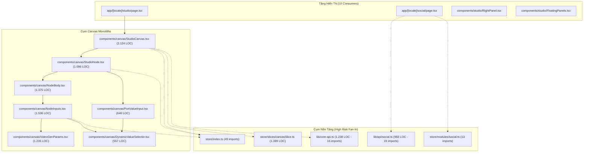
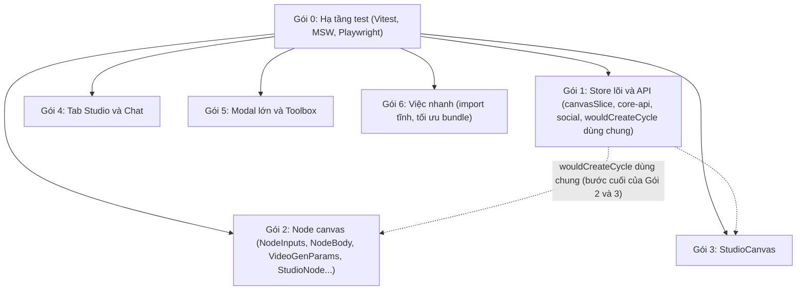

# KẾ HOẠCH KIẾN TRÚC TÁI CẤU TRÚC VÀ TÁCH COMPONENT DASHBOARD
> **Tài liệu nguồn:** `ai/plans/refactor-components.md`  
> **Vai trò:** Kiến trúc sư Frontend (Frontend System Architect)  
> **Mục tiêu tối thượng:** An toàn tuyệt đối (Zero Regression) – Tối ưu hiệu năng render (Measurable Performance) – Dễ debug và bảo trì cho AI Agents (AI-Ready Modularity).  
> **Phạm vi áp dụng:** Toàn bộ mã nguồn `tool/dashboard` (Next.js 15, React 19, Zustand 5, @xyflow/react).  
> **Phiên bản:** v2, cập nhật 2026-11-09, đo lại tại commit `210e8e5ff` (v1 đo tại `3278f28ce`). Xem mục 0 để biết v2 đã sửa gì.

---

## 0. NHẬT KÝ CẬP NHẬT V2 (2026-11-09)

v1 được đo ngay khi khai báo token thiết kế. Sau đó các agent chuyển token đã sửa/tách nhiều file nên một số số liệu và giả định của v1 không còn đúng. v2 đo lại và sửa. Cột "Cách kiểm lại" cho phép bất kỳ ai chạy lại.

| # | Thay đổi so với v1 | Cách kiểm lại |
| :-: | :--- | :--- |
| 1 | Token thiết kế ĐÃ chuyển xong: `check:design` = **0 vi phạm / 134 tệp** (v1: 2.033 / 125). Mục H và K.3 viết lại. | `cd tool/dashboard && npm run -s check:design` |
| 2 | 4 file đã được tách MỘT PHẦN ngoài kế hoạch: `NodeInputs` 1.536→1.194, `NodeBody` 1.375→908, `VideoGenParams` 1.235→764, `ProjectTab` 1.208→425. File mới: `AdaptiveExpandingTextarea`, `EpisodeScriptPicker`, `SpeakTextBox`, `CastPreview`, `CharacterHero`, `videoModelLogos.tsx`, `fallbackVideoModels.ts`, `CharacterProfileDetail.tsx` (795 dòng). B và C của các file này viết lại. | `wc -l` các file trên |
| 3 | Số file trên 1.000 dòng: 12 → **9** (`StudioCanvas`, `canvasSlice`, `core-api`, `CreateVideoModal`, `ChatTab`, `NodeInputs`, `PublishCenterModal`, `ToolboxPanel`, `StudioNode`). | `find app components lib store -name "*.ts*" \| xargs wc -l` |
| 4 | `CAST_CACHE` đã chuyển sang `components/canvas/CastPreview.tsx:12` (v1 ghi `NodeBody.tsx:523`). | `grep -rn CAST_CACHE components` |
| 5 | `toCoreGraph` chỉ có MỘT định nghĩa: `lib/core-api.ts:819`. `StudioCanvas.tsx:115` chỉ re-export. Bỏ bản trùng v1 đề xuất ở C.1. | `grep -rnE "(function\|const) toCoreGraph" components lib` |
| 6 | `lib/studio-agent.ts:91` (không phải :120) nạp động `StudioCanvas` chỉ để lấy `toCoreGraph`; có thể nhập thẳng từ `lib/core-api`. | `grep -n StudioCanvas lib/studio-agent.ts` |
| 7 | Mục tiêu bundle "361 kB → dưới 220 kB" của v1 BỊ BỎ: giả định "modal nặng nằm trong bundle ban đầu" sai (xem E.1). Baseline 361 kB vẫn đúng (đo lại: trang 95,9 kB + dùng chung 103 kB). | `NEXT_DIST_DIR=.next-build-x npx next build` |
| 8 | Sửa 2 nhận định kỹ thuật sai (B.2, B.6) về "render lại do chung module / dữ liệu tĩnh". | xem B.2, B.6 |
| 9 | Lưới an toàn (D.1) mở rộng: v1 chỉ có 3 test nên Gói 4 và 5 không có gì bảo vệ. | xem D.1, G |
| 10 | G: sửa sơ đồ phụ thuộc (Gói 3 không cần Gói 2), bổ sung quyền sở hữu file, thêm Gói 6 (việc nhanh không cần tách file). | xem G |
| 11 | CHƯA đo lại ở v2: số hook/store (cột bị bỏ khỏi A.1), số fan-in ở A.2, ước lượng giờ ở mục I, con số "commit > 45 ms". Các mục này ghi rõ "chưa xác minh". | |

---

## 1. NGUYÊN TẮC CỐT LÕI & TIÊU CHUẨN KIẾN TRÚC

1. **Bảo toàn hành vi 100% (Zero Visible Change):** Mọi thao tác tách file, di chuyển logic, bóc tách hook phải đảm bảo giao diện, DOM attribute, animation và phản hồi người dùng giữ nguyên vẹn. Không trộn lẫn refactor cấu trúc với việc sửa tính năng hoặc đổi design token trong cùng một bước.
2. **Ranh giới Render lại (Re-render Boundaries):** State đặt sát nhất có thể với nơi tiêu thụ. Triệt tiêu tình trạng state tầng trên (top-level) làm render lại cây con hàng nghìn dòng. Sử dụng atomic store selectors (`useShallow` cục bộ hoặc selector đơn trường).
3. **Mô-đun hóa tính năng (Feature-Folder Architecture):** Gom các file liên quan theo thư mục tính năng (`components/canvas/node-inputs/`, `components/canvas/viewport/`, `store/slices/canvas/`).
4. **Bảo tồn đường dẫn nhập khẩu (Backward-Compatible Re-exports):** Mỗi thư mục mới bắt buộc có `index.ts` re-export đầy đủ các thành phần cũ với đúng tên nguyên bản để không làm gãy các file đang import từ ngoài.
5. **Đo đạc thực nghiệm, không phỏng đoán (Measure, Don't Guess):** Mọi nhận định về nghẽn hiệu năng, kích thước chunk và số lần render phải đi kèm số liệu đo đạc thực tế từ công cụ build và Profiler.

---

## A. KIỂM KÊ TOÀN DIỆN & SƠ ĐỒ PHỤ THUỘC (INVENTORY & DEPENDENCIES)

### A.1. Bảng kiểm kê các tệp tin >= 400 dòng tại `tool/dashboard` (đo lại v2 tại `210e8e5ff`)
*(LOC đo trực tiếp. Các cột số hook/store/sub-component của v1 bị bỏ vì chưa đo lại; cần thì chạy `grep -c "useState(" <file>`. Cột "Trách nhiệm" lấy từ v1, chưa đọc lại từng file.)*

| STT | Tệp tin | LOC v2 | LOC v1 | Trạng thái | Trách nhiệm đang trộn lẫn (v1) |
| :---: | :--- | :---: | :---: | :--- | :--- |
| 1 | `components/canvas/StudioCanvas.tsx` | **2.128** | 2.124 | không đổi | Viewport, ReactFlow events, Hotkeys, Auto-save, Graph layout, Modals |
| 2 | `store/slices/canvasSlice.ts` | **1.388** | 1.389 | không đổi | Node/Edge CRUD, 300 dòng hardcode story templates, DFS algorithms, IDB sync |
| 3 | `lib/core-api.ts` | **1.237** | 1.238 | không đổi | 531 dòng hardcode fallback types, cost estimation, graph validation, NLP parser |
| 4 | `components/studio/CreateVideoModal.tsx` | **1.226** | 1.226 | không đổi | Wizard 3 bước: Template picker, Script/Craft generator, Multi-platform publishing |
| 5 | `components/studio/tabs/ChatTab.tsx` | **1.207** | 1.221 | không đổi | Chat streaming, slash commands, agent workflow, approval dialogs, layout |
| 6 | `components/canvas/NodeInputs.tsx` | **1.194** | 1.536 | **đã tách một phần** (-342) | 11 loại input khác nhau, upload file, parse kịch bản, audio player |
| 7 | `components/social/PublishCenterModal.tsx` | **1.188** | 1.189 | không đổi | Video metadata editor, platform overrides (TikTok/YT/FB), calendar scheduler |
| 8 | `components/toolbox/ToolboxPanel.tsx` | **1.096** | 1.097 | không đổi | 5 workspace độc lập (BgRemove, Audio, Depth, Scene, VoiceClone), File uploads |
| 9 | `components/canvas/StudioNode.tsx` | **1.094** | 1.096 | không đổi | Node frame, inline title edit, dynamic handle math, context menu, run trigger |
| 10 | `lib/api/social.ts` | **981** | 982 | không đổi | 35+ interface definitions, 45+ endpoint methods cho 7 phân hệ social |
| 11 | `components/studio/chat/SophisticatedChatInput.tsx` | **948** | 947 | không đổi | Textarea expand, Speech recognition, Slash command popover, Attachment bar |
| 12 | `components/canvas/NodeBody.tsx` | **908** | 1.375 | **đã tách một phần** (-467) | 10+ node renderers, script regex parsing, audio hover preview, video poster |
| 13 | `components/studio/tabs/CharacterProfileDetail.tsx` | **795** | - | **MỚI** (sau v1) | Hồ sơ nhân vật (tách ra từ ProjectTab); chưa khảo sát chi tiết |
| 14 | `components/canvas/VideoGenParams.tsx` | **764** | 1.235 | **đã tách một phần** (-471) | 272 dòng video models data, 15 SVG logos, camera params, prompt textarea |
| 15 | `components/studio/tabs/JobsCostTab.tsx` | **706** | 707 | không đổi | Job history table, status filtering, cost metrics aggregation, cancel job API |
| 16 | `components/navigation/UserBubble.tsx` | **680** | 681 | không đổi | API keys manager drawer, project switcher, language selector, theme toggle |
| 17 | `components/canvas/PortValueInput.tsx` | **645** | 646 | không đổi | Type-specific input picker, script reference picker, trùng lặp code cycle check |
| 18 | `components/studio/AIModelsLibraryModal.tsx` | **625** | 626 | không đổi | Catalog search, category filter pills, model spec sheet, provider comparison |
| 19 | `components/studio/tabs/PublishTab.tsx` | **605** | 606 | không đổi | Accounts summary widget, calendar queue preview, direct post publisher |
| 20 | `components/canvas/GenericParams.tsx` | **586** | 587 | không đổi | Form generator cho 8 node types mới, slot mapping, validation rules |
| 21 | `components/studio/ModelPicker.tsx` | **581** | 582 | không đổi | Model dropdown popover, search filter, commercial pricing tag, provider logos |
| 22 | `components/social/hub/Queue/QueueView.tsx` | **564** | 565 | không đổi | Queue bucket navigation, batch selection, drag-and-drop reschedule |
| 23 | `components/characters/CharacterDetail.tsx` | **546** | 547 | không đổi | Character inspect sheet, master DNA preview, voice audition, expressions |
| 24 | `components/social/CalendarView.tsx` | **529** | 530 | không đổi | Calendar month/week grid, scheduled post cards, golden hour indicators |
| 25 | `components/characters/CharacterDialog.tsx` | **523** | 524 | không đổi | Create/Edit character modal, prompt tags, voice-id linking, asset uploader |
| 26 | `store/modules/social.ts` | **519** | 520 | không đổi | Social store state: accounts, queue filters, calendar view state, batch publish |
| 27 | `components/project/ProjectHub.tsx` | **519** | 520 | không đổi | Project dashboard, episodes manager, brand kit assets, storage stats |
| 28 | `components/canvas/DynamicValueFlyout.tsx` | **510** | - | **MỚI** (sau v1) | Flyout chọn giá trị động `{source.value}`; chưa khảo sát chi tiết |
| 29 | `components/studio/tabs/NodeTab.tsx` | **483** | 484 | không đổi | Selected node inspector, ports editor delegation, dynamic params delegate |
| 30 | `components/characters/CharactersManager.tsx` | **477** | 478 | không đổi | Character list strip, create dialog trigger, active character selection |
| 31 | `components/project/ProductsManager.tsx` | **472** | 472 | không đổi | Product catalog table, scrape product from URL, image gallery, specs |
| 32 | `lib/repositories/local.ts` | **470** | 471 | không đổi | IDB project/asset persistence, binary blob caching, dirty checking |
| 33 | `components/voice/VoiceCloneModal.tsx` | **464** | 465 | không đổi | Voice cloning consent form, audio sample recording, dialect selector |
| 34 | `components/studio/PolicyEditor.tsx` | **454** | 455 | không đổi | Policy rules editor, banned words tag input, spending limit thresholds |
| 35 | `components/social/PostComposer.tsx` | **439** | 440 | không đổi | Post text editor, hashtags generator, media attachment, schedule time |
| 36 | `components/social/hub/VideoLibrary/VideoLibraryView.tsx` | **433** | 434 | không đổi | Rendered video grid, video preview modal trigger, filter by status |
| 37 | `components/social/hub/Accounts/AccountsView.tsx` | **426** | 427 | không đổi | Social account cards, connect OAuth modal triggers, token health check |
| 38 | `components/studio/tabs/ProjectTab.tsx` | **425** | 1.208 | **đã tách một phần** (-783) | General settings, Character roster, Voice testing & OmniVoice cloning modal |
| 39 | `components/social/AccountDetailSheet.tsx` | **417** | 418 | không đổi | Account details drawer, audience analytics, posting windows settings |
| 40 | `components/project/ProjectsTab.tsx` | **417** | 418 | không đổi | Multi-project manager, project switcher cards, new project creation wizard |
| 41 | `components/social/hub/Templates/TemplatesView.tsx` | **404** | 405 | không đổi | Template cards grid, category tags filter, apply template to post composer |

Đã xuống dưới 400 dòng so với v1: `components/canvas/DynamicValueSelector.tsx` (95).

---

### A.2. Sơ đồ phụ thuộc & Điểm rủi ro cao (Dependency Graph & High Fan-In)

#### 1. Các tệp tin có Fan-in (số nơi phụ thuộc) cao nhất dự án *(số liệu v1, CHƯA đo lại ở v2)*:
- `lib/utils.ts`: **78 imports** (Tiện ích dùng chung - Cực kỳ quan trọng)
- `components/ui/icons.ts`: **76 imports** (Hệ thống Morphicons - Cấm sửa đổi cấu trúc)
- `store/index.ts`: **49 imports** (Zustand root store - Điểm nghẽn rủi ro cấp 1)
- `lib/api/social.ts`: **19 imports** (982 dòng - Rủi ro gãy API rất cao)
- `lib/core-api.ts`: **16 imports** (1.238 dòng - Rủi ro gãy Studio Canvas & Execution rất cao)
- `store/modules/social.ts`: **13 imports** (Store quản lý toàn bộ phân hệ Social)
- `store/slices/canvasSlice.ts`: **10 imports** (Slice lõi của Studio Canvas)



#### 2. Rủi ro phụ thuộc chéo và phát hiện vòng lặp (Cycles & Coupling):
- **Phụ thuộc ngược từ thư viện vào UI (Inverted UI Dependency):**  
  Tại `lib/studio-agent.ts:91`, file logic agent đang import động:  
  `const { toCoreGraph } = await import("@/components/canvas/StudioCanvas");`  
  *Nguy cơ:* Một tệp logic thuần ở tầng thư viện (`lib/`) lại phải load nguyên tệp giao diện 2.124 dòng `StudioCanvas.tsx` chỉ để lấy một hàm chuyển đổi dữ liệu đồ thị! *(v2: hàm này thực ra định nghĩa ở `lib/core-api.ts:819`; `StudioCanvas.tsx:115` chỉ re-export, nên `studio-agent.ts` có thể nhập thẳng từ `@/lib/core-api`.)*
- **Trùng lặp thuật toán đồ thị:**  
  Thuật toán kiểm tra vòng lặp `wouldCreateCycle` bị viết lặp lại độc lập ở cả:
  - `components/canvas/StudioCanvas.tsx:117` (khai báo `wouldCreateCycle`)
  - `components/canvas/PortValueInput.tsx:59` (khai báo `wouldCreateCycle`)
- **Mức độ phụ thuộc vòng (Circular Dependencies):**  
  Phân tích đồ thị nhập khẩu cho thấy hiện tại **chưa có cycle cứng** (0 cycles detected), nhưng độ kết dính (coupling) cực kỳ chặt chẽ giữa `StudioCanvas` -> `StudioNode` -> `NodeBody` -> `NodeInputs`.

---

## B. PHÂN TÍCH CHUYÊN SÂU 12 TỆP LỚN NHẤT (danh sách của v1; ở v2 còn 9 tệp trên 1.000 dòng)

> **Phạm vi xác minh v2:** các mục B.2, B.4, B.6, B.8, B.9 đã đo lại. B.1 chỉ kiểm lại các dòng nêu trong ghi chú cuối mục. B.3, B.5, B.7, B.10, B.11, B.12 giữ nội dung và số dòng tham chiếu của v1 (LOC tổng chỉ lệch 1-2 dòng), CHƯA đọc lại; phải kiểm các dải dòng trước khi tách.


---

### 1. `components/canvas/StudioCanvas.tsx` (2.128 dòng)
- **Các trách nhiệm đang bị nhồi nhét:**
  1. *Chuyển đổi đồ thị thuần túy:* `toCoreGraph` và `wouldCreateCycle` (Dòng 114–136).
  2. *Bộ chọn Store khổng lồ (Wide Store Selector):* Dòng 234–278 sử dụng `useStudioStore(useShallow(...))` để bốc một lúc **30 thuộc tính** (từ nodes, edges, selectedNodeId đến executionState, runPolicy, undo/redo stack).
  3. *Lắng nghe phím tắt toàn cục (Global Hotkeys):* Dòng 304–399 lắng nghe sự kiện bàn phím `keydown` cho Cmd+Z, Cmd+Shift+Z, Delete, Cmd+S, Space.
  4. *Tự động lưu và đồng bộ:* Dòng 410–440 xử lý debounce auto-save đồ thị vào IDB/backend.
  5. *Thuật toán chống đè node (Overlap Resolver):* Dòng 445–499 tính toán va chạm tọa độ bounding box.
  6. *Logic kéo nối cổng (Port Drag & Connecting):* Dòng 500–600 quản lý `activeDragPort`, ghost line khi kéo dây nối.
  7. *Điều phối thực thi đồ thị (Execution Orchestrator):* Dòng 899–1100 xử lý mock mode, spending limit confirm dialog, polling job status.
  8. *Khung nhìn ReactFlow và các thanh công cụ:* Dòng 1600–2124 chứa toàn bộ JSX của canvas, dock dưới, context menu.
- **Vùng render lại thừa (Wasted Rerenders):**
  - Bất kỳ khi nào một node con cập nhật params (ví dụ: gõ 1 ký tự trong ô prompt của node LLM), mảng `nodes` trong store thay đổi tham chiếu, khiến `useShallow` ở dòng 234 kích hoạt render lại toàn bộ `StudioCanvasInner` (1.939 dòng JSX).
  - Khi người dùng kéo chuột nối cổng, state `activeDragPort` (dòng 286) thay đổi liên tục theo tọa độ chuột, kích hoạt render lại toàn bộ canvas thay vì chỉ vẽ một SVG layer nổi.

- **Ghi chú xác minh v2 (chỉ những dòng đã kiểm lại):** `toCoreGraph` là re-export ở dòng 115 (định nghĩa thật ở `lib/core-api.ts:819`); `wouldCreateCycle` khai báo ở dòng 117; `useShallow` bốc một khối lớn từ dòng 235-236; `activeDragPort` là `useState` ở dòng 287. Các số dòng khác trong mục này là của v1, chưa kiểm lại; phải kiểm trước khi tách.

---

### 2. `components/canvas/NodeInputs.tsx` (1.194 dòng; v1: 1.536) — ĐÃ TÁCH MỘT PHẦN
- **Đã tách ra file riêng (có trước v2):** `AdaptiveExpandingTextarea.tsx` và `EpisodeScriptPicker.tsx`, cùng thư mục `components/canvas/`.
- **Còn trong file (đo v2, theo vị trí khai báo):** 9 component. Mô tả lấy từ v1, chưa đọc lại.
  1. `NodeTextInput` (59-174, ~116 dòng): textarea node văn bản kèm bộ chọn biến.
  2. `NodeImageInput` (175-500, ~326 dòng): tải ảnh, dán URL, thư viện ảnh dự án. **Vượt ngưỡng 250 dòng của quy chuẩn**, cần tách tiếp nhưng ranh giới chưa khảo sát.
  3. `NodeScriptInput` (501-760, ~260 dòng): bóc tách kịch bản, bảng phân vai.
  4. `NodeVoiceInput` (761-835, ~75 dòng): chọn giọng, nghe thử.
  5. `NodeImageGenInput` (836-1006, ~171 dòng): tham số tạo ảnh.
  6. `NodeVideoGenInput` (1007-1030, ~24 dòng): wrapper `VideoGenParams`.
  7. `NodeExportInput` (1031-1129, ~99 dòng): định dạng xuất, bitrate, FPS.
  8. `NodeCharacterSelect` (1130-1157, ~28 dòng).
  9. `NodeCaptionsInput` (1158-1194, ~37 dòng).
- **Nhận định kỹ thuật đã sửa:** v1 cho rằng 11 component chung module "khiến effect của component khác bị đánh giá lại khi thao tác một component". Sai: effect chỉ chạy khi component được mount, và component chỉ render lại khi props/state/context của chính nó đổi. Việc tách file KHÔNG tự giảm số lần render. Lợi ích của tách file là dễ đọc, dễ debug, và cho phép lazy-load; giảm render phải làm bằng selector hẹp, `memo` và hạ state xuống sát nơi dùng (E.2).
- **Điều chưa xác minh:** `AdaptiveExpandingTextarea` có thật sự gây giật các node xung quanh hay không (v1 nêu nhưng không kèm số đo).

---

### 3. `store/slices/canvasSlice.ts` (1.388 dòng)
- **Các trách nhiệm đang bị nhồi nhét:**
  1. *Khai báo kiểu và hằng số:* `PORT_TYPE_COLORS`, cấu hình collapse (Dòng 24–141).
  2. *Dữ liệu mẫu đồ thị khổng lồ:* `genericizeTemplate`, `buildSocNhoStoryTemplate`, `DEFAULT_EPISODES` chiếm gần 300 dòng mã (Dòng 142–442) chỉ để chứa mảng JSON tọa độ và cấu hình các node mẫu.
  3. *Thuật toán đồ thị:* `collectDownstreamIds` (duyệt DFS tìm node hạ nguồn, dòng 526–552).
  4. *Đồng bộ bộ nhớ lưu trữ:* `syncProjectWorkspace` (dòng 553–573).
  5. *State Creator khổng lồ:* `createCanvasSlice` (Dòng 576–1388) gồm hơn 40 actions quản lý từ Node/Edge CRUD, Undo/Redo stack, Selection, Template loading đến Execution status và Validation.
- **Rủi ro kiến trúc:** Bất kỳ module nào cần import `PORT_TYPE_COLORS` hoặc kiểu `StudioNodeData` đều phải kéo theo toàn bộ 1.389 dòng của `canvasSlice`.

---

### 4. `components/canvas/NodeBody.tsx` (908 dòng; v1: 1.375) — ĐÃ TÁCH MỘT PHẦN
- **Đã tách ra file riêng:** `SpeakTextBox.tsx`, `CastPreview.tsx` (chứa `CAST_CACHE` ở dòng 12), `CharacterHero.tsx`.
- **Còn trong file (đo v2):** các helper `Empty` (51), `ImagePreview` (73), `VoiceHoverSpeaker` (107), `PolicyBadge` (179), `EpisodeOutputPreview` (212), `ShotPackLink` (280), và `NodeBody` (298-908, ~610 dòng) chứa phần điều hướng theo loại node. Cấu trúc bên trong `NodeBody` chưa đọc lại ở v2.
- **Về render lại:** v1 nói `CastPreview` chạy regex ở mỗi lần render. v2: kết quả đã được cache theo khóa trong `CAST_CACHE` nên nhận định này cần đo lại trước khi coi là vấn đề.

---

### 5. `lib/core-api.ts` (1.237 dòng)
- **Các trách nhiệm đang bị nhồi nhét:**
  1. *Static Metadata khổng lồ:* `FALLBACK_NODE_TYPES` chiếm **531 dòng mã** (Dòng 30–561) định nghĩa schemas của từng node.
  2. *Ước lượng chi phí (Cost Estimation):* `estimateNodeCostUsd` (Dòng 562–716) chứa bảng giá cứng của Midjourney, Kling, Runway, ElevenLabs.
  3. *Kiểm tra tính hợp lệ của đồ thị:* `validateGraphLocally` (Dòng 717–818).
  4. *Chuyển đổi đồ thị Core:* `toCoreGraph` và `normalizeGraphForCore` (Dòng 799–872).
  5. *Giao tiếp mạng HTTP:* Các hàm `fetchNodeTypes`, `saveProjectGraph`, `runGraphOnCore` (Dòng 873–1093).
  6. *Phân tích ngôn ngữ tự nhiên (Client-side NLP):* `parseStudioCommandClientSide` (Dòng 1094–1237) bóc tách câu lệnh tiếng Việt/Anh để tự sinh node.
- **Rủi ro kiến trúc:** Một file tiện ích giao tiếp API lại ôm trọn metadata, logic tính tiền, logic kiểm tra đồ thị và bộ parser lệnh chat. 16 file khác nhau trong dự án đang phụ thuộc vào file này.

---

### 6. `components/canvas/VideoGenParams.tsx` (764 dòng; v1: 1.235) — ĐÃ TÁCH MỘT PHẦN
- **Đã tách ra file riêng:** `videoModelLogos.tsx` (logo thương hiệu), `fallbackVideoModels.ts` (danh mục model).
- **Còn trong file (đo v2):** hằng `ASPECT` (dòng 33) và MỘT component `VideoGenParams` từ dòng 40 đến 764 (~725 dòng, một hàm).
- **Nhận định kỹ thuật đã sửa:** v1 nói đổi thanh Seed làm "15 logo và danh mục 272 dòng bị render lại". Dữ liệu tĩnh không "render"; logo SVG chỉ render lại nếu component cha render lại và logo không được `memo`. Cần đo bằng Profiler trước khi kết luận.
- **Việc còn lại:** tách thân `VideoGenParams` thành các phần form (chọn model, prompt, camera, thời lượng/tỉ lệ/độ phân giải/số biến thể, ước tính chi phí). Ranh giới cụ thể chưa khảo sát.

---

### 7. `components/studio/CreateVideoModal.tsx` (1.226 dòng)
- **Các trách nhiệm đang bị nhồi nhét:**
  - Quản lý tới **31 useState độc lập** (Dòng 77–121).
  - Ôm trọn cả 3 bước của quy trình tạo video trong một hàm duy nhất:
    - *Bước 1:* Chọn kịch bản mẫu từ thư viện (Dòng 200–450).
    - *Bước 2:* Tự động sinh kịch bản bằng AI, cấu hình nhân vật, giọng đọc, và các kỹ thuật Video Craft (Hook A/B/C, chiều sâu 3 lớp, chuyển cảnh) (Dòng 451–850).
    - *Bước 3:* Phân phối đa kênh (TikTok, YouTube, FB), kết nối tài khoản, ước tính chi phí, tạo hàng loạt (Batch mode) (Dòng 851–1225).
- **Vùng render lại thừa:** Gõ một ký tự vào ô chủ đề (topic) kích hoạt render lại toàn bộ component modal 1.226 dòng cùng 31 state.

---

### 8. `components/studio/tabs/ChatTab.tsx` (1.207 dòng; v1: 1.221)
- **Đã có trong `components/studio/chat/`:** `ChatContextBar.tsx` (299 dòng), `ChatMessageList.tsx` (125), `ChatPendingConfirmModal.tsx` (56), `SophisticatedChatInput.tsx` (948).
- **Vấn đề v2 xác nhận:** `ChatTab` vẫn là MỘT hàm bắt đầu từ dòng 32 và kéo dài hết file (~1.175 dòng), nên các component con mới chỉ lấy một phần nhỏ trách nhiệm.
- **Trách nhiệm trộn lẫn (từ v1, chưa đọc lại):** luồng hội thoại AI và streaming, lệnh slash, quy trình agent, xác nhận chạy lệnh, bố cục.

---

### 9. `components/studio/tabs/ProjectTab.tsx` (425 dòng; v1: 1.208) — GẦN HOÀN TẤT, PHÁT SINH FILE MỚI
- Phần hồ sơ nhân vật đã được tách sang `components/studio/tabs/CharacterProfileDetail.tsx`, nhưng file mới này lớn: **795 dòng**, vượt xa ngưỡng 250 dòng. Chưa khảo sát cấu trúc bên trong.
- `ProjectTab` còn 425 dòng, chưa thật cần tách thêm ở v2 (xem C.8).

---

### 10. `components/social/PublishCenterModal.tsx` (1.188 dòng)
- **Các trách nhiệm đang bị nhồi nhét:**
  - Quản lý 23 `useState`.
  - Xử lý cùng lúc: xem trước video, biên tập tiêu đề/mô tả/hashtag, thiết lập cấu hình đặc thù cho từng nền tảng (TikTok duet/stitch, YouTube playlist/kids, Facebook page), chọn khung giờ vàng trên lịch, và theo dõi tiến trình tải video lên mạng xã hội.

---

### 11. `components/toolbox/ToolboxPanel.tsx` (1.096 dòng)
- **Các trách nhiệm đang bị nhồi nhét:**
  - Chứa tới **5 workspace tính năng riêng biệt** trong một file duy nhất:
    1. `BgRemoveWorkspace` (Dòng 294–391): Tách nền ảnh/video.
    2. `AudioWorkspace` (Dòng 392–479): Tách vocal, nén âm, lồng tiếng.
    3. `DepthWorkspace` (Dòng 480–567): Tạo bản đồ độ sâu 3D depth map.
    4. `SceneWorkspace` (Dòng 568–669): Nhận diện phân cảnh và cắt shot.
    5. `VoiceCloneWorkspace` (Dòng 670–776): Thu âm và huấn luyện giọng.
  - Kèm theo 49 hook `useState` và các component dùng chung (`Dropzone`, `SaveBar`, `ErrorLine`).

---

### 12. `components/canvas/StudioNode.tsx` (1.094 dòng)
- **Các trách nhiệm đang bị nhồi nhét:**
  - Đây là custom node được khởi tạo cho **từng node trên canvas** (nếu canvas có 20 node thì có 20 instance của `StudioNode` chạy song song).
  - Vừa render khung vỏ (header, tiêu đề inline editing, nút đóng/mở), vừa tính toán vị trí tọa độ cổng kết nối (dynamic handles math), vừa hiển thị thanh công cụ thao tác nhanh (duplicate, delete, bypass, run), vừa bọc component `NodeBody`.
  - Thiếu `ErrorBoundary` cục bộ: Nếu 1 node gặp lỗi render dữ liệu, toàn bộ canvas bị sập (White Screen of Death).

---

## C. ĐỀ XUẤT CẤU TRÚC CHIA CHO TỪNG TỆP TIN LỚN

> **Quy chuẩn kiến trúc:**
> - Component hiển thị: **Tối đa ~250 dòng**.
> - Custom Hook: **Tối đa ~150 dòng**.
> - Logic thuần (Pure TypeScript): Tách vào file `.ts` không chứa React (dễ viết unit test).
> - Giữ nguyên đường dẫn import thông qua re-export tại `index.ts` của từng thư mục tính năng.

---

### C.1. Tái cấu trúc `components/canvas/StudioCanvas.tsx` (2.128 dòng)
Tách thành module: `components/canvas/studio-canvas/`

| Tệp tin mới | Vai trò & Trách nhiệm | LOC dự kiến | Export | Props / Interface |
| :--- | :--- | :---: | :--- | :--- |
| `index.tsx` | Re-export `StudioCanvas` và `toCoreGraph` (re-export từ `@/lib/core-api`) để giữ nguyên tương thích 100% | ~25 | `StudioCanvas`, `toCoreGraph` | `StudioCanvasProps` |
| `StudioCanvasRoot.tsx` | Component bao ngoài cùng, cung cấp `ReactFlowProvider` và `CanvasErrorBoundary` | ~80 | `StudioCanvasRoot` | None |
| `StudioCanvasViewport.tsx` | Vùng hiển thị chính của ReactFlow, gắn nodes/edges, Minimap, Controls, Background | ~220 | `StudioCanvasViewport` | None (lấy từ hook canvas) |
| `hooks/useCanvasShortcuts.ts` | Lắng nghe toàn bộ sự kiện bàn phím (Cmd+Z, Cmd+S, Delete, Space, Zoom) | ~110 | `useCanvasShortcuts` | `(handlers: ShortcutHandlers) => void` |
| `hooks/useCanvasConnections.ts` | Xử lý sự kiện kéo thả dây nối (`onConnect`, `onConnectStart`, `onConnectEnd`, cycle check) | ~130 | `useCanvasConnections` | `() => ConnectionHandlers` |
| `hooks/useCanvasAutoSave.ts` | Debounce auto-save đồ thị vào IDB và backend API | ~90 | `useCanvasAutoSave` | `(projectId: string) => void` |
| `hooks/useCanvasExecution.ts` | Điều phối chạy thử nghiệm đồ thị (mock mode, spending limit modal, polling) | ~140 | `useCanvasExecution` | `() => ExecutionControls` |
| `components/CanvasOverlayToolbar.tsx`| Thanh công cụ nổi trên canvas (chọn chế độ con trỏ, snap-to-grid, zoom level) | ~160 | `CanvasOverlayToolbar` | None |
| `components/CanvasBottomDock.tsx` | Thanh điều khiển phía dưới (chạy graph, nút Undo/Redo, thông báo banner) | ~180 | `CanvasBottomDock` | None |
| `components/CanvasModalsHost.tsx` | Nơi tập trung hiển thị `CreateVideoModal`, `PendingRunConfirmDialog` (load dynamic) | ~120 | `CanvasModalsHost` | None |
| `components/LinkGhostLayer.tsx` | Lớp vẽ đường dây nối ảo khi đang kéo chuột từ cổng | ~90 | `LinkGhostLayer` | `{ from: ActiveDragPort }` |
| `utils/graphAlgorithms.ts` | Logic thuần: `resolveOverlaps` (chống đè node). KHÔNG chứa `toCoreGraph` và KHÔNG tự định nghĩa `wouldCreateCycle` (xem ghi chú v2 bên dưới) | ~100 | `resolveOverlaps` | Pure function (Unit tested) |


> **Ghi chú v2 (sửa lỗi của v1):** v1 đề xuất đặt `toCoreGraph` vào `utils/graphAlgorithms.ts` VÀ vào `lib/core/graphTransformers.ts` (C.5): sẽ thành hai bản. Thực tế `toCoreGraph` chỉ định nghĩa một lần ở `lib/core-api.ts:819`; `StudioCanvas.tsx:115` chỉ re-export. Giữ MỘT bản ở `lib/core/graphTransformers.ts` (Gói 1). Hàm `wouldCreateCycle` đang bị viết trùng ở `StudioCanvas.tsx:117` và `PortValueInput.tsx:59`: Gói 1 tạo bản dùng chung `lib/graph/wouldCreateCycle.ts` (có test), sau đó Gói 2 và Gói 3 thay bản cục bộ của mình bằng import từ đó. `lib/studio-agent.ts:91` đổi sang `import { toCoreGraph } from "@/lib/core-api"` (Gói 1).
---

### C.2. Tái cấu trúc `components/canvas/NodeInputs.tsx` (1.194 dòng, v2)
Tách thành module: `components/canvas/node-inputs/`. Hai file `AdaptiveExpandingTextarea.tsx` và `EpisodeScriptPicker.tsx` ĐÃ tách sẵn ở `components/canvas/`; chuyển chúng vào thư mục mới ở bước cuối (sau khi các nơi import được cập nhật, hoặc để re-export tại chỗ cũ).

| Tệp tin mới | Vai trò | LOC v2 (hiện) | Ghi chú |
| :--- | :--- | :---: | :--- |
| `index.ts` | Barrel re-export 9 input còn lại + 2 file đã tách | ~30 | Giữ nguyên đường dẫn import cũ qua `components/canvas/NodeInputs.tsx` (file cũ chỉ còn re-export) |
| `NodeTextInput.tsx` | Ô văn bản + bộ chọn biến | ~116 | |
| `NodeImageInput.tsx` | Tải ảnh, dán URL, thư viện ảnh | ~326 | Vượt ngưỡng 250: sau khi tách, khảo sát tách tiếp (dropzone/URL/thư viện). Ranh giới CHƯA khảo sát |
| `NodeScriptInput.tsx` | Biên tập kịch bản, bảng phân vai | ~260 | Nếu có logic bóc tách thuần thì tách `utils/scriptParser.ts` (chưa xác minh có hay không) |
| `NodeVoiceInput.tsx` | Chọn giọng, nghe thử | ~75 | |
| `NodeImageGenInput.tsx` | Tham số tạo ảnh | ~171 | |
| `NodeVideoGenInput.tsx` | Wrapper `VideoGenParams` | ~24 | |
| `NodeExportInput.tsx` | Định dạng xuất, bitrate, FPS | ~99 | |
| `NodeCharacterSelect.tsx` | Chọn nhân vật chính | ~28 | |
| `NodeCaptionsInput.tsx` | Cấu hình phụ đề | ~37 | |

---

### C.3. Tái cấu trúc `store/slices/canvasSlice.ts` (1.388 dòng)
Tách thành module: `store/slices/canvas/`

| Tệp tin mới | Vai trò & Trách nhiệm | LOC dự kiến | Export | Ghi chú |
| :--- | :--- | :---: | :--- | :--- |
| `index.ts` | Export `createCanvasSlice` ghép từ các sub-slices | ~50 | `createCanvasSlice` | Giữ nguyên API của Zustand store |
| `types.ts` | Gom toàn bộ `StudioNodeData`, `PortType`, `CollapseConfig` | ~120 | All Types & Constants | Độc lập, không import từ code UI |
| `templates/socNhoStoryTemplate.ts` | Chứa dữ liệu kịch bản mẫu và hàm `buildSocNhoStoryTemplate` | ~250 | `buildSocNhoStoryTemplate` | Tách riêng 300 dòng dữ liệu tĩnh |
| `templates/templateUtils.ts` | Hàm tiện ích `genericizeTemplate`, `DEFAULT_EPISODES` | ~80 | `genericizeTemplate` | Pure function |
| `nodesSlice.ts` | Action handlers cho Node (add, remove, updateParams, collapse) | ~220 | `createNodesSubSlice` | Zustand sub-slice |
| `edgesSlice.ts` | Action handlers cho Edge (add, remove, connect) | ~140 | `createEdgesSubSlice` | Zustand sub-slice |
| `historySlice.ts` | Action handlers cho Undo/Redo snapshots | ~130 | `createHistorySubSlice` | Zustand sub-slice |
| `executionSlice.ts` | Trạng thái chạy đồ thị, tiến độ từng node, spending limit | ~160 | `createExecutionSubSlice` | Zustand sub-slice |
| `persistence.ts` | Logic thuần lưu trữ và tải từ IDB (`syncProjectWorkspace`) | ~90 | `syncProjectWorkspace` | Không phụ thuộc React |

---

### C.4. Tái cấu trúc `components/canvas/NodeBody.tsx` (908 dòng, v2)
Tách thành module: `components/canvas/node-body/`. `SpeakTextBox.tsx`, `CastPreview.tsx`, `CharacterHero.tsx` ĐÃ tách sẵn.

| Tệp tin mới | Vai trò | LOC v2 (hiện) | Ghi chú |
| :--- | :--- | :---: | :--- |
| `index.ts` | Export `NodeBody`, giữ đường dẫn cũ qua `components/canvas/NodeBody.tsx` | ~20 | |
| `components/Empty.tsx`, `ImagePreview.tsx`, `VoiceHoverSpeaker.tsx`, `PolicyBadge.tsx`, `EpisodeOutputPreview.tsx`, `ShotPackLink.tsx` | 6 helper đang nằm trước `NodeBody` | 20-70 mỗi file | Chuyển nguyên văn, không đổi hành vi |
| `NodeBodyDispatcher.tsx` | Điều hướng theo `data.nodeType` tới renderer | ~150 | Cấu trúc `NodeBody` (dòng 298-908) CHƯA đọc lại ở v2; nhóm renderer quyết định sau khi đọc |
| `renderers/*.tsx` | Nhóm renderer theo họ node (kịch bản, media, nhân vật, generic/toolbox) | ~120-180 mỗi file | Đề xuất của v1, chưa kiểm chứng ranh giới |
| `utils/castExtractor.ts` | Tách logic thuần trích xuất cast (và `CAST_CACHE`) khỏi `CastPreview.tsx:12` | ~90 | Xem K.4 về cache |

---

### C.5. Tái cấu trúc `lib/core-api.ts` (1.237 dòng)
Tách thành module: `lib/core/`

| Tệp tin mới | Vai trò & Trách nhiệm | LOC dự kiến | Export | Ghi chú |
| :--- | :--- | :---: | :--- | :--- |
| `index.ts` | Re-export toàn bộ API cũ (100% backward compatible) | ~40 | All core-api exports | Bảo toàn 16 nơi đang import |
| `nodeDefinitions.ts` | 531 dòng tĩnh định nghĩa schema các node | ~250 | `FALLBACK_NODE_TYPES` | Chia nhỏ theo nhóm nếu cần |
| `costEstimator.ts` | Logic tính giá và bảng giá tĩnh các model AI | ~160 | `estimateNodeCostUsd` | Pure function (Unit tested) |
| `graphValidator.ts` | Kiểm tra tính hợp lệ của đồ thị trước khi chạy | ~120 | `validateGraphLocally` | Pure function (Unit tested) |
| `graphTransformers.ts` | Chuyển đổi giữa format xyflow và backend core engine | ~100 | `toCoreGraph` | Pure function (Unit tested) |
| `coreClient.ts` | Các hàm fetch API mạng tới Core Backend | ~220 | `runGraphOnCore`, `saveGraph` | Network logic |
| `commandParser.ts` | Parser lệnh ngôn ngữ tự nhiên từ studio chat | ~150 | `parseStudioCommandClientSide`| Pure function (Unit tested) |


> **Ghi chú v2:** `toCoreGraph` chỉ có một định nghĩa (`lib/core-api.ts:819`), nên `graphTransformers.ts` là nơi DUY NHẤT chứa nó; `normalizeGraphForCore` (dòng 799) đi cùng. `lib/core-api.ts` chỉ còn re-export. Thêm `lib/graph/wouldCreateCycle.ts` (xem ghi chú C.1).
---

### C.6. Tái cấu trúc `components/canvas/VideoGenParams.tsx` (764 dòng, v2)
`videoModelLogos.tsx` và `fallbackVideoModels.ts` ĐÃ tách sẵn. Còn lại là hằng `ASPECT` (dòng 33) và một component `VideoGenParams` ~725 dòng.

| Tệp tin mới | Vai trò | LOC dự kiến | Ghi chú |
| :--- | :--- | :---: | :--- |
| `video-gen-params/index.ts` | Export `VideoGenParams` | ~20 | Giữ đường dẫn cũ |
| `video-gen-params/VideoGenParamsForm.tsx` | Khung form ghép các phần | ~200 | |
| `video-gen-params/sections/*.tsx` | Các phần: chọn model, prompt, camera, thời lượng/tỉ lệ/độ phân giải/số biến thể, ước tính chi phí | ~100-180 mỗi file | Ranh giới đề xuất, CHƯA khảo sát thân hàm; đọc trước khi chốt |
| `video-gen-params/constants.ts` | `ASPECT` và hằng khác | ~30 | |

---

### C.7. Tái cấu trúc `components/studio/CreateVideoModal.tsx` (1.226 dòng)
Tách thành module: `components/studio/create-video-modal/`

| Tệp tin mới | Vai trò & Trách nhiệm | LOC dự kiến | Export | Props / Interface |
| :--- | :--- | :---: | :--- | :--- |
| `index.tsx` | Modal shell, quản lý active step (1, 2, 3) và dialog backdrop | ~160 | `CreateVideoModal` | `{ isOpen: boolean; onClose: () => void }` |
| `steps/Step1TemplatePicker.tsx` | Bước 1: Danh sách kịch bản mẫu, lọc chuyên mục | ~220 | `Step1TemplatePicker` | Props callback chọn template |
| `steps/Step2ContentCraft.tsx` | Bước 2: Sinh kịch bản AI, chọn nhân vật, Video Craft playbook | ~250 | `Step2ContentCraft` | Props formData và onChange |
| `steps/Step3PublishEstimate.tsx`| Bước 3: Đa nền tảng, ước tính chi phí, tiến trình render | ~230 | `Step3PublishEstimate` | Props submit handlers |
| `components/VideoCraftSection.tsx`| Nhóm cấu hình Video Craft (Hook A/B/C, chiều sâu 3 lớp) | ~160 | `VideoCraftSection` | Craft params props |
| `hooks/useVideoCreationForm.ts` | Quản lý form state tập trung thay cho 31 useState rải rác | ~180 | `useVideoCreationForm` | Form state & actions |

---

### C.8. `ProjectTab.tsx` và `CharacterProfileDetail.tsx` (v2)
- **`components/studio/tabs/ProjectTab.tsx` (425 dòng):** ĐÃ gần hoàn tất; không tách thêm ở v2. Chỉ tách tiếp nếu khảo sát cho thấy trách nhiệm trộn lẫn.
- **`components/studio/tabs/CharacterProfileDetail.tsx` (795 dòng, file MỚI do tách từ ProjectTab):** vượt xa ngưỡng 250. Bước 1 của Gói 4 là KHẢO SÁT cấu trúc bên trong và đề xuất cách chia, rồi mới tách. Chưa có đề xuất cụ thể vì chưa đọc file.

---

### C.9. Tái cấu trúc `components/social/PublishCenterModal.tsx` (1.188 dòng)
Tách thành module: `components/social/publish-center-modal/`

| Tệp tin mới | Vai trò & Trách nhiệm | LOC dự kiến | Export | Props / Interface |
| :--- | :--- | :---: | :--- | :--- |
| `index.tsx` | Khung Modal, điều hướng tab nền tảng và nút xuất bản | ~170 | `PublishCenterModal` | `PublishCenterModalProps` |
| `components/VideoPreviewCard.tsx` | Card phát video xem trước và tóm tắt thông số | ~140 | `VideoPreviewCard` | `{ videoUrl: string }` |
| `components/MetadataEditor.tsx` | Trình biên tập tiêu đề, mô tả, hashtag | ~190 | `MetadataEditor` | Form values & handlers |
| `components/PlatformOverrides.tsx` | Cấu hình chuyên biệt từng kênh (TikTok / YouTube / FB) | ~240 | `PlatformOverrides` | Platform config props |
| `components/SchedulePicker.tsx` | Lựa chọn xuất bản ngay hoặc đặt lịch theo khung giờ vàng | ~180 | `SchedulePicker` | Time selection props |
| `components/PublishProgressModal.tsx`| Hiển thị thanh tiến trình tải lên và trạng thái từng kênh | ~150 | `PublishProgressModal` | Progress status props |

---

### C.10. Tái cấu trúc `components/toolbox/ToolboxPanel.tsx` (1.096 dòng)
Tách thành module: `components/toolbox/panel/`

| Tệp tin mới | Vai trò & Trách nhiệm | LOC dự kiến | Export | Props / Interface |
| :--- | :--- | :---: | :--- | :--- |
| `index.tsx` | Container điều hướng tab giữa 5 công cụ xử lý media | ~160 | `ToolboxPanel` | None |
| `workspaces/BgRemoveWorkspace.tsx`| Workspace tách nền hình ảnh và video | ~190 | `BgRemoveWorkspace` | `{ targets, onDone }` |
| `workspaces/AudioWorkspace.tsx` | Workspace tách vocal, chuẩn hóa âm thanh TikTok | ~180 | `AudioWorkspace` | `{ targets, onDone }` |
| `workspaces/DepthWorkspace.tsx` | Workspace sinh 3D depth map và hiệu ứng parallax | ~180 | `DepthWorkspace` | `{ targets, onDone }` |
| `workspaces/SceneWorkspace.tsx` | Workspace phát hiện ranh giới phân cảnh kịch bản | ~190 | `SceneWorkspace` | `{ targets, onDone }` |
| `workspaces/VoiceCloneWorkspace.tsx`| Workspace thu âm và huấn luyện giọng nói | ~200 | `VoiceCloneWorkspace` | `{ onDone }` |
| `shared/ToolboxDropzone.tsx` | Vùng kéo thả file tải lên chung | ~110 | `ToolboxDropzone` | Dropzone props |
| `shared/ToolboxSaveBar.tsx` | Thanh lưu file đã xử lý vào thư viện dự án | ~120 | `ToolboxSaveBar` | SaveBar props |

---

### C.11. Tái cấu trúc `components/canvas/StudioNode.tsx` (1.094 dòng)
Tách thành module: `components/canvas/studio-node/`

| Tệp tin mới | Vai trò & Trách nhiệm | LOC dự kiến | Export | Props / Interface |
| :--- | :--- | :---: | :--- | :--- |
| `index.tsx` | Component vỏ bọc chính, gắn `NodeErrorBoundary` | ~130 | `StudioNode` | `NodeProps<StudioNodeType>` |
| `components/NodeHeader.tsx` | Thanh tiêu đề, icon loại node, inline rename, nút collapse | ~180 | `NodeHeader` | Header props |
| `components/NodePortsList.tsx` | Danh sách các cổng Input/Output và tính toán vị trí Handle | ~220 | `NodePortsList` | Ports data & active drag state |
| `components/NodeActionBar.tsx` | Thanh công cụ thao tác nhanh: Duplicate, Delete, Run, Bypass | ~140 | `NodeActionBar` | Action callbacks |
| `components/NodeExecutionBadge.tsx`| Chip trạng thái thực thi (running spinner, success, error) | ~90 | `NodeExecutionBadge` | `{ status, cost, progress }` |
| `components/NodeErrorBoundary.tsx` | ErrorBoundary cục bộ hiển thị fallback card khi node lỗi | ~80 | `NodeErrorBoundary` | Standard ErrorBoundary |

---

### C.12. Tái cấu trúc `lib/api/social.ts` (981 dòng)
Tách thành module: `lib/api/social/`

| Tệp tin mới | Vai trò & Trách nhiệm | LOC dự kiến | Export | Ghi chú |
| :--- | :--- | :---: | :--- | :--- |
| `index.ts` | Re-export `socialApi` và tất cả types (100% tương thích) | ~50 | `socialApi`, All Types | Bảo toàn 19 nơi đang import |
| `types.ts` | Toàn bộ 35+ interface dữ liệu xã hội | ~250 | All Social Types | Độc lập, không import React |
| `endpoints/accounts.ts` | API kết nối, kiểm tra token tài khoản mạng xã hội | ~120 | `accountsApi` | Sub-API client |
| `endpoints/queue.ts` | API lấy hàng đợi xuất bản, đổi lịch, duyệt bài | ~140 | `queueApi` | Sub-API client |
| `endpoints/library.ts` | API video hoàn thiện sẵn sàng đăng tải | ~110 | `libraryApi` | Sub-API client |
| `endpoints/calendar.ts` | API lịch xuất bản, khung giờ vàng | ~130 | `calendarApi` | Sub-API client |
| `endpoints/analytics.ts` | API chỉ số hiệu suất, heatmap tương tác | ~140 | `analyticsApi` | Sub-API client |

---

## D. KẾ HOẠCH AN TOÀN TUYỆT ĐỐI (SAFETY NET & PROTOCOLS)

> [!CRITICAL]
> **QUY TẮC BẤT DI BẤT DỊCH TRƯỚC KHI TÁCH BẤT KỲ FILE NÀO:**  
> Không được phép động vào bất kỳ dòng code nào khi chưa dựng xong **Lưới An Toàn Tự Động (Automated Safety Net)**. Mọi thay đổi phải hoàn tác được (revertable) chỉ bằng một lệnh git duy nhất.

---

### D.1. Thiết lập Lưới An Toàn: Vitest, Testing Library (+ MSW) và Playwright
Dự án CHƯA có công cụ test nào (v2 xác nhận: không có thư viện test trong `package.json`, không có file `.test`/`.spec`). v1 chỉ yêu cầu 3 test, nên các gói chạm modal, tab và Toolbox không có gì bảo vệ. v2 yêu cầu bộ test đặc tả đi kèm TỪNG gói.

#### 1. Cài đặt
```bash
cd tool/dashboard
npm install -D vitest @testing-library/react @testing-library/jest-dom @testing-library/user-event @vitejs/plugin-react jsdom msw @playwright/test
```
`msw` để giả lập mạng (không phụ thuộc backend Python thật).

#### 2. Cấu hình `vitest.config.ts` và `test/setup.ts`
- `environment: "jsdom"`, alias `@` trỏ về thư mục dashboard, `include: ["test/**/*.test.{ts,tsx}"]`, loại `e2e/` ra.
- `test/setup.ts` phải giả lập các API trình duyệt mà `@xyflow/react` cần: `ResizeObserver`, `DOMMatrixReadOnly`, `matchMedia`, `IntersectionObserver` (v1 chỉ nêu `ResizeObserver`). Phải chạy thử để biết còn thiếu API nào.

#### 3. Bộ test đặc tả hành vi HIỆN TẠI, bắt buộc xanh TRƯỚC khi tách từng nhóm file
| Gói | Test tối thiểu (đặc tả hành vi hiện tại, không đổi code) |
| :-: | :--- |
| 1 | Hàm thuần: `estimateNodeCostUsd`, `validateGraphLocally`, `toCoreGraph`/`normalizeGraphForCore`, `parseStudioCommandClientSide`; `wouldCreateCycle` (trả `true` khi nối ngược); `canvasSlice`: `addNode`, `removeNode`, `updateNodeParams`, collapse, bypass, undo/redo, nạp template; client `social` với `msw` kiểm URL/method từng endpoint |
| 2 | `NodeInputs`: gõ giá trị từng input, `NodeScriptInput` đếm đúng cảnh/lời thoại, `NodeVoiceInput` chọn đúng `voiceId`; `NodeBody`: render không lỗi cho MỖI loại node; `VideoGenParams`: đổi model đổi độ phân giải hợp lệ, số biến thể, hiển thị chi phí; `StudioNode`: thu gọn/mở rộng, bypass, đổi tên tại chỗ; `PortValueInput` |
| 3 | `StudioCanvas`: render với 5 node không lỗi, chọn node cập nhật `selectedNodeId`, phím `Delete` xóa đúng node, `Cmd+Z` hoàn tác, nối cổng tạo cạnh và bị chặn khi tạo vòng, chạy mock |
| 4 | `ChatTab`: gửi tin hiện trong danh sách, xác nhận chạy lệnh; `CharacterProfileDetail`, `JobsCostTab`, `PublishTab`: render và thao tác chính |
| 5 | `ToolboxPanel`: chuyển đủ 5 workspace; `CreateVideoModal`: đi đủ 3 bước, giữ giá trị form khi đổi bước; `PublishCenterModal`: chọn nền tảng, đặt lịch; `UserBubble` |
| 6 | `Sidebar` mở thư viện model; `ModelsTab` render danh mục |

Quy tắc: gói chỉ được bắt đầu tách file X khi test của X đã XANH trên mã CHƯA đổi. Test viết sau khi tách không chứng minh được hành vi giữ nguyên.

#### 4. Playwright (chụp ảnh so sánh), ĐIỀU KIỆN để dùng được
v1 chỉ nêu tên mà không nói cách dựng. Yêu cầu: chạy `next build` và `next start` vào thư mục dist riêng; backend giả bằng `msw`/fixture cố định (KHÔNG gọi backend Python thật, không dùng dữ liệu `data/` thật); viewport cố định; tắt animation (`animations: "disabled"`); phông chữ tải sẵn; ảnh gốc lưu vào repo. Ảnh tối thiểu: canvas 5 node, `CreateVideoModal` 3 bước, `PublishCenterModal`. **Chưa xác minh khả thi**: cần dựng thử và chạy hai lần liên tiếp xem ảnh có ổn định không. Ngưỡng sai khác (0,2% ở v1) cần chốt sau thử nghiệm (K.2).

---

### D.2. Quy trình kiểm tra xác thực sau mỗi commit nguyên tử (Atomic Commit Checklist)
Mỗi bước tách file là **MỘT commit nhỏ, duy nhất, hoàn tác được**. Sau mỗi commit, Agent chạy:

```bash
cd tool/dashboard

# 1. Kiểu dữ liệu (không ghi tsbuildinfo)
npx tsc --noEmit --incremental false

# 2. Bộ test hành vi
npx vitest run

# 3. Token thiết kế phải giữ 0 vi phạm (v2: đã đạt 0 trên 134 tệp)
npm run -s check:design

# 4. Production build vào thư mục RIÊNG của gói (không dùng .next vì dev server cổng 3000 đang chạy)
NEXT_DIST_DIR=.next-build-<tên-gói> npx next build

# 5. Dọn thư mục build tạm của chính mình
rm -rf .next-build-<tên-gói>
```
Nếu `git status` cho thấy build làm đổi `tsconfig.json` hay file khác, CHỈ hoàn tác khi `git diff` chứng minh thay đổi đó do build tạo ra. Không dùng `git checkout --` mù quáng lên file người khác có thể đang sửa.

---

### D.3. Đánh giá rủi ro, phát hiện lỗi và phương án hoàn tác (Risk & Rollback Strategy)

| Mức Độ Rủi Ro | Dấu Hiệu Hỏng Hóc Có Thể Xảy Ra | Cách Phát Hiện Sớm | Kế Hoạch Hoàn Tác (Rollback Plan) |
| :--- | :--- | :--- | :--- |
| **RỦI RO CAO**<br>(Tách `store/slices/canvasSlice.ts` và `lib/core-api.ts`) | Gãy import ở 16-19 file khác; State đồ thị mất đồng bộ; Hàm gọi API trả về lỗi type mismatch. | `npx tsc --noEmit` báo lỗi import; Vitest store test thất bại. | Chạy ngay `git revert <sha-commit-vừa-tạo>` (KHÔNG dùng `git reset --hard`: sẽ xóa luôn commit của người khác nếu họ đã đẩy lên sau bạn). Kiểm tra lại toàn bộ file re-export tại `index.ts`. Không commit khi còn lỗi. |
| **RỦI RO TRUNG BÌNH**<br>(Tách `StudioCanvas.tsx` và `StudioNode.tsx`) | Dây nối bị lệch tọa độ; Phím tắt Cmd+Z không hoạt động; Node render lại liên tục làm giật canvas. | Playwright visual diff phát hiện lệch vị trí; React Profiler commit time tăng đột biến. | Hoàn tác commit gần nhất. Kiểm tra xem các selector `useStudioStore` có bị bốc thừa props hay không. |
| **RỦI RO THẤP**<br>(Tách các modal độc lập: `CreateVideoModal`, `ToolboxPanel`) | Modal không mở được; Tab chuyển bước bị reset form state. | Unit test của từng modal kiểm tra event mở/đóng và submit. | Hoàn tác commit thành phần. Đảm bảo form state được nâng lên đúng tầm hook quản lý. |

---

## E. KẾ HOẠCH TỐI ƯU HIỆU NĂNG & ĐO ĐẠC THỰC TẾ (v2)

### E.1. Hiện trạng đã xác minh và giả định v1 bị bác bỏ

**Đã xác minh (đo lại v2):**
- `/[locale]/studio`: trang 95,9 kB + dùng chung 103 kB = **361 kB First Load JS** (`next build`).
- `StudioCanvas.tsx` dùng `useShallow` bốc một khối lớn từ dòng 235-236; `activeDragPort` là `useState` ở dòng 287 của component canvas lớn.
- `lib/studio-agent.ts:91` nạp động `StudioCanvas` chỉ để lấy `toCoreGraph`, trong khi hàm này định nghĩa ở `lib/core-api.ts:819` (lib phụ thuộc ngược vào UI).

**Giả định v1 SAI:**
- v1 nói modal nặng "bị gom vào bundle khởi tạo của màn Studio". Thực tế các modal này ĐÃ dùng `next/dynamic`: `CreateVideoModal` (`StudioCanvas.tsx:89`), `PublishCenterModal` (`tabs/PublishTab.tsx:41`), `ToolboxPanel` (`RightPanel.tsx:17`, `FloatingPanels.tsx:17`), `AIModelsLibraryModal` (`tabs/ModelsTab.tsx:22`). Có 6 file dùng `next/dynamic`.
- **Ngoại lệ thật (phá lazy-load):** `components/navigation/Sidebar.tsx:8` và `components/studio/tabs/ModelsTab.tsx:18` nhập TĨNH `AIModelsLibraryModal` / `EXTENDED_MODELS_CATALOG` từ `AIModelsLibraryModal.tsx`. Tác động lên kích thước bundle CHƯA đo.

**Chưa xác minh:** nguyên nhân thật của 361 kB (cần phân tích bundle, K.5); số lần render lại khi gõ/kéo; con số "commit > 45 ms" của v1 (không có phép đo nào đi kèm nên bị bỏ).

### E.2. Các giải pháp, theo thứ tự ưu tiên
1. **Việc nhanh, không cần tách file (Gói 6):** đổi hai import tĩnh ở trên thành `next/dynamic` và chuyển `EXTENDED_MODELS_CATALOG` sang file dữ liệu riêng; đổi `lib/studio-agent.ts:91` sang import từ `@/lib/core-api` (Gói 1).
2. **Selector hẹp cho `StudioCanvas` (Gói 3):** thay khối `useShallow` bốc nhiều trường bằng các selector đơn lẻ/nhóm nhỏ theo từng hook sau khi tách.
3. **Cô lập `activeDragPort` (Gói 3):** đưa vào một lớp SVG/context riêng để kéo dây chỉ vẽ lại lớp đó. Hợp lý về lý thuyết, cần đo trước/sau.
4. **`memo` cho `StudioNode` (Gói 2):** `StudioNode.tsx` đã import `memo`; cần xác minh hàm so sánh có bao phủ `data.params`, `selected`, trạng thái chạy hay chưa trước khi sửa.
5. **Tách file KHÔNG tự giảm render.** Lợi ích của tách là dễ đọc, debug và lazy-load; giảm render đến từ 2, 3, 4.

### E.3. Mục tiêu và cách đo (không đặt số khi chưa có số đo)
- **Bundle:** v1 đặt "361 → dưới 220 kB" không có căn cứ nên BỊ BỎ. Quy trình: cài `@next/bundle-analyzer` (K.5), phân tích, tìm 5 gói lớn nhất của `/studio`, rồi mới đặt mục tiêu.
- **Render:** viết một kịch bản đo cố định bằng React Profiler (hoặc `<Profiler>` trong test) cho 3 thao tác: gõ vào ô prompt của một node, kéo một node, kéo dây nối. Ghi số node render lại và thời gian commit TRƯỚC khi sửa. Mục tiêu thiết kế (cần đo xác nhận): kéo một node chỉ render lại node đó và các dây nối trực tiếp.

---

## F. QUY ƯỚC DỄ DEBUG DÀNH CHO AI AGENTS (AI-FRIENDLY CODEBASE STANDARDS)

Để các Agent AI (Claude, Antigravity, Gemini, Codex) có thể đọc hiểu mã nguồn trong 1 lần duyệt context và sửa lỗi chính xác mà không tạo tác dụng phụ, toàn bộ mã nguồn sau tái cấu trúc phải tuân thủ nghiêm ngặt 7 quy ước:

### 1. Quy ước đặt tên minh bạch (Self-Documenting Naming)
- Tên tệp tin và component phải thể hiện chính xác nhiệm vụ duy nhất:
  - Tốt: `ScriptEpisodePicker.tsx`, `useCanvasShortcuts.ts`, `graphValidation.ts`.
  - Cấm: `Helper.tsx`, `CommonInputs.tsx`, `StudioUtils.tsx`, `NodeStuff.tsx`.

### 2. Thuộc tính định danh kiểm thử (`data-testid`) — làm ở COMMIT RIÊNG
Thêm `data-testid` là thay đổi thuộc tính DOM, trái nguyên tắc "không đổi DOM" của các commit tách file. v2: hiện chỉ có 6 `data-testid` trong dự án. Làm theo hai bước:
- Khi tách file: test dùng role/text để chọn phần tử, KHÔNG thêm `data-testid`.
- Sau khi tách xong một nhóm: một commit riêng chỉ thêm `data-testid` theo quy ước, ví dụ `canvas-node-${nodeId}`, `node-port-${nodeId}-${portName}-${type}`, `node-toggle-collapse-${nodeId}`, `input-script-textarea`, `canvas-run-graph-btn`.

### 3. Debug log có tiền tố và cờ bật/tắt (không bắt buộc ngay)
v2: hiện KHÔNG còn `console.log` nào trong `app/components/lib/store` (0 chỗ) và chưa có `lib/logger.ts`. Chỉ thêm logger khi có nhu cầu gỡ lỗi cụ thể; khi thêm, dùng tiền tố theo module và cờ `localStorage.getItem("SOC_DEBUG") === "true"`:
```ts
// lib/logger.ts
export const debugLog = (module: "CANVAS" | "STORE" | "API" | "SOCIAL", event: string, payload?: unknown) => {
  if (typeof window !== "undefined" && window.localStorage.getItem("SOC_DEBUG") === "true") {
    console.log(`[${module}] ${event}`, payload ?? "");
  }
};
```

### 4. Cách ly lỗi bằng `ErrorBoundary` theo từng tính năng
v2 xác nhận: KHÔNG có `ErrorBoundary` nào trong `app/components/lib`. Một lỗi render ở một node hiện có thể làm sập cả canvas.
- Mỗi `StudioNode` được bọc bởi `NodeErrorBoundary`: lỗi chỉ hiện thẻ báo lỗi cục bộ kèm nút "Thử lại" (thêm trong Gói 2, có test: ném lỗi trong một node, các node khác vẫn hiển thị).
- Chat, Toolbox và các modal lớn có ErrorBoundary riêng (thêm trong Gói 4 và 5).

### 5. Gom nhóm kiểu dữ liệu cục bộ (`types.ts`)
- Các kiểu dữ liệu nội bộ của một tính năng phải nằm ngay tại tệp `types.ts` bên trong thư mục tính năng đó.
- Không import chéo kiểu dữ liệu giữa các module giao diện ngang hàng để tránh tạo sự kết dính ngầm.

### 6. Không cài cắm logic ẩn bên trong `useEffect`
- Cấm sử dụng `useEffect` để kích hoạt hiệu ứng dây chuyền (cascading state updates) làm khó suy luận luồng dữ liệu.
- Mọi biến đổi trạng thái sau hành động người dùng (click, submit, delete) phải được thực hiện trực tiếp trong **hàm xử lý sự kiện (Event Handlers)** hoặc **Zustand Action Dispatcher**.

### 7. Tách biệt hoàn toàn Hằng số và Cấu hình ra khỏi JSX
- Các danh mục model, bảng giá, mảng tỷ lệ khung hình, mapping icon không được viết inline trong JSX. Toàn bộ phải nằm trong tệp `constants.ts` hoặc `config.ts` để AI có thể tra cứu và cập nhật độc lập.

---

## G. CHIA GÓI CÔNG VIỆC CHẠY SONG SONG KHÔNG XUNG ĐỘT (v2)

Có **7 gói (0 đến 6)**. Mỗi gói sở hữu độc quyền một tập file; không file nào thuộc hai gói. Mỗi gói cũng sở hữu thư mục test riêng `test/<tên-gói>/**` để không đụng nhau.


*(v2 sửa: v1 vẽ Gói 3 chỉ phụ thuộc Gói 1 nhưng viết cần cả Gói 2; không có lý do file nào buộc điều đó. Gói 2 và 3 chạy song song sau Gói 0. Chỉ có một phụ thuộc mềm: hàm dùng chung `lib/graph/wouldCreateCycle.ts` do Gói 1 tạo, Gói 2 và 3 thay bản cục bộ bằng import ở bước cuối.)*

| Gói | File sở hữu độc quyền | Tiên quyết |
| :-: | :--- | :--- |
| **0** | `package.json` (chỉ thêm devDependencies/scripts), `package-lock.json`, `vitest.config.ts`, `playwright.config.ts`, `test/setup.ts`, `test/_shared/**`, `e2e/**` | Không |
| **1** | `store/slices/canvasSlice.ts` (+ `store/slices/canvas/**`), `lib/core-api.ts` (+ `lib/core/**`), `lib/api/social.ts` (+ `lib/api/social/**`), `store/modules/social.ts`, `lib/studio-agent.ts`, `lib/graph/**` (mới) | Gói 0 |
| **2** | `components/canvas/**` TRỪ `StudioCanvas.tsx` (gồm `NodeInputs`, `NodeBody`, `VideoGenParams`, `StudioNode`, `PortValueInput`, `DynamicValueFlyout`, `DynamicValueSelector`, `GenericParams` và các thư mục mới `node-inputs/`, `node-body/`, `video-gen-params/`, `studio-node/`) | Gói 0 |
| **3** | `components/canvas/StudioCanvas.tsx` và `components/canvas/studio-canvas/**` (mới) | Gói 0 |
| **4** | `components/studio/tabs/**` TRỪ `ModelsTab.tsx`, `components/studio/chat/**`, `components/studio/ModelPicker.tsx` | Gói 0 |
| **5** | `components/studio/CreateVideoModal.tsx` (+ `create-video-modal/**`), `components/social/PublishCenterModal.tsx` (+ `publish-center-modal/**`), `components/toolbox/ToolboxPanel.tsx` (+ `toolbox/panel/**`), `components/navigation/UserBubble.tsx` | Gói 0 |
| **6** | `components/navigation/Sidebar.tsx`, `components/studio/tabs/ModelsTab.tsx`, `components/studio/AIModelsLibraryModal.tsx` | Gói 0 |

Khối quy tắc chung (ghép đầu mọi prompt):
```text
[KHỐI QUY TẮC CHUNG: ghép vào ĐẦU mọi prompt gói]
Repo /Volumes/Data/socnhotv, dashboard ở tool/dashboard. Đọc ai/AGENTS.md và ai/plans/refactor-components.md (v2) trước. Icon dùng Morphicons ("@/components/ui/icons").
- Chỉ sửa file thuộc gói của bạn; file khác chỉ ĐỌC. Cần đổi file ngoài gói: ghi yêu cầu vào báo cáo của gói, KHÔNG tự sửa.
- KHÔNG đổi hành vi. KHÔNG đổi class Tailwind (token đã chuẩn, `npm run -s check:design` phải giữ 0 vi phạm). KHÔNG thêm data-testid trong commit tách file.
- Tách file giữ đường dẫn import cũ: file cũ chỉ còn re-export (barrel), để code của người khác vẫn compile.
- TEST TRƯỚC: viết test đặc tả hành vi hiện tại trong test/<tên-gói>/** (xanh trên code CHƯA đổi, theo D.1), rồi mới tách.
- Mỗi bước là MỘT commit nhỏ. Sau mỗi commit chạy checklist D.2: `npx tsc --noEmit --incremental false`, `npx vitest run`, `npm run -s check:design`, `NEXT_DIST_DIR=.next-build-<tên-gói> npx next build`, rồi xóa thư mục build tạm của mình.
- Trước mỗi commit: `git status` (không đụng file người khác đang sửa dở), `git pull --rebase origin main`. Chỉ `git add` đúng đường dẫn của gói; không format cả file; không commit data/ hay tsconfig.tsbuildinfo.
- Hoàn tác bằng `git revert <sha>`, KHÔNG dùng `git reset --hard`.
- Báo cáo cuối ghi tại ai/knowledge/audits/refactor-<tên-gói>.md: dòng trước/sau từng file, test đã thêm, số đo, việc còn lại, yêu cầu cho gói khác.
```

### Gói 0: Hạ tầng test (BẮT BUỘC XONG ĐẦU TIÊN)
```text
[Khối quy tắc chung] Tên gói: p0-test-infra.
Việc: dựng hạ tầng kiểm thử cho tool/dashboard, KHÔNG sửa code tính năng, KHÔNG viết test cho gói khác (mỗi gói tự viết test của mình).
1) Cài devDependencies theo D.1 (vitest, @testing-library/*, jsdom, msw, @playwright/test). Chỉ sửa package.json và package-lock.json.
2) vitest.config.ts + test/setup.ts: alias "@", jsdom, và giả lập ResizeObserver, DOMMatrixReadOnly, matchMedia, IntersectionObserver cho @xyflow/react. Chạy thử để biết còn API nào thiếu, ghi vào báo cáo.
3) test/_shared/: tiện ích dùng chung (render có store zustand, server msw mặc định, dữ liệu mẫu 5 node).
4) Một test mẫu chạy được (ví dụ wouldCreateCycle) để các gói khác bắt chước.
5) Playwright: playwright.config.ts, một test chụp ảnh canvas 5 node với msw/fixture, viewport cố định, animations tắt. Chạy 2 lần liên tiếp và báo ảnh có ổn định không (nếu không: nêu nguyên nhân và đề xuất ngưỡng).
Xong khi: npx vitest run xanh, npx tsc --noEmit --incremental false không lỗi, báo cáo có kết quả thử Playwright. Commit.
```

### Gói 1: Store lõi và API
```text
[Khối quy tắc chung] Tên gói: p1-core. Điều kiện: Gói 0 xong.
File được giao: xem bảng sở hữu (Gói 1).
Thứ tự:
0) Viết test đặc tả (bảng D.1, dòng Gói 1) cho code CHƯA đổi: hàm thuần của core-api, canvasSlice, client social (msw), wouldCreateCycle.
1) Tạo lib/graph/wouldCreateCycle.ts (có test) làm bản dùng chung duy nhất. KHÔNG thay trong StudioCanvas/PortValueInput (đó là việc của Gói 3 và 2).
2) lib/core-api.ts -> lib/core/ (nodeDefinitions, costEstimator, graphValidator, graphTransformers, coreClient, commandParser). toCoreGraph chỉ MỘT bản trong graphTransformers.ts. lib/core-api.ts còn lại chỉ re-export (16 nơi đang import). Đổi lib/studio-agent.ts:91 sang import từ "@/lib/core-api".
3) lib/api/social.ts -> lib/api/social/ (types, endpoints/*). Giữ re-export (19 nơi import).
4) store/slices/canvasSlice.ts -> store/slices/canvas/ (types, templates/, nodes/edges/history/execution sub-slices, persistence). Giữ nguyên API công khai; 10 nơi import.
5) store/modules/social.ts nếu còn thời gian.
Mức rủi ro CAO: sau mỗi bước chạy đủ checklist. Không commit khi còn lỗi tsc.
```

### Gói 2: Node canvas (không gồm StudioCanvas)
```text
[Khối quy tắc chung] Tên gói: p2-nodes. Điều kiện: Gói 0 xong.
File được giao: components/canvas/** TRỪ StudioCanvas.tsx.
Thứ tự (mỗi bước: test đặc tả trước, rồi tách):
1) VideoGenParams.tsx (764): tách thân component ~725 dòng thành sections/ (chọn model, prompt, camera, thời lượng/tỉ lệ/độ phân giải/biến thể, chi phí) + constants. Khảo sát ranh giới trước, ghi vào báo cáo.
2) NodeInputs.tsx (1.194): chuyển 9 input vào node-inputs/ (xem C.2); NodeImageInput (~326 dòng) tách tiếp sau khi khảo sát.
3) NodeBody.tsx (908): chuyển 6 helper vào node-body/components/, tách NodeBody thành dispatcher + renderer theo họ node (xem C.4).
4) StudioNode.tsx (1.094): tách header, danh sách cổng, thanh thao tác, huy hiệu trạng thái; bọc NodeErrorBoundary (có test lỗi cô lập). Xác minh hàm so sánh của memo trước khi sửa.
5) BƯỚC CUỐI (sau khi Gói 1 xong): PortValueInput.tsx dùng lib/graph/wouldCreateCycle thay bản cục bộ (dòng 59).
```

### Gói 3: StudioCanvas
```text
[Khối quy tắc chung] Tên gói: p3-canvas. Điều kiện: Gói 0 xong.
File được giao: components/canvas/StudioCanvas.tsx và components/canvas/studio-canvas/** (mới).
Thứ tự: 0) test đặc tả canvas (D.1, dòng Gói 3). 1) Đo trước (E.3): số node render lại khi gõ/kéo node/kéo dây. 2) Bóc 4 hook: useCanvasShortcuts, useCanvasConnections, useCanvasAutoSave, useCanvasExecution. 3) Tách thanh công cụ nổi, dock dưới, host modal (giữ next/dynamic cho CreateVideoModal ở dòng 89). 4) Thu hẹp selector (dòng 235-236) và cô lập activeDragPort (dòng 287). 5) Đo sau, ghi vào báo cáo. 6) BƯỚC CUỐI (sau khi Gói 1 xong): dùng lib/graph/wouldCreateCycle thay bản cục bộ (dòng 117). Giữ `export { toCoreGraph }` (dòng 115) cho tương thích.
Mức rủi ro TRUNG BÌNH-CAO: commit nhỏ, kiểm giao diện thủ công (thêm node, kéo, nối dây, phím tắt, chạy mock) sau mỗi bước.
```

### Gói 4: Tab Studio và Chat
```text
[Khối quy tắc chung] Tên gói: p4-tabs. Điều kiện: Gói 0 xong.
File được giao: components/studio/tabs/** (TRỪ ModelsTab.tsx), components/studio/chat/**, components/studio/ModelPicker.tsx.
Thứ tự: 0) test đặc tả (D.1, dòng Gói 4). 1) ChatTab.tsx: hiện là MỘT hàm ~1.175 dòng (từ dòng 32); chia thành hook (luồng hội thoại, lệnh slash, agent) và component, dùng hết chat/ChatContextBar, ChatMessageList, ChatPendingConfirmModal; thêm ErrorBoundary riêng cho tab chat. 2) CharacterProfileDetail.tsx (795): KHẢO SÁT cấu trúc, ghi đề xuất vào báo cáo, rồi tách. 3) SophisticatedChatInput.tsx (948): tách toolbar, voice recorder, popover slash. 4) JobsCostTab, PublishTab, ModelPicker: chỉ tách nếu khảo sát thấy trách nhiệm trộn lẫn. ProjectTab (425) không cần tách.
```

### Gói 5: Modal lớn và Toolbox
```text
[Khối quy tắc chung] Tên gói: p5-modals. Điều kiện: Gói 0 xong.
File được giao: CreateVideoModal.tsx, social/PublishCenterModal.tsx, toolbox/ToolboxPanel.tsx, navigation/UserBubble.tsx (và thư mục con mới của chúng).
Thứ tự (rủi ro thấp nhất trước): 0) test đặc tả (D.1, dòng Gói 5). 1) ToolboxPanel (1.096): 5 workspace riêng + shared/ (Dropzone, SaveBar). 2) CreateVideoModal (1.226): 3 bước + hook useVideoCreationForm thay 31 useState. 3) PublishCenterModal (1.188): preview, metadata, ghi đè theo nền tảng, lịch, tiến trình. 4) UserBubble (680). Giữ next/dynamic hiện có ở nơi gọi; thêm ErrorBoundary riêng cho từng modal lớn.
```

### Gói 6: Việc nhanh, không tách file
```text
[Khối quy tắc chung] Tên gói: p6-quickwins. Điều kiện: Gói 0 xong.
File được giao: components/navigation/Sidebar.tsx, components/studio/tabs/ModelsTab.tsx, components/studio/AIModelsLibraryModal.tsx.
Việc: 1) Đo bundle TRƯỚC bằng @next/bundle-analyzer (cài trong dự án, chỉ bật bằng biến môi trường; nếu phải sửa package.json thì ghi yêu cầu cho Gói 0). 2) Chuyển EXTENDED_MODELS_CATALOG ra file dữ liệu riêng để ModelsTab và Sidebar không phải nạp cả modal. 3) Đổi import tĩnh AIModelsLibraryModal ở Sidebar.tsx:8 và ModelsTab.tsx:18 thành next/dynamic. 4) Đo bundle SAU và ghi chênh lệch thật (không đặt mục tiêu trước). Báo cáo 5 gói lớn nhất của /studio để chốt mục tiêu bundle (K.5).
```

---

## H. ĐIỀU PHỐI VỚI TIẾN ĐỘ THỰC TẾ (v2)

### H.1. Hiện trạng đã xác minh
- **Token thiết kế đã chuyển xong:** `npm run -s check:design` = **0 vi phạm trên 134 tệp** (v1 ghi 2.033 trên 125 tệp: đã lỗi thời). Việc chuyển token đã kéo theo tách một phần nhiều file (mục 0, dòng 2).
- Tại thời điểm đo v2, `git status` không có file nào của người khác đang sửa dở (chỉ có thư mục chưa theo dõi `data/projects/soc-nho-tv/products/{p1,prod1}/` và `integrations/`, ngoài phạm vi). Điều này có thể thay đổi, nên giao thức dưới đây vẫn bắt buộc.
- Nhiều người/agent (`dtthoai`, các agent khác) vẫn có thể đẩy commit lên `main` bất cứ lúc nào.

### H.2. Nguyên tắc điều phối (đã đảo so với v1)
1. **Token đã chuẩn, nên tách file phải GIỮ NGUYÊN 100% class hiện có** và `check:design` phải còn 0 sau mỗi commit. (v1 nói "refactor trước, token sau": đã không còn đúng.)
2. **Không sửa đè file đang có thay đổi chưa commit:** trước mỗi bước chạy `git status`; nếu file trong gói có thay đổi của người khác thì dừng hoặc chỉ làm file sạch.
3. **`git pull --rebase origin main` trước mỗi commit;** chỉ `git add` đúng đường dẫn của gói; không `git add .`.
4. **Barrel re-export bảo vệ code bên ngoài:** file cũ còn lại chỉ re-export, nên ai đang import từ `@/components/canvas/StudioCanvas`, `NodeInputs`... vẫn compile.
5. **Hoàn tác bằng `git revert`,** không dùng `git reset --hard`.

---

## I. THỨ TỰ ƯU TIÊN & MA TRẬN ĐẦU TƯ (ROI RANKING MATRIX, v2)

Công thức: $$\text{Điểm ROI} = \frac{\text{Lợi ích hiệu năng} + \text{Lợi ích debug AI}}{\text{Rủi ro}} \times 10$$

**Gói 0 (hạ tầng test, ~2,5 giờ agent) luôn đứng ĐẦU vì là điều kiện tiên quyết của mọi gói, bất kể điểm.** Bảng dưới xếp phần còn lại THEO ĐIỂM giảm dần (v1 xếp không theo điểm). Điểm rủi ro/lợi ích (1-5) và số giờ là ước lượng chủ quan của người lập, CHƯA kiểm chứng; số giờ đã hạ cho các file được tách một phần ở mục 0.

| Hạng | Hạng mục | Công sức (giờ agent, ước lượng) | Rủi ro (1-5) | Hiệu năng (1-5) | Debug AI (1-5) | Điểm ROI | Gói |
| :-: | :--- | :-: | :-: | :-: | :-: | :-: | :-: |
| 1 | `components/toolbox/ToolboxPanel.tsx` | 3.0 | 1 | 4 | 5 | **90.0** | Gói 5 |
| 2 | **Gói 6:** việc nhanh (import tĩnh, lib→UI) | 1.5 | 1 | 3 | 2 | **50.0** | Gói 6 |
| 3 | `components/canvas/NodeInputs.tsx` (còn 1.194) | 3.5 | 2 | 5 | 5 | **50.0** | Gói 2 |
| 4 | `components/studio/CreateVideoModal.tsx` | 3.5 | 2 | 4 | 5 | **45.0** | Gói 5 |
| 5 | `components/canvas/NodeBody.tsx` (còn 908) | 3.0 | 2 | 4 | 5 | **45.0** | Gói 2 |
| 6 | `components/canvas/VideoGenParams.tsx` (còn 764, một hàm) | 2.5 | 2 | 3 | 5 | **40.0** | Gói 2 |
| 7 | `components/social/PublishCenterModal.tsx` | 3.0 | 2 | 3 | 5 | **40.0** | Gói 5 |
| 8 | `components/studio/tabs/CharacterProfileDetail.tsx` (795, MỚI) | 3.0 | 2 | 3 | 5 | **40.0** | Gói 4 |
| 9 | `components/canvas/StudioNode.tsx` | 3.5 | 3 | 5 | 4 | **30.0** | Gói 2 |
| 10 | `components/canvas/StudioCanvas.tsx` | 6.0 | 4 | 5 | 5 | **25.0** | Gói 3 |
| 11 | `components/studio/tabs/ChatTab.tsx` (một hàm ~1.175 dòng) | 4.0 | 3 | 3 | 4 | **23.3** | Gói 4 |
| 12 | `lib/core-api.ts` | 3.5 | 4 | 3 | 5 | **20.0** | Gói 1 |
| 13 | `store/slices/canvasSlice.ts` | 4.0 | 4 | 4 | 4 | **20.0** | Gói 1 |
| 14 | `lib/api/social.ts` | 2.5 | 4 | 2 | 4 | **15.0** | Gói 1 |

Ghi chú: hạng mục có rủi ro 4 (`lib/core-api.ts`, `canvasSlice.ts`, `lib/api/social.ts`) bị 10-19 nơi import, nên điểm thấp là hợp lý: làm sau, khi đã có test của Gói 1.

---

## K. ĐIỀU CHƯA CHẮC VÀ CẦN NGƯỜI QUYẾT ĐỊNH (v2)

1. **Công cụ kiểm thử (còn mở):** đề xuất Vitest + `@testing-library/react` + `msw`. Có đồng ý thêm vào `devDependencies` của `tool/dashboard` không?
2. **Playwright và ngưỡng sai khác ảnh (còn mở, cần thử nghiệm):** v1 đề xuất ngưỡng 0,2% mà chưa có cơ sở. Gói 0 sẽ chạy thử hai lần liên tiếp; ngưỡng chốt SAU khi có kết quả. Đồng ý dùng backend giả (`msw`/fixture) thay vì backend Python thật?
3. **Đã giải quyết:** v1 hỏi chiến lược 2.033 lỗi token. Token đã xong (0 vi phạm). Quy tắc mới: tách file giữ nguyên class và `check:design` phải giữ 0.
4. **`CAST_CACHE` (còn mở, vị trí đã đổi):** hiện ở `components/canvas/CastPreview.tsx:12`, là `Map` toàn cục không giới hạn. Khi tách logic sang `utils/castExtractor.ts`, giữ nguyên hay chuyển sang LRU có giới hạn để tránh phình bộ nhớ khi mở nhiều kịch bản dài?
5. **Phân tích bundle (mới):** có đồng ý cài `@next/bundle-analyzer` (chỉ bật khi đặt biến môi trường) để tìm nguyên nhân thật của 361 kB trước khi đặt mục tiêu?
6. **`data-testid` (mới):** đồng ý thêm ở commit riêng sau khi tách (F.2), thay vì cùng lúc với tách file?
