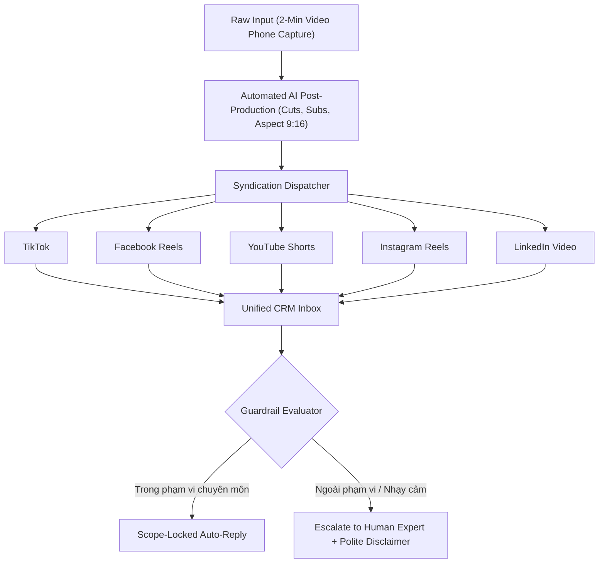

# Technique: 7-Platform Automated Syndication & Scope-Locked AI CRM

## Tóm Tắt Kỹ Thuật
Kiến trúc tự động hoá hai chiều (Two-way Automation Architecture) kết hợp quy trình sản xuất nội dung tốn ít lực (Low-friction Capture: 2 phút/ngày), phân phối đa nền tảng đồng thời (Omnichannel Syndication), và cơ chế kiểm soát hội thoại có rào chắn an toàn (Scope-Locked Guardrails) trên hộp thư hợp nhất.

---

## 1. Vấn Đề Giải Quyết
- **Điểm nghẽn thời gian của chuyên gia/nhà sáng lập**: Không thể dành 3-4 tiếng mỗi ngày để ngồi dựng video hay quản lý 7 mạng xã hội.
- **Rủi ro ảo giác và phát ngôn sai lệch của AI Chatbot**: Chatbot tự động nếu không khóa phạm vi dễ đưa ra lời khuyên sai chuyên môn, gây tổn hại pháp lý và uy tín thương hiệu.
- **Phân tán tương tác**: Tin nhắn nằm rải rác trên nhiều ứng dụng khiến tỷ lệ bỏ lỡ khách hàng tiềm năng lên đến 60%.

---

## 2. Kiến Trúc Vận Hành

---

## 3. Quy Tắc Khóa Phạm Vi (Scope-Locking Implementation)
1. **Phân loại câu hỏi (Intent Classification)**:
   - Level 1: Hỏi giá, link tài liệu, thông tin cơ bản -> Tự động phản hồi ngay kèm link.
   - Level 2: Hỏi chuyên môn trong danh mục đào tạo -> Trả lời ngắn gọn dựa trên knowledge base đã thẩm định.
   - Level 3: Hỏi chẩn đoán sâu, tư vấn cá nhân hóa rủi ro cao -> Lập tức từ chối lịch sự và kích hoạt thông báo cho admin.
2. **Hệ thống dữ liệu tập trung**:
   - Mọi tương tác được gắn nhãn (Lead Tagging) và cập nhật vào bảng CRM phục vụ gợi ý nội dung tiếp theo.
