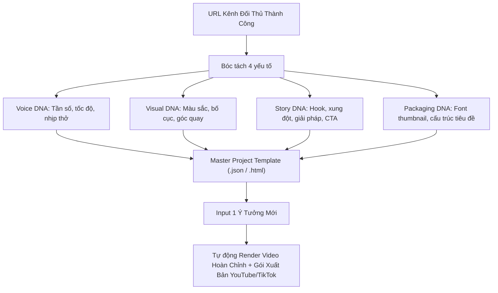

# Technique: Channel Style Decomposition & Template Cloning Pipeline

## Tóm Tắt Kỹ Thuật
Quy trình dịch ngược (Reverse-engineering) phong cách nhận diện của một kênh video thành công (Visual, Voice, Narrative Structure) thành bộ khung mẫu bất biến (Channel Template Blueprint), cho phép tự động hoá sản xuất hàng loạt video nhất quán 100% thương hiệu từ một câu lệnh ý tưởng duy nhất.

---

## 1. Bản Chất Kỹ Thuật
- Thay vì sáng tạo tự do mỗi video một kiểu (dễ mất nhận diện thương hiệu và tốn thời gian cân chỉnh), các kênh lớn luôn vận hành trên một **Template Framework** cố định:
  - Khung thời lượng mỗi cảnh cố định (ví dụ: Hook 3s, Intro 5s, Scene 1 12s...).
  - Bảng màu và ánh sáng cố định (Master Look LUT).
  - Giọng đọc và âm nhạc nền theo công thức ducking cố định.

---

## 2. 4 Bước Bóc Tách Một Kênh Mẫu

---

## 3. Ứng Dụng Trong Sóc Nhỏ TV
- Lưu trữ cấu hình template tại `data/projects/<project-id>/templates/`.
- Khi cần sản xuất một tập phim mới cho Sóc Nhỏ:
  1. Chỉ nạp chủ đề giáo dục / phiêu lưu vào CLI.
  2. Engine tự động dùng kịch bản chuẩn, nạp nhân vật Bi (100cm) và Koala (150cm) với prompt DNA đã khóa.
  3. Xuất video qua HyperFrames và tạo kèm ảnh bìa YouTube đúng font chữ nhận diện thương hiệu.
