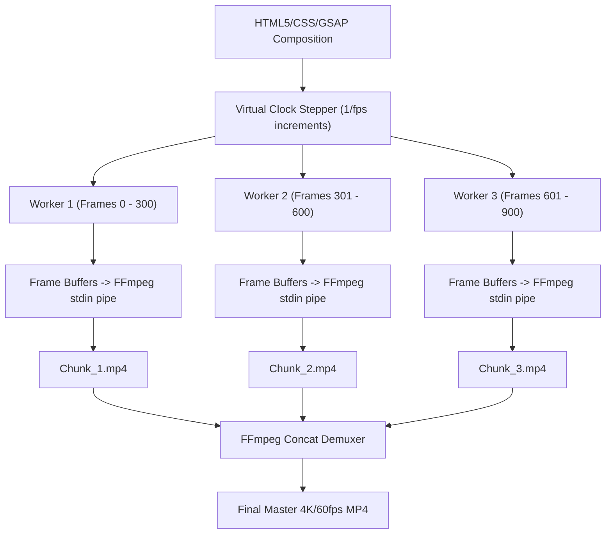

# Technique: Deterministic Web-to-Video Rendering Pipeline

## Tóm Tắt Kỹ Thuật
Quy trình biến mã nguồn Web (HTML5, CSS, SVG, GSAP/Anime.js) thành video MP4 chất lượng cao thông qua cơ chế can thiệp đồng hồ ảo (Virtual Clock) trên trình duyệt không đầu (Headless Browser) kết hợp đường ống dữ liệu FFmpeg image2pipe, cho phép kết xuất song song theo phân đoạn (parallel chunking) mà không bao giờ bị rớt frame hay nhoè hình.

---

## 1. Vấn Đề Giải Quyết
- **Bất định của Diffusion Models**: Các mô hình sinh video AI (Runway, Kling, Sora) thường biến dạng chữ, bố cục trôi dạt và không thể chỉnh sửa chi tiết.
- **Rớt frame khi quay màn hình**: Quay màn hình (screen capture) phụ thuộc vào hiệu năng máy tại thời điểm quay, dễ giật lag, drop frame.
- **Thời gian render lâu**: Render tuần tự từng frame trên 1 luồng rất chậm cho video dài.

---

## 2. Nguyên Lý Vận Hành Cốt Lõi



### Các bước thực thi:
1. **Khóa đồng hồ thời gian (Deterministic Timeline)**:
   - Thay vì dùng `requestAnimationFrame` hay `setInterval` chạy theo thời gian thực (wall-clock time), trình duyệt headless điều khiển timeline qua hàm `timeline.seek(t)` hoặc mock `window.performance.now()`.
2. **Xuất frame dạng Stream Pipe**:
   - Chụp frame dưới dạng raw buffer hoặc PNG và pipe trực tiếp vào tiến trình FFmpeg qua CLI:
     ```bash
     ffmpeg -y -f image2pipe -vcodec png -r 30 -i - -c:v libx264 -pix_fmt yuv420p output.mp4
     ```
3. **Phân đoạn song song (Chunking)**:
   - Chia tổng thời lượng video thành $K$ phân đoạn tương ứng với số CPU cores.
   - Mỗi worker render độc lập một phân đoạn.
   - Nối nhanh các file bằng `ffmpeg -f concat -safe 0 -c copy`.

---

## 3. Khả Năng Ứng Dụng Trong Sóc Nhỏ TV
- Tích hợp trực tiếp vào module dựng `HyperFramesEngine` (`tool/src/socnhotv/video/hyperframes_engine.py`).
- Đảm bảo các video giải thích kiến thức, hoạt hình 3D kết hợp motion graphics, và video bán hàng KOC đạt độ phân giải chuẩn nét 1080x1920 không tốn chi phí render GPU đám mây.
