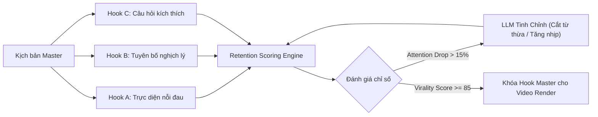

# Technique: Pre-Publish Hook Retention Prediction & Neuromarketing Scoring

## Tóm Tắt Kỹ Thuật
Quy trình tiền kiểm định (Pre-publish QA) và xếp hạng đa biến thể Hook video (3-5 giây đầu) trước khi xuất bản thực tế, sử dụng mô hình dự đoán đường cong chú ý theo từng giây (Second-by-Second Attention Curve) kết hợp phản hồi từ LLM để loại bỏ triệt để điểm rơi người xem (Drop-off points).

---

## 1. Bản Chất Vấn Đề
- Trên TikTok, Reels, YouTube Shorts: **80% quyết định lướt qua diễn ra trong 3 giây đầu**.
- Đa phần nhà sáng tạo chỉ biết video flop *sau khi đã đăng*, lúc này thuật toán đã đóng luồng phân phối ban đầu (initial traffic pool).
- Thử nghiệm A/B thủ công trực tiếp trên kênh gây loãng feed và lãng phí tài nguyên render.

---

## 2. Quy Trình Tiền Kiểm Thử (Pre-Publish Protocol)

### Các tiêu chí chấm điểm tự động:
1. **Tốc độ truyền đạt (Pacing)**: Tối thiểu 150 - 180 từ/phút (WPM) ở 3 giây đầu.
2. **Kích thích thị giác (Visual Novelty)**: Tối thiểu 1 cut/zoom/motion trong 1.5 giây đầu.
3. **Mật độ thông tin (Cognitive Density)**: Không có từ đệm ("À", "Ừm", "Hôm nay mình sẽ...").
4. **Độ tương phản chủ đề (Semantic Contrast)**: Đưa ra nghịch lý hoặc giá trị bất ngờ ngay trong câu đầu tiên.

---

## 3. Ứng Dụng Trong Hệ Thống socnhotv
- Session A (Scriptwriter) luôn tạo ra `hooks: [A, B, C]` trong file `script.json`.
- Session B (Prompt/Media) render 3 biến thể hook visual 3 giây.
- QA Hook Script tự động tính điểm theo ma trận trên và chọn Hook có điểm giữ chân cao nhất để đưa vào HyperFrames timeline.
